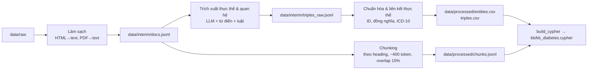

# 00 — Sổ nguồn dữ liệu

> **Mục đích:** liệt kê mọi nguồn dữ liệu, cách thu thập, nơi lưu, giấy phép và cách xử lý.
> **Giai đoạn:** 0 — Dữ liệu & KB · **Cập nhật:** 2026-11-11

---

## 1. Danh mục nguồn

| ID | Nguồn | Ngôn ngữ | Vai trò | Dạng gốc | Lưu tại | Ưu tiên |
|---|---|---|---|---|---|---|
| SRC-VMC | **Vinmec** — chuyên mục bài viết tiểu đường (vinmec.com/vie/bai-viet/...) | vi | Nguồn y tế tiếng Việt **chính**: triệu chứng, chẩn đoán, điều trị, biến chứng, lối sống | HTML | `data/raw/vinmec/<slug>.html` + `data/raw/vinmec/index.jsonl` | Bắt buộc |
| SRC-MOH | **Bộ Y tế** — hiện có: Hướng dẫn ĐTĐ típ 2 **QĐ 3280/QĐ-BYT (2011)** (`MOH-3280-2011`). Còn thiếu: QĐ 5481/2020 (típ 2, có HbA1c), hướng dẫn tiền ĐTĐ, hướng dẫn típ 1 | vi | Tiêu chuẩn chẩn đoán chính thức (ngưỡng xét nghiệm), phác đồ | PDF | `data/raw/moh/*.pdf` | Bắt buộc |
| SRC-WHO | **WHO** — Global Report on Diabetes / Diabetes fact sheet | en | Dịch tễ, định nghĩa | PDF/HTML | `data/raw/who/` | Nên có |
| SRC-HET | **Hetionet v1.0** — đồ thị sinh y | en | Quan hệ Disease–Symptom–Drug–Gene–Anatomy có cấu trúc | TSV/SIF | `data/raw/hetionet/` | Nên có |
| SRC-CASE | **Ca bệnh mô phỏng** sinh từ KB (mục 4) | vi | Huấn luyện & kiểm thử Patient Simulator / HRL | JSONL | `data/cases/` | Bắt buộc |
| SRC-KAGGLE | **Diabetes Prediction Dataset** (Kaggle `iammustafatz/diabetes-prediction-dataset`), 100.000 dòng; đặc trưng: `gender, age, hypertension, heart_disease, smoking_history, bmi, HbA1c_level, blood_glucose_level` → nhãn `diabetes`. Giấy phép **chưa xác minh**; không rõ là dữ liệu thật hay tổng hợp | en | Huấn luyện mô hình DL cho AG-13 (FR-17). Ràng buộc chất lượng: `01_REQUIREMENTS.md` §7.2 | CSV | `data/raw/kaggle/diabetes_prediction_dataset.csv` (sao chép từ `archive/`) | Bắt buộc |
| SRC-WEB | **Bài viết do AG-12 tìm được** trên web whitelist (T-12/T-13) | vi/en | Nguồn tạm khi KB thiếu; ứng viên bổ sung KB | HTML | `data/cache/web/` (tạm), `data/review_queue.jsonl` (hàng chờ) | Tùy chọn |

### Hàng chờ duyệt `data/review_queue.jsonl`

```json
{"url": "https://www.vinmec.com/vie/bai-viet/...", "title": "...", "domain": "vinmec.com",
 "reason": "Trả lời câu hỏi 'metformin gây đau bụng' mà KB chưa có", "session_id": "s-17",
 "queued_at": "2026-11-20T10:05:00+07:00", "status": "pending", "reviewer": null, "reviewed_at": null}
```

Quy trình: thành viên nhóm đổi `status` thành `approved`/`rejected` → `ingest/fetch_static.py --from-queue` tải bài `approved` vào `data/raw/<domain>/` với `source_id` mới, ghi vào bảng mục 1 → build lại KB.

## 2. Quy tắc thu thập Vinmec

1. Đọc `https://www.vinmec.com/robots.txt` và điều khoản sử dụng **trước khi** crawl; lưu bản chụp vào `data/raw/vinmec/_robots_<ngày>.txt`.
2. Mục đích: học thuật, phi thương mại. Không phân phối lại toàn văn; trong câu trả lời chỉ trích đoạn ngắn kèm **link nguồn**.
3. Giới hạn tốc độ: ≤ 1 request / 2 giây, User-Agent mô tả rõ mục đích học thuật.
4. Chọn bài theo từ khóa: `tiểu đường`, `đái tháo đường`, `đường huyết`, `HbA1c`, `insulin`, `tiền tiểu đường`, `tiểu đường thai kỳ`, `biến chứng tiểu đường`.
5. Mỗi bài ghi một dòng vào `index.jsonl`:

```json
{"source_id": "VMC-0001", "url": "https://www.vinmec.com/vie/bai-viet/...", "title": "...",
 "author": "ThS.BS ...", "published": "2025-03-14", "fetched_at": "2026-11-12T09:00:00+07:00",
 "sha256": "...", "file": "vinmec/VMC-0001.html"}
```

6. Bài trùng (cùng `sha256` sau làm sạch) → bỏ. Bài không có tác giả là bác sĩ → đánh dấu `reviewed=false`, độ tin cậy thấp hơn khi xếp hạng.

## 3. Pipeline xử lý



> **Đã điều chỉnh theo [ADR-001](decisions/ADR-001-seed-kb-tuyen-chon.md):** KB chẩn đoán lấy từ seed tuyển chọn có kiểm chứng trích dẫn. Bước "trích xuất bằng LLM" được hoãn.

Lệnh chạy từ thư mục `diabetes_mas/`:

| Bước | Lệnh | Input | Output |
|---|---|---|---|
| Thu thập Vinmec | `python -m diabetes_mas.ingest.fetch_vinmec` | sitemap Vinmec | `data/raw/vinmec/*.html`, `index.jsonl` |
| Thu thập nguồn tĩnh | `python -m diabetes_mas.ingest.fetch_static` | `configs/sources.yaml` | `data/raw/{moh,who,hetionet}/`, `static_manifest.jsonl` |
| Làm sạch | `python -m diabetes_mas.ingest.clean` | raw | `data/interim/docs.jsonl`, `data/processed/sources.jsonl` |
| Chunking | `python -m diabetes_mas.ingest.chunk` | docs | `data/processed/chunks.jsonl` |
| Kiểm chứng seed | `python -m diabetes_mas.kb.seed` | `kb/seed/*.csv` + docs | báo cáo; exit 1 nếu có trích dẫn sai |
| Sinh Cypher | `python -m diabetes_mas.kb.build_cypher` | seed, Hetionet, chunks | `kb/kb_diabetes.cypher`, `data/processed/kb_stats.json` |
| Sinh ca bệnh | `python -m diabetes_mas.simulator.cases` | seed | `data/cases/{train,val,test}.jsonl`, `stats.json` |
| Nạp Neo4j | `python -m diabetes_mas.kb.neo4j_io load` | `kb/*.cypher` | Neo4j + báo cáo chất lượng |
| Embedding | `python -m diabetes_mas.rag.embed_chunks` | Chunk trong Neo4j | `Chunk.embedding` |

Chunk theo **heading** (H2/H3 của bài Vinmec, mục/chương của PDF) để mỗi chunk mang một ý trọn vẹn; nếu dài hơn ~400 token mới cắt tiếp.

## 4. Sinh ca bệnh mô phỏng (SRC-CASE)

Mỗi ca = một **mục tiêu bệnh nhân** (user goal) cho Patient Simulator:

```json
{"case_id": "C-00042", "disease": "DTD_TIP_2",
 "explicit": {"uong_nhieu": {"status": "yes", "value": null}},
 "implicit": {"tieu_nhieu": {"status": "yes", "value": null}, "nhin_mo": {"status": "no", "value": null},
              "bmi_tu_23": {"status": "yes", "value": null}, "tien_su_gia_dinh_dtd": {"status": "yes", "value": null},
              "HBA1C": {"status": "yes", "value": 7.1}, "GLUCOSE_DOI": {"status": "unknown", "value": null},
              "tuoi": {"status": "yes", "value": 52.0}, "bmi": {"status": "yes", "value": 28.7},
              "gioi_tinh": {"status": "yes", "value": "nam"}, "hut_thuoc": {"status": "unknown", "value": null},
              "benh_tim": {"status": "no", "value": null}, "...": "(rút gọn — ca thật có đủ 25 slot hỏi được)"},
 "true_labs": {"HBA1C": 7.1, "GLUCOSE_DOI": 8.3, "OGTT_2H": 12.9, "GLUCOSE_BAT_KY": 10.6},
 "rule_hits": ["CRIT_DTD_GLUCOSE_DOI", "CRIT_DTD_HBA1C", "CRIT_DTD_OGTT_2H"],
 "source": "sampled_from_seed_kb", "seed": 42}
```

- Tên slot dùng đúng **id node trong KB** (`HBA1C`, `GLUCOSE_DOI`, `uong_nhieu`, `bmi_tu_23`…). Tuổi và BMI được biểu diễn bằng yếu tố nguy cơ nhị phân (`tuoi_tu_45`, `tuoi_duoi_30`, `bmi_tu_23`) theo đúng ngưỡng trong nguồn.
- Mỗi xét nghiệm có xác suất `p_lab_unknown = 0,5` bệnh nhân không biết kết quả. Nhờ vậy agent phải dựa cả vào triệu chứng và yếu tố nguy cơ, bài toán không bị tầm thường hóa.
- `true_labs` là giá trị thật (ẩn với agent), dùng để kiểm tra nhãn nhất quán với tiêu chuẩn trong KB.
- Tham số không có nguồn (tỉ lệ lớp, khoảng HbA1c theo lớp, tỉ lệ nền) khai báo tập trung ở `PRIORS` trong `simulator/cases.py`.
- `DTD_KHAC` chưa được sinh vì KB chưa có dữ liệu phân biệt cho thể này.

- `explicit`: điều bệnh nhân tự kể lúc đầu. `implicit`: chỉ tiết lộ khi được hỏi.
- Sinh bằng lấy mẫu theo trọng số `HAS_SYMPTOM.prob` và khoảng giá trị trong `DiagnosticCriterion` của KB.
- Chia `train/val/test = 70/15/15`, cố định `seed`, lưu `data/cases/{train,val,test}.jsonl`.
- ~~`examination_50_questions_v2.pdf` dùng làm bộ đánh giá tư vấn~~ — **sai**: file này là đề vấn đáp của môn học, không phải câu hỏi của bệnh nhân (xem `01_REQUIREMENTS.md` §2.2). Bộ đánh giá tư vấn là `data/eval/consult_eval.csv` do nhóm tự xây (`08_EVALUATION.md` §1.2).

## 5. Tiêu chí hoàn thành

- [x] Có ≥ 50 bài Vinmec trong `index.jsonl`, mỗi bài đủ trường. *(2026-11-11: 4 trang bệnh + 300 bài viết, lọc từ 1.147 URL khớp từ khóa; 303 bài có nội dung, 54 bài ghi rõ bác sĩ viết/tư vấn → `reviewed = true`)*
- [ ] Có đủ PDF của Bộ Y tế cho ĐTĐ típ 2 và tiền ĐTĐ. *(Mới có QĐ 3280/2011. Thiếu QĐ 5481/2020 và hướng dẫn tiền ĐTĐ.)*
- [x] `chunks.jsonl` không có chunk rỗng/trùng; mỗi chunk truy ngược được về `source_id` + URL. *(2.359 chunk: Vinmec 2.186, WHO 136, Bộ Y tế 37; 15–300 từ, trung vị 157)*
- [x] Sinh được `data/cases/` với ≥ 1.000 ca, phân bố bệnh được thống kê. *(1.500 ca, phân tầng theo bệnh)*

### Thống kê ca bệnh

**Nguồn số liệu duy nhất: `diabetes_mas/data/cases/stats.json`**, sinh lại mỗi lần chạy `simulator.cases`. File này không chép lại số liệu để tránh lệch. Ảnh chụp lần sinh 2026-11-11 (seed 42, đã có slot hồ sơ FR-19):

- Theo bệnh: DTD_TIP_2 442 · KHONG_DTD 386 · TIEN_DTD 300 · DTD_THAI_KY 191 · DTD_TIP_1 181.
- Train / val / test: 1.050 / 225 / 225.
- 85 ca không biết chỉ số xét nghiệm nào; trung bình 0,48 triệu chứng được kể ngay từ đầu.
- Mọi ca nhất quán với tiêu chuẩn KB (ưu tiên ĐTĐ > ĐTĐ thai kỳ > Tiền ĐTĐ).
- Mỗi ca có đủ câu trả lời cho mọi slot hỏi được (25 slot; riêng `OGTT_1H` chỉ có ở thai phụ). Slot hồ sơ `tuoi` / `bmi` nhất quán với cờ `tuoi_tu_45` / `tuoi_duoi_30` / `bmi_tu_23`; thai phụ luôn là nữ, 18–44 tuổi (`tests/unit/test_criteria_cases.py`).

> ⚠ **Giả định không có nguồn trong dữ liệu ca bệnh:** khoảng HbA1c tiềm ẩn của lớp Tiền ĐTĐ (5,6–6,4 %) trong `PRIORS` khiến bộ phân loại có thể *học* dải HbA1c tiền ĐTĐ dù KB không có tiêu chí này. Khi có văn bản Bộ Y tế mới, cần thêm tiêu chí vào seed và đối chiếu lại `PRIORS`.
