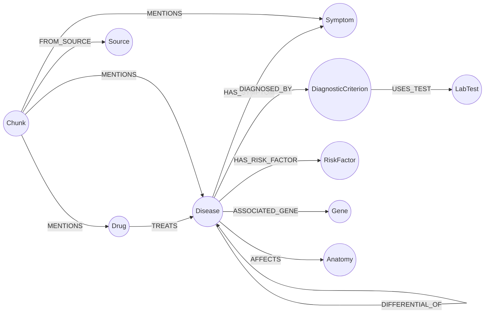

# 00 — KB_Graph: thiết kế đồ thị tri thức tiểu đường

> **Mục đích:** định nghĩa schema đồ thị (node, quan hệ, thuộc tính, ràng buộc) và cách sinh/nạp file `kb_diabetes.cypher` vào Neo4j.
> **Giai đoạn:** 0 — Dữ liệu & KB · **Cập nhật:** 2026-11-11
> Đây là "File KB_Graph" thầy yêu cầu.

---

## 1. Sơ đồ schema



`Chunk -[:MENTIONS]-> thực thể` là **cầu nối giữa RAG và KB**: từ một thực thể tìm được đoạn văn chứng cứ, và ngược lại (xem `06_KB_RAG_INTEGRATION.md`).

## 2. Node

| Label | Thuộc tính bắt buộc | Thuộc tính tùy chọn | Ví dụ |
|---|---|---|---|
| `Disease` | `id`, `name_vi`, `name_en` | `icd10`, `aliases[]`, `in_scope:bool` | `DTD_TIP_2`, "Đái tháo đường típ 2", `E11` |
| `Symptom` | `id`, `name_vi`, `group` | `name_en`, `aliases[]`, `question_vi` | `khat_nuoc_nhieu`, group=`trieu_chung_kinh_dien` |
| `LabTest` | `id`, `name_vi`, `unit`, `kind` (`numeric`/`binary`) | `name_en`, `question_vi` | `HBA1C`, "HbA1c", `%`; `CETON_NIEU` (binary) |
| `DiagnosticCriterion` | `id`, `test_id`, `op`, `value`, `unit` | `value_max`, `condition`, `note` | `HbA1c >= 6.5 %` |
| `RiskFactor` | `id`, `name_vi`, `group` | `question_vi` | `beo_phi` (BMI ≥ 25 theo chuẩn châu Á) |
| `Drug` | `id`, `name` | `atc`, `class_vi` | `METFORMIN`, `A10BA02` |
| `Gene` | `id`, `symbol` | `entrez_id` | `TCF7L2` |
| `Anatomy` | `id`, `name_vi` | `uberon_id` | `tuy` |
| `Source` | `id`, `publisher`, `title`, `url` | `author`, `published`, `reviewed:bool` | `VMC-0001`, Vinmec |
| `Chunk` | `id`, `text`, `source_id`, `embedding: float[1024]` | `section`, `lang`, `n_tokens` | `VMC-0001#03` |

`group` của `Symptom`/`RiskFactor` quyết định **Work-Agent nào phụ trách hỏi** (xem `02_AGENT_DESIGN.md`):

| group | Work-Agent |
|---|---|
| `canh_bao` (buồn nôn, thở nhanh, hơi thở mùi táo thối, rối loạn ý thức) | Không Work-Agent nào hỏi. Chỉ AG-08 Safety dùng để phát hiện cấp cứu |
| `trieu_chung_kinh_dien` | AG-W1 |
| `xet_nghiem` (qua `LabTest`) | AG-W2 |
| `tien_su_nguy_co` | AG-W3 |
| `bien_chung` | AG-W4 |

## 3. Quan hệ

Mọi quan hệ có **provenance**: `source_id` (bắt buộc), `evidence_chunk_id` (nếu trích từ văn bản), `confidence` ∈ [0,1].

| Quan hệ | Từ → Đến | Thuộc tính riêng | Nguồn chính |
|---|---|---|---|
| `HAS_SYMPTOM` | Disease → Symptom | `prob` (P(triệu chứng \| bệnh)) | Vinmec, Hetionet DpS |
| `DIAGNOSED_BY` | Disease → DiagnosticCriterion | — | Bộ Y tế |
| `USES_TEST` | DiagnosticCriterion → LabTest | — | Bộ Y tế |
| `HAS_RISK_FACTOR` | Disease → RiskFactor | `strength` (thấp/vừa/cao) | Vinmec, Bộ Y tế |
| `HAS_COMPLICATION` | Disease → Disease | — | Vinmec |
| `SUBTYPE_OF` | Disease → Disease | — | Bộ Y tế |
| `DIFFERENTIAL_OF` | Disease → Disease | — | Vinmec |
| `TREATS` | Drug → Disease | `line` (đầu tay/bổ sung) | Bộ Y tế, Hetionet CtD |
| `ASSOCIATED_GENE` | Disease → Gene | — | Hetionet DaG |
| `AFFECTS` | Disease → Anatomy | — | Hetionet DlA |
| `FROM_SOURCE` | Chunk → Source | — | pipeline |
| `MENTIONS` | Chunk → (Disease\|Symptom\|Drug\|RiskFactor\|LabTest) | `count` | pipeline (entity linking) |

## 4. Tập bệnh trong phạm vi (`in_scope = true`)

| id | Tên | Ghi chú |
|---|---|---|
| `KHONG_DTD` | Không mắc ĐTĐ | Lớp âm tính |
| `TIEN_DTD` | Tiền đái tháo đường | |
| `DTD_TIP_1` | ĐTĐ típ 1 | `SUBTYPE_OF DTD` |
| `DTD_TIP_2` | ĐTĐ típ 2 | `SUBTYPE_OF DTD` |
| `DTD_THAI_KY` | ĐTĐ thai kỳ | `SUBTYPE_OF DTD` |
| ~~`DTD_KHAC`~~ | ĐTĐ thể đặc biệt khác | **Tạm `in_scope=false`**: KB chưa có triệu chứng/tiêu chuẩn phân biệt → không có ca huấn luyện. Bộ phân loại dùng **5 lớp** còn lại. |

Biến chứng (bệnh thận, võng mạc, thần kinh, bàn chân ĐTĐ…) là `Disease` với `in_scope=false`, chỉ dùng cho tư vấn và hỏi triệu chứng của AG-W4.

## 5. Tiêu chuẩn chẩn đoán (đã đối chiếu nguyên văn, xem `kb/seed/criteria.csv`)

| Bệnh | Xét nghiệm | Ngưỡng | Nguồn |
|---|---|---|---|
| ĐTĐ | Glucose huyết tương lúc đói | ≥ 7,0 mmol/L (126 mg/dL) | MOH-3280-2011 tr.3 |
| ĐTĐ | Glucose 2 giờ sau nghiệm pháp 75 g (OGTT) | ≥ 11,1 mmol/L (200 mg/dL) | MOH-3280-2011 tr.3 |
| ĐTĐ | Glucose bất kỳ + triệu chứng kinh điển | ≥ 11,1 mmol/L | MOH-3280-2011 tr.3 |
| ĐTĐ | HbA1c | > 6,5 % | VMC-0002 (Vinmec, theo ADA) |
| Tiền ĐTĐ (IGT) | Glucose 2 giờ OGTT | 7,8 – 11,0 mmol/L | MOH-3280-2011 tr.3 |
| Tiền ĐTĐ (IFG) | Glucose lúc đói | 6,1 – 6,9 mmol/L (WHO-1999) | MOH-3280-2011 tr.3 |
| ĐTĐ thai kỳ | OGTT 75 g: đói / 1 giờ / 2 giờ | ≥ 5,1 / 10,0 / 8,5 mmol/L (một giá trị đạt là đủ) | VMC-0003 |

> ⚠ File PDF trong source cũ tên `qd5481_dtd_tip2_2020.pdf` thực chất là **QĐ 3280/QĐ-BYT (2011)**. Chưa có văn bản nguồn cho HbA1c 5,7–6,4 % (tiền ĐTĐ) và IFG theo ngưỡng 5,6 → **chưa đưa vào KB**. Xem [ADR-001](decisions/ADR-001-seed-kb-tuyen-chon.md).

Các giá trị này được nạp thành node `DiagnosticCriterion` với `source_id` trỏ tới văn bản Bộ Y tế cụ thể, **không** viết cứng trong code agent.

## 6. File Cypher

### 6.1 `kb/schema.cypher` (viết tay, chạy trước)

```cypher
CREATE CONSTRAINT disease_id IF NOT EXISTS FOR (n:Disease) REQUIRE n.id IS UNIQUE;
CREATE CONSTRAINT symptom_id IF NOT EXISTS FOR (n:Symptom) REQUIRE n.id IS UNIQUE;
CREATE CONSTRAINT labtest_id IF NOT EXISTS FOR (n:LabTest) REQUIRE n.id IS UNIQUE;
CREATE CONSTRAINT crit_id    IF NOT EXISTS FOR (n:DiagnosticCriterion) REQUIRE n.id IS UNIQUE;
CREATE CONSTRAINT risk_id    IF NOT EXISTS FOR (n:RiskFactor) REQUIRE n.id IS UNIQUE;
CREATE CONSTRAINT drug_id    IF NOT EXISTS FOR (n:Drug) REQUIRE n.id IS UNIQUE;
CREATE CONSTRAINT gene_id    IF NOT EXISTS FOR (n:Gene) REQUIRE n.id IS UNIQUE;
CREATE CONSTRAINT anat_id    IF NOT EXISTS FOR (n:Anatomy) REQUIRE n.id IS UNIQUE;
CREATE CONSTRAINT source_id  IF NOT EXISTS FOR (n:Source) REQUIRE n.id IS UNIQUE;
CREATE CONSTRAINT chunk_id   IF NOT EXISTS FOR (n:Chunk) REQUIRE n.id IS UNIQUE;

CREATE FULLTEXT INDEX entity_names IF NOT EXISTS
  FOR (n:Disease|Symptom|Drug|RiskFactor|LabTest) ON EACH [n.name_vi, n.name_en, n.aliases_text];

// Dùng cho T-12 search_articles(scope = 'local')
CREATE FULLTEXT INDEX source_text IF NOT EXISTS
  FOR (n:Source|Chunk) ON EACH [n.title, n.text];

CREATE VECTOR INDEX chunk_embedding IF NOT EXISTS
  FOR (c:Chunk) ON (c.embedding)
  OPTIONS {indexConfig: {`vector.dimensions`: 1024, `vector.similarity_function`: 'cosine'}};
```

### 6.2 `kb/kb_diabetes.cypher` (sinh bởi `kb/build_cypher.py`, không sửa tay)

Đầu vào là `kb/seed/*.csv` (đã qua kiểm chứng trích dẫn), Hetionet và `chunks.jsonl`. File dùng `UNWIND` theo lô kết hợp `MERGE`: chạy lại nhiều lần không bị nhân bản, và chạy build 2 lần cho ra file giống hệt từng byte. Trích đoạn file sinh ra:

```cypher
// ---- HAS_SYMPTOM ----
UNWIND [{from: 'DTD_TIP_2', props: {confidence: 0.8, evidence: 'Uống nhiều (hay khát nước)', prob: 0.4,
         prob_source: 'team_estimate', source_id: 'VMC-0002'}, to: 'uong_nhieu'}, ...] AS row
MATCH (a:Disease {id: row.from}), (b:Symptom {id: row.to})
MERGE (a)-[r:HAS_SYMPTOM]->(b) SET r += row.props;
```

Mỗi quan hệ y khoa mang `source_id` + `evidence` (câu trích nguyên văn) → khi demo có thể chỉ ra câu gốc trong tài liệu.

Embedding của `Chunk` **không** nằm trong file `.cypher` (quá lớn): `build_cypher.py` sinh node `Chunk` không có embedding, sau đó `rag/embed_chunks.py` ghi embedding bằng driver Python theo batch.

### 6.3 Nạp vào Neo4j

```bash
docker compose up -d neo4j
docker compose exec neo4j sh -c 'cypher-shell -u neo4j -p "$KB_PASS" -f /import/schema.cypher'
docker compose exec neo4j sh -c 'cypher-shell -u neo4j -p "$KB_PASS" -f /import/kb_diabetes.cypher'
python -m diabetes_mas.kb.neo4j_io check      # kiểm tra chất lượng mục 8 + thống kê
python -m diabetes_mas.rag.embed_chunks
```

`kb/` được mount vào container tại `/import`. **Không** pipe file bằng `cat … |` từ Windows PowerShell 5.1, vì tiếng Việt sẽ bị đổi thành `?`. Cách thay thế: `python -m diabetes_mas.kb.neo4j_io load` (driver Python, UTF-8).

## 7. Câu truy vấn mẫu để demo trên Neo4j Browser

```cypher
// Toàn cảnh 1 bệnh
MATCH p=(d:Disease {id:'DTD_TIP_2'})-[r]-(x) WHERE type(r) <> 'MENTIONS' RETURN p LIMIT 80;

// Triệu chứng phân biệt giữa típ 1 và típ 2
MATCH (d1:Disease {id:'DTD_TIP_1'})-[r1:HAS_SYMPTOM]->(s)<-[r2:HAS_SYMPTOM]-(d2:Disease {id:'DTD_TIP_2'})
RETURN s.name_vi, r1.prob AS p_tip1, r2.prob AS p_tip2, abs(r1.prob - r2.prob) AS do_phan_biet ORDER BY do_phan_biet DESC;

// Tiêu chuẩn chẩn đoán kèm nguồn
MATCH (d:Disease)-[r:DIAGNOSED_BY]->(c)-[:USES_TEST]->(t), (s:Source {id:r.source_id})
RETURN d.name_vi, t.name_vi, c.op, c.value, c.unit, s.title;

// Đoạn văn chứng cứ cho 1 thực thể
MATCH (c:Chunk)-[:MENTIONS]->(:Drug {id:'METFORMIN'}), (c)-[:FROM_SOURCE]->(s) RETURN s.publisher, s.url, c.text LIMIT 5;
```

## 8. Kiểm tra chất lượng KB (chạy sau mỗi lần nạp)

| Kiểm tra | Cypher | Kỳ vọng |
|---|---|---|
| Quan hệ thiếu nguồn | `MATCH ()-[r]->() WHERE r.source_id IS NULL AND type(r) <> 'MENTIONS' AND type(r) <> 'FROM_SOURCE' AND type(r) <> 'USES_TEST' RETURN count(r)` | 0 |
| Bệnh trong phạm vi không có triệu chứng | `MATCH (d:Disease {in_scope:true}) WHERE NOT (d)-[:HAS_SYMPTOM]->() AND d.id <> 'KHONG_DTD' RETURN d.id` | rỗng |
| Chunk không có embedding | `MATCH (c:Chunk) WHERE c.embedding IS NULL RETURN count(c)` | 0 |
| Chunk mồ côi | `MATCH (c:Chunk) WHERE NOT (c)-[:FROM_SOURCE]->() RETURN count(c)` | 0 |

## 9. Tiêu chí hoàn thành

- [x] `schema.cypher` và `kb_diabetes.cypher` nạp thành công trên Neo4j sạch, chạy lại lần 2 không đổi số node/relationship. *(2026-11-11: nạp bằng `cypher-shell -f` trong khoảng 42 giây. Trước và sau lần nạp thứ 2 đều là 3.164 node / 8.133 quan hệ, khớp `kb_stats.json`.)*
- [x] Đạt toàn bộ kiểm tra ở mục 8. *(2026-11-11: 4/4 đạt — 0 quan hệ thiếu nguồn, 0 bệnh thiếu triệu chứng, 0 chunk mồ côi, 0 chunk thiếu embedding. Embedding bge-m3 chạy trên CPU mất khoảng 35 phút.)*
- [x] Có thống kê số node/relationship theo loại và theo nguồn (ghi vào cuối file này).

## 10. Thống kê build (2026-11-11, `data/processed/kb_stats.json`)

File `kb/kb_diabetes.cypher` nặng 3,62 MB.

| Node | Số lượng | | Quan hệ | Số lượng |
|---|---|---|---|---|
| Source | 307 | | HAS_SYMPTOM | 26 |
| Chunk | 2.359 | | HAS_RISK_FACTOR | 14 |
| Disease | 14 | | HAS_COMPLICATION | 7 |
| Symptom | 14 | | DIAGNOSED_BY / USES_TEST | 9 / 9 |
| RiskFactor | 11 | | SUBTYPE_OF / DIFFERENTIAL_OF | 4 / 1 |
| LabTest | 5 | | TREATS (seed 8 + Hetionet 20 mới) | 28 |
| DiagnosticCriterion | 9 | | ASSOCIATED_GENE (Hetionet) | 406 |
| Drug | 25 | | AFFECTS (Hetionet) | 72 |
| Gene | 374 | | FROM_SOURCE | 2.359 |
| Anatomy | 46 | | MENTIONS | 5.198 |

Theo nguồn: quan hệ y khoa lõi (seed) gồm 69 dòng, lấy từ MOH-3280-2011 và VMC-0001…0003, mỗi dòng có câu trích. Quan hệ Hetionet có `source_id = HETIONET-1.0-EDGES`; 3 cạnh TREATS trùng seed được gộp và gắn cờ `also_in_hetionet`.
