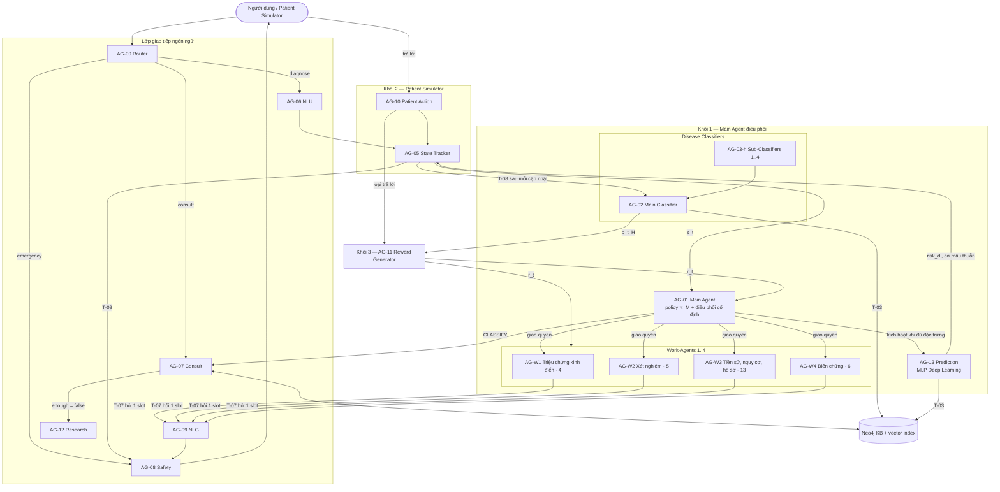

# 02 — Thiết kế agent (v2)

> **Mục đích:** xác định các agent, vai trò, ranh giới trách nhiệm, input/output, cách tổ chức phân cấp và mô hình hóa ra quyết định.
> **Giai đoạn:** 2 · **Input:** danh sách tác vụ (`01_REQUIREMENTS.md` §5) · **Output:** sơ đồ agent + hợp đồng thiết kế đã chốt bằng code
> **Cập nhật:** 2026-11-12 (v3: đối chiếu với code Giai đoạn 5 — đầu vào AG-02, mạng Worker riêng, điều phối bằng đồ thị tự viết ADR-003)

> **Trạng thái triển khai (2026-11-12):** ✅ Hợp đồng thiết kế (kho slot, `DialogState`, `s_t`, mask, reward, quyền tool) và ✅ **hành vi agent** đều đã có code + test: policy DQN (`agents/policy.py`, `rl/`), classifier (`agents/classifiers.py`), AG-13 (`agents/prediction.py`), agent LLM (`router`, `nlu`, `nlg`, `consult`, `safety`, `research`), đồ thị điều phối (`agents/graph.py`, ADR-003). Số đo ở `09_MODEL_NOTES.md` §5; đánh giá đầy đủ ở Giai đoạn 8.

---

## 0. Hợp đồng thiết kế chốt bằng code

| Thành phần | File | Kiểm chứng |
|---|---|---|
| Kho slot, nhóm slot ↔ Work-Agent, slot suy ra | `diabetes_mas/configs/slots.yaml`, `src/diabetes_mas/agents/slots.py` | `python -m diabetes_mas.agents.slots` |
| `DialogState`, mã hóa `s_t`, action mask | `src/diabetes_mas/agents/state.py` | `tests/unit/test_agent_design.py` |
| Công thức reward (T-11) | `src/diabetes_mas/rl/reward.py` | `tests/unit/test_agent_design.py::test_reward_formula_tc08` |
| Sổ đăng ký agent + quyền gọi tool | `diabetes_mas/configs/agents.yaml`, `src/diabetes_mas/agents/registry.py` | `python -m diabetes_mas.devtools.check_docs` (đối chiếu với §2 và `03_TOOL_SPEC.md` §2) |
| Ca bệnh có đủ slot hồ sơ (FR-19) | `src/diabetes_mas/simulator/cases.py` | `tests/unit/test_criteria_cases.py` |

Đổi bất kỳ mục nào ở bảng này **phải ghi ADR**: đổi `s_t` hay reward sẽ làm mất hiệu lực mọi checkpoint đã huấn luyện.

## 1. Lựa chọn kiến trúc (Q31–Q33)

| Kiểu | Mô tả | Ưu | Nhược | Áp dụng ở đây |
|---|---|---|---|---|
| Đơn agent | 1 policy chọn trực tiếp trong 25 slot + kết luận | Đơn giản | Không gian hành động phẳng lớn, khó học khi reward thưa; khó giải thích | Dùng làm **baseline B1** (`08_EVALUATION.md`) |
| Tập trung | 1 điều phối trung tâm gọi các agent chức năng | Dễ kiểm soát | Điều phối trung tâm thành nút thắt | Lớp ngôn ngữ (Router → Consult/NLU…) |
| Phi tập trung | Agent ngang hàng thương lượng | Bền vững | Khó đảm bảo an toàn y khoa, khó kiểm thử | Không dùng |
| **Phân cấp** | Main Agent chọn **nhóm** câu hỏi; Work-Agent chọn **câu hỏi cụ thể** trong nhóm | Chia nhỏ quyết định: Main có 5 hành động, mỗi Worker có 5–14; khớp yêu cầu R-T11 | Cần reward cho 2 cấp (§5) | **Lõi chẩn đoán** |

Lý do chọn đa agent thay vì một agent (Q43):
- Tách **ra quyết định học được** (lõi phân cấp, đo được bằng epoch/layer) khỏi **giao tiếp ngôn ngữ** (LLM) và khỏi **kiểm soát an toàn** (luật).
- Mỗi phần kiểm thử và thay thế được độc lập.

## 1b. Sơ đồ



Số sau tên Work-Agent là số slot nó được hỏi (kích thước không gian hành động, chưa tính `RETURN`).

## 2. Thẻ agent

Mỗi agent: **vai trò · input · output · tool (theo `configs/agents.yaml`) · không được làm · cài đặt**.

### Khối 1 — Main Agent điều phối, Work-Agents, Classifiers, Prediction

| Mã | Tên | Vai trò | Input | Output | Tool | Không được làm | Cài đặt |
|---|---|---|---|---|---|---|---|
| AG-01 | Main Agent | **(a) Policy π_M** chọn hành động cấp cao. **(b) Điều phối cố định** (§6): dừng khi cấp cứu, ép kết luận khi hết lượt, kích hoạt AG-13 | `s_t` (122 chiều) + mask | `a ∈ {W1, W2, W3, W4, CLASSIFY}` | T-06 | Tự hỏi bệnh nhân; tự kết luận bệnh (chỉ chuyển quyền cho Classifier) | DQN (MLP) + code điều phối |
| AG-W1 | Work-Agent triệu chứng kinh điển | Chọn 1 slot trong nhóm để hỏi, hoặc trả quyền | `s_t` + mask | slot ∈ {an_nhieu, uong_nhieu, tieu_nhieu, sut_can} ∪ {RETURN} | T-01, T-06, T-07 | Hỏi slot ngoài nhóm; hỏi lại slot đã biết (mask chặn) | DQN (MLP) |
| AG-W2 | Work-Agent xét nghiệm | Như trên | `s_t` + mask | {GLUCOSE_DOI, OGTT_2H, OGTT_1H*, GLUCOSE_BAT_KY, HBA1C} ∪ {RETURN}; *OGTT_1H chỉ mở khi `dang_mang_thai = yes` | T-01, T-06, T-07 | Như trên | DQN (MLP) |
| AG-W3 | Work-Agent tiền sử, nguy cơ, hồ sơ | Như trên | `s_t` + mask | 8 yếu tố nguy cơ + 5 slot hồ sơ (`tuoi, bmi, gioi_tinh, hut_thuoc, benh_tim`) ∪ {RETURN} | T-01, T-06, T-07 | Hỏi trực tiếp cờ suy ra (`tuoi_tu_45`…) | DQN (MLP) |
| AG-W4 | Work-Agent biến chứng | Như trên | `s_t` + mask | {nhin_mo, te_bi_ban_chan, loet_ban_chan, dau_nguc, day_bung_cham_tieu, dau_cach_hoi} ∪ {RETURN} | T-01, T-06, T-07 | Như trên | DQN (MLP) |
| AG-02 | Main Classifier | Phân phối `p_t` trên 5 lớp; áp **luật KB** (T-03, `apply_rules`): trúng ĐTĐ ⇒ đặt 0 cho Không ĐTĐ, Tiền ĐTĐ, ĐTĐ thai kỳ; trúng ĐTĐ thai kỳ ⇒ đặt 0 cho Không ĐTĐ, Tiền ĐTĐ; trúng Tiền ĐTĐ ⇒ đặt 0 cho Không ĐTĐ; rồi chuẩn hóa lại | phần **slot** của `s_t` (109 chiều đầu: nhị phân + số + phân loại; không gồm lượt, Worker, `p_t`, entropy — `p_t` là chính đầu ra của AG-02) + `p_t^h` của 4 Sub-Classifier (4×5) | `p_t`, `H(p_t)`, `rule_hits` | T-03, T-06 | Bỏ qua kết quả luật | MLP + luật |
| AG-03-h | Sub-Classifier 1..4 | Phân phối từ riêng slot nhóm h → đặc trưng cho AG-02 | slot nhóm h | `p_t^h` | T-06 | Kết luận | MLP nhỏ |
| AG-13 | Prediction (Deep Learning) | Xác suất mắc ĐTĐ từ 8 đặc trưng dữ liệu bảng; đối chiếu luật, gắn cờ mâu thuẫn | đặc trưng DL ánh xạ từ `DialogState` (`03` T-15) | `risk_dl`, `model_variant`, `missing_features`, `dl_conflict` → `DialogState` | T-15, T-03 | Kết luận chẩn đoán; ghi đè `p_t` hay luật KB | MLP PyTorch (`09_MODEL_NOTES.md` §2b) |

### Khối 2 — Patient Simulator

| Mã | Tên | Vai trò | Input | Output | Tool | Không được làm | Cài đặt |
|---|---|---|---|---|---|---|---|
| AG-10 | Patient Action | Đóng vai bệnh nhân theo ca (`data/cases`). Đầu phiên kể các slot `explicit`; khi được hỏi slot X thì trả `implicit[X]` | ca bệnh + slot được hỏi | `yes` / `no` / `value` / `unknown` (+ câu tự nhiên ở chế độ LLM, prompt P-04) | — | Tự nói tên bệnh; trả lời slot không được hỏi | Luật (huấn luyện); luật + LLM (demo) |
| AG-05 | State Tracker | Ghi slot, suy ra cờ nhị phân (`tuoi` → `tuoi_tu_45`…). **Sau mỗi lần cập nhật** gọi T-08 (phân loại lại) và T-09 (kiểm tra cấp cứu) | cập nhật slot | `DialogState` mới, `s_t` | T-05, T-06, T-08, T-09 | Ra quyết định hỏi gì | Code xác định |

### Khối 3 — Reward Generation

| Mã | Tên | Vai trò | Input | Output | Tool | Không được làm | Cài đặt |
|---|---|---|---|---|---|---|---|
| AG-11 | Reward Generator | Tính `r_t` mỗi bước (§5) | loại trả lời, `H(p_{t-1})`, `H(p_t)`, kết thúc?, đúng? | `r_t` + từng thành phần | T-11 | Chạy ở chế độ demo (chỉ log entropy) | Code xác định |

### Lớp giao tiếp ngôn ngữ (Qwen qua Ollama, chỉ chạy ở chế độ demo)

| Mã | Tên | Vai trò | Input | Output | Tool | Không được làm | Cài đặt |
|---|---|---|---|---|---|---|---|
| AG-00 | Router | Phân loại ý định: `diagnose` / `consult` / `out_of_scope` / `emergency` | câu người dùng | ý định | — | Trả lời nội dung y khoa | LLM (P-01) |
| AG-06 | NLU | Câu tự do → slot JSON, quy đổi đơn vị (mg/dL ÷ 18; cân nặng, chiều cao → BMI) | câu + câu hỏi vừa hỏi | `dict[slot, SlotValue]` | T-02 | Suy diễn slot người dùng không nói | LLM (P-02) + luật số học |
| AG-09 | NLG | Slot → câu hỏi tiếng Việt (dựa `question_vi`) | slot_id | 1 câu hỏi | T-01 | Thêm câu hỏi hay lời khuyên khác | LLM (P-03) |
| AG-07 | Consult | Trả lời kiến thức; giải thích kết luận (top-3, luật đạt, `risk_dl` + cờ mâu thuẫn, nguồn) | câu hỏi hoặc kết quả phân loại | văn bản có `[n]` | T-03, T-04 | Trả lời khi `enough = false` sau cả bước tìm bài; kê liều | LLM (P-05, P-06) |
| AG-08 | Safety | Kiểm mọi câu ra: cấp cứu, kê đơn, khẳng định chẩn đoán, thiếu nguồn, thiếu disclaimer | câu nháp + hội thoại | câu đã kiểm hoặc câu thay thế | T-09 | — | Luật + LLM (P-07) |
| AG-12 | Research | Tìm bài trong kho rồi web whitelist khi KB thiếu | câu hỏi (đã lọc PII) | chunk tạm có nguồn | T-12, T-13, T-14 | Gửi dữ liệu cá nhân ra web; ghi thẳng vào KB; chạy khi huấn luyện | LLM (P-08) + code |

## 3. Kho slot và trạng thái `s_t`

Sinh từ KB seed + `configs/slots.yaml` (`python -m diabetes_mas.agents.slots`):

| Nguồn | Số slot | Hỏi được | Ghi chú |
|---|---|---|---|
| Symptom (KB) | 14 | 10 | 4 slot nhóm `canh_bao` không hỏi; chỉ NLU ghi nhận, Safety dùng |
| RiskFactor (KB) | 11 | 8 | 3 cờ (`tuoi_tu_45`, `tuoi_duoi_30`, `bmi_tu_23`) **suy ra** từ `tuoi`, `bmi` |
| LabTest (KB) | 5 | 5 | Slot số |
| Hồ sơ (`slots.yaml`) | 5 | 5 | `tuoi`, `bmi` (số); `gioi_tinh` (3 giá trị); `hut_thuoc` (5 giá trị); `benh_tim` (nhị phân) |
| **Tổng** | **35** | **25** | |

Mã hóa (`agents/state.py::encode`), mọi giá trị ∈ [0,1]:

| Thành phần | Mã hóa | Chiều |
|---|---|---|
| 26 slot nhị phân | one-hot `yes/no/unknown`, chưa hỏi = 000 | 78 |
| 7 slot số | [giá trị chuẩn hóa min-max, đã biết, không biết] | 21 |
| 2 slot phân loại | one-hot giá trị + bit không biết | 4 + 6 = 10 |
| Lượt | `turn / T_max`, `sub_turn / max_sub_turns` | 2 |
| Worker đang giữ quyền | one-hot W1..W4 + "không ai" | 5 |
| `p_t` | 5 lớp | 5 |
| Entropy | `H(p_t) / ln 5` | 1 |
| **d_s** | | **122** |

`risk_dl` **không** nằm trong `s_t` ở v1 (ADR-002).

**Action mask** (`worker_mask`, `main_mask`):
- **Worker:**
  - Chặn slot đã biết (FR-04).
  - Chặn mọi câu hỏi khi `turn = T_max` hoặc `sub_turn = max_sub_turns`.
  - `OGTT_1H` chỉ mở khi `dang_mang_thai = yes`.
  - `RETURN` chỉ mở khi đã hỏi ≥ 1 câu trong lần giao quyền này, hoặc không còn câu nào hỏi được. Cách này chống option rỗng (K = 0), vốn khiến Main giao quyền vô hạn mà hội thoại không tiến triển.
  - **(GĐ 8) W2 xét nghiệm** chưa được `RETURN` khi `labs_ready` sai và còn xét nghiệm hỏi được — tránh trả quyền sau 2 câu "không biết" (08 §5).
- **Main:** mask được tính cho **một lần giao quyền mới**, nên không xét `sub_turn` của Worker trước.
  - Chặn Worker không còn slot hỏi được.
  - `CLASSIFY` chỉ mở khi `turn ≥ 1` **và** `labs_ready` (GĐ 8, `require_lab_before_classify`): đã có ít nhất một **giá trị** xét nghiệm, hoặc đã hỏi hết các xét nghiệm hỏi được.
  - **(GĐ 9) `confident_stop` = 0,95:** khi `labs_ready` và max p_t ≥ 0,95 thì chặn mọi Worker ⇒ bắt buộc `CLASSIFY` (giảm lượt, không giảm acc — 08 §5).
  - Hết `T_max` hoặc không còn Worker khả dụng thì bắt buộc `CLASSIFY`.
- **Quy tắc reset:** khi giao quyền (`delegate`) đặt `current_worker = W_h`, `sub_turn = 0`. Khi Worker `RETURN` / hết lượt con / hết `T_max` (`end_option`) đặt `current_worker = None`, `sub_turn = 0`.

## 4. Mô hình hóa quyết định — MDP (Q35, Q36)

Môi trường là Patient Simulator với một ca bệnh ẩn. Chuyển trạng thái được quyết định bởi câu trả lời của bệnh nhân. Không có mô hình xác suất chuyển tường minh, nên dùng RL **không mô hình** (DQN).

| Thành phần | Main Agent (cấp cao) | Work-Agent h (cấp thấp) |
|---|---|---|
| Trạng thái | `s_t` ∈ [0,1]^122 | `s_t` (cùng vector; mỗi Worker có **mạng Q riêng**, nên không cần one-hot h) |
| Hành động | {W1..W4, CLASSIFY} (5) | slot nhóm h ∪ {RETURN} (5 / 6 / 14 / 7) |
| Chuyển trạng thái | Giao cho W_h ⇒ W_h hỏi 1..K câu (K ≤ 4) rồi trả quyền → `s_{t+K}` | Hỏi slot ⇒ bệnh nhân trả lời ⇒ State Tracker cập nhật, phân loại lại → `s_{t+1}` |
| Phần thưởng | Tổng chiết khấu của cả đoạn: `R = Σ_{k<K} γ^k r_{t+k}` (SMDP / options) | `r_t` từng câu hỏi (§5) |
| Cập nhật Q | `y = R + γ^K · max_a' Q_M(s_{t+K}, a')` | `y = r_t + γ · max_a' Q_h(s_{t+1}, a')` (`RETURN` là trạng thái cuối của option) |
| Kết thúc episode | CLASSIFY; hoặc `turn = T_max = 12` (ép CLASSIFY); hoặc cờ cấp cứu (chế độ demo) | RETURN; hoặc `sub_turn = 4`; hoặc `turn = T_max` |
| Policy | ε-greedy trên Q có mask | ε-greedy trên Q có mask |

γ = 0,95 (`09_MODEL_NOTES.md` §3). Classifier (AG-02, AG-03-h) **không phải agent RL**: chúng học có giám sát (cross-entropy) trên ca bệnh và cung cấp `p_t` cho trạng thái lẫn reward.

## 5. Reward (chốt — `rl/reward.py`)

```text
Mỗi câu hỏi:   r_t = −1                                        (chi phí một lượt hỏi)
                    + 1 · is_hit(slot, câu trả lời)            (phát hiện dương tính trên slot y khoa)
                    + λ · (H(p_{t−1}) − H(p_t)),  λ = 2        (giảm entropy của Main Classifier — R-T13)
Khi CLASSIFY:  r = +20 nếu top-1 = bệnh thật, −20 nếu sai (ép kết luận ở T_max tính như CLASSIFY)
Intake hồ sơ (§6 bước 0): không có reward, không tính lượt.
```

- **`is_hit`** chỉ đúng với slot gắn KB: Symptom/RiskFactor trả `yes`, LabTest có giá trị. Slot hồ sơ (tuổi, BMI, giới tính, hút thuốc, bệnh tim) **không bao giờ** là hit. Nếu được thưởng, mỗi câu hỏi hồ sơ sẽ có lãi ròng −1 + 1 = 0 vì luôn có câu trả lời, trong khi hỏi một triệu chứng âm tính mất −1. Khi đó policy sẽ học cách lấp lượt bằng câu hỏi nhân khẩu học.
- **Bỏ phạt hỏi lặp (`r_repeat`)** so với bản v1: action mask đã khiến hành động lặp không thể xảy ra.
- Work-Agent nhận `r_t` của từng câu hỏi nó đặt ra. Main Agent nhận tổng chiết khấu của cả option (§4), cộng phần thưởng kết thúc.
- Tham số hiện là giá trị mặc định của `RewardConfig` trong `rl/reward.py`; Giai đoạn 5 sẽ nạp từ `configs/train.yaml` (chưa tạo). Đổi tham số chỉ cần ghi vào nhật ký `08_EVALUATION.md` §5; đổi **dạng** công thức thì phải viết ADR.

## 6. Logic điều phối cố định của AG-01 (mỗi bước)

```text
0. Intake: hỏi lần lượt các slot hồ sơ còn thiếu trong dialog.intake_slots = [tuoi, bmi, gioi_tinh]
   (pending_intake). Chạy ở CẢ huấn luyện lẫn demo; không tính vào T_max; không có reward.
   Mục đích: AG-13 luôn có tuoi + bmi để chạy (Q45, Q49), và phân phối s_t giống nhau giữa hai chế độ.
1. State Tracker vừa cập nhật → đã gọi T-08 (p_t) và T-09 (red_flag).
2. Nếu red_flag:              dừng hội thoại → AG-08 trả khuyến cáo cấp cứu (FR-09).
3. Nếu đặc trưng DL thay đổi và có tuoi + bmi:  kích hoạt AG-13 (T-15) → risk_dl, dl_conflict.
   (Sau intake điều kiện này luôn đúng → AG-13 chạy ít nhất 1 lần mỗi phiên demo.)
4. Nếu đang có Worker giữ quyền và Worker chưa RETURN, sub_turn < 4, turn < 12: Worker chọn tiếp trong worker_mask.
   Worker RETURN / hết lượt con / hết T_max → end_option (current_worker = None, sub_turn = 0).
5. Ngược lại: π_M chọn trong main_mask(s_t) → delegate(W_h) (sub_turn = 0). Nếu mọi Worker đều bị chặn thì CLASSIFY.
6. CLASSIFY: AG-02 ra top-1 cuối cùng → AG-07 giải thích → AG-08 kiểm → trả người dùng.
```

**Khi nào hệ dừng hỏi?** (câu giám khảo hay hỏi) — một trong bốn điều kiện:

| # | Điều kiện | Loại |
|---|---|---|
| 1 | Cờ cấp cứu (T-09) | Code cố định, dừng ngay ở bất kỳ lượt nào |
| 2 | π_M chọn CLASSIFY — chỉ được khi `turn ≥ 1` **và** `labs_ready` | Policy học được, trong khuôn luật |
| 3 | `labs_ready` **và** max p_t ≥ `confident_stop` (0,95) | Code cố định (GĐ 9) |
| 4 | `turn = T_max = 12` hoặc không còn Worker khả dụng | Code cố định |

Cấu hình: `configs/slots.yaml` → `dialog` (`T_max`, `min_turns_before_classify`, `require_lab_before_classify`, `confident_stop`); code: `agents/state.py` (`main_mask`, `worker_mask`, `labs_ready`).

Bước 2–3 và 6 là **code cố định**; chỉ bước 4–5 là **policy học được**. Nhờ vậy an toàn không phụ thuộc vào chất lượng huấn luyện.

## 7. Ranh giới trách nhiệm

1. **Chỉ AG-02 ra kết luận bệnh.** AG-07 chỉ diễn giải; AG-13 chỉ là tín hiệu tham khảo.
2. **Ngưỡng y khoa nằm trong KB** (T-03). Không agent nào viết cứng ngưỡng.
3. **Mọi câu ra người dùng đi qua AG-08.**
4. **Agent học không gọi LLM; agent LLM không chọn hành động chẩn đoán.**
5. **Tại mỗi thời điểm chỉ một Work-Agent giữ quyền hỏi.**
6. **Agent chỉ gọi tool có trong `configs/agents.yaml`** (`registry.assert_allowed`).

## 8. Xử lý lỗi và dự phòng

| Sự cố | Agent | Xử lý |
|---|---|---|
| NLU trả JSON lỗi 2 lần | AG-06 | Ghi `unknown` cho slot vừa hỏi, tiếp tục |
| Bệnh nhân trả lời ngoài câu hỏi | AG-06 | Vẫn ghi slot trích được; slot vừa hỏi giữ `not_asked` nếu không trả lời |
| Ollama không phản hồi | Lớp LLM | NLG dùng nguyên `question_vi`; Consult trả lời bằng template từ `rule_hits` + nguồn; Router mặc định `diagnose` |
| Neo4j không phản hồi | T-03, T-04 | Dùng `kb/seed` trong bộ nhớ cho T-03; Consult báo "tạm thời không truy cập được dữ liệu" |
| Thiếu `tuoi` hoặc `bmi` | AG-13 | Không gọi T-15; giải thích ghi "chưa đủ thông tin để chạy mô hình dự đoán" |
| Checkpoint DQN chưa có | AG-01, AG-W* | Policy dự phòng theo luật: W2 → W1 → W3 → W4, mỗi Worker hỏi theo thứ tự slot (baseline B0'), có log cảnh báo |

## 9. Hai chế độ chạy

| Chế độ | Người đối thoại | Lớp LLM | Reward | AG-13 | Mục đích |
|---|---|---|---|---|---|
| Huấn luyện | AG-10 (slot) | Tắt | Bật | Tắt | Học π_M, π_h, classifier |
| Demo / kiểm thử | Người thật hoặc AG-10 (LLM) | Bật | Tắt (chỉ log entropy) | Bật | Hội thoại tự nhiên, vấn đáp Q49 |

## 10. Truy vết tác vụ → agent

| Tác vụ | Agent |
|---|---|
| TK-01 | AG-00 |
| TK-02 | AG-06 |
| TK-03 | AG-05 |
| TK-04 | AG-01 |
| TK-05 … TK-08 | AG-W1 … AG-W4 |
| TK-09 | AG-02, AG-03-h |
| TK-10 | AG-02 (T-03) |
| TK-11, TK-12 | AG-07 |
| TK-13 | AG-08 |
| TK-14 | AG-10 |
| TK-15 | AG-11 |
| TK-16 | AG-12 |
| TK-17 | AG-13 (AG-01 kích hoạt) |
| TK-18, TK-19 | — (KB / đánh giá) |

## 11. Tiêu chí hoàn thành

- [x] Mọi tác vụ TK-xx có agent đảm nhận hoặc ghi rõ "—" (§10; `check_docs` mục [1]).
- [x] Mỗi agent có đủ vai trò, input, output, tool, điều cấm, cách cài đặt (§2); sổ đăng ký khớp tài liệu (`check_docs` mục [6], [7]).
- [x] Công thức reward và cấu trúc `s_t` được chốt bằng code và test (§0, §3, §5). Từ nay thay đổi phải ghi ADR.
