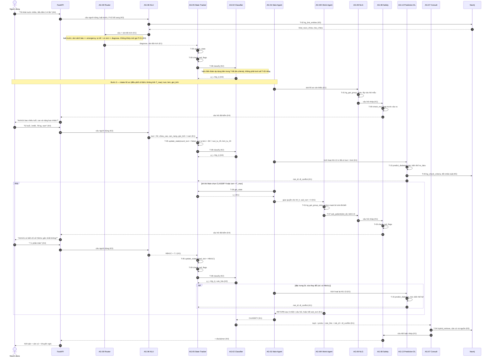
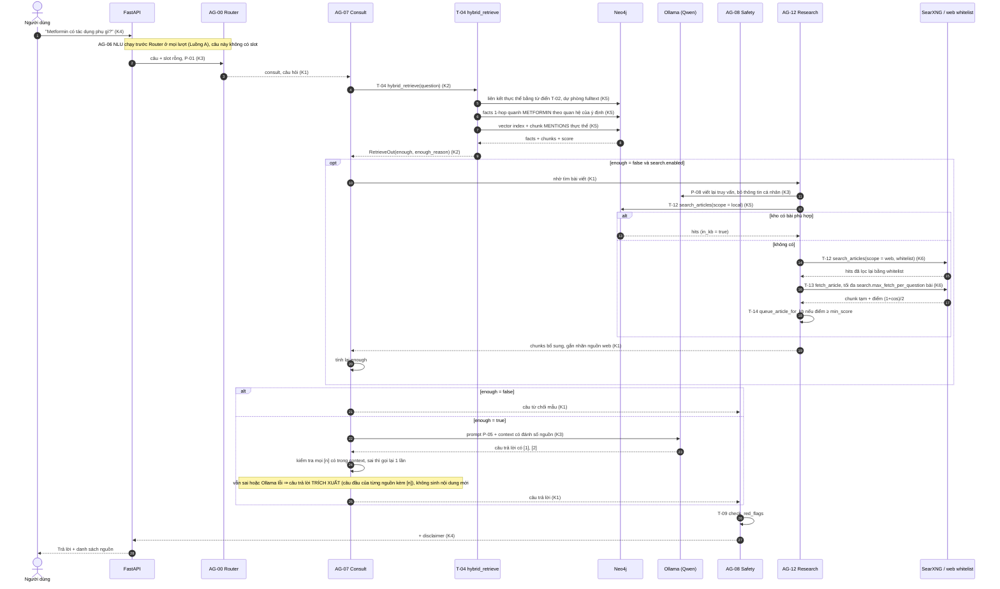
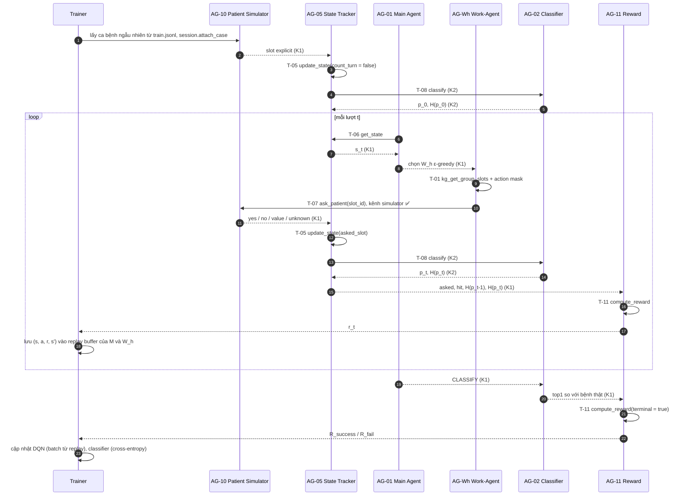
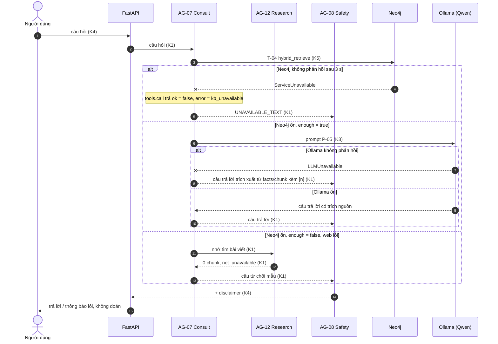

# 04 — Luồng giao tiếp (Sequence diagram)

> **Mục đích:** mô tả agent nào gọi agent nào, gọi tool nào, qua kênh nào, theo thứ tự thời gian.
> **Giai đoạn:** 4 · **Input:** `02_AGENT_DESIGN.md` + `03_TOOL_SPEC.md` · **Output:** sequence diagram (Mermaid + ảnh `docs/assets/seq_*.png`)
> **Cập nhật:** 2026-11-12 (v3: đối chiếu với code agent của Giai đoạn 5 — NLU chạy trước Router, Ollama tắt thì trả lời trích xuất)

> **Trạng thái triển khai:**
> - ✅ Các **tool** trong sơ đồ đã có code và test (`03_TOOL_SPEC.md` §2), gồm cả nhánh lỗi hạ tầng (Luồng D).
> - ✅ Các **agent**, đồ thị điều phối (`agents/graph.py`, tự viết thay LangGraph — ADR-003), client Ollama (`agents/llm.py`), FastAPI (`api/app.py`) và kênh UI của T-07 đã có code và test (`tests/unit/test_agents_llm_graph_api.py`). Mỗi lượt API trả `path` (các node đã đi qua) và `tool_calls` để đối chiếu với sơ đồ.
> Khi vấn đáp phải nói rõ phần nào "đã chạy", phần nào "dự kiến".

---

## 1. Kênh giao tiếp

| Kênh | Giữa | Cơ chế |
|---|---|---|
| K1 — Graph state | Agent ↔ agent trong một phiên | `DialogState` chia sẻ trong đồ thị điều phối (`agents/graph.py`, ADR-003). Chuyển quyền điều khiển giữa agent = chuyển node trên đồ thị, dữ liệu đi qua state (đọc bằng T-06, ghi bằng T-05) |
| K2 — Tool call | Agent → tool / model / simulator | `tools.call(...)` (`tools/base.py`): kiểm quyền, kiểm schema, timeout, log T-10 tự động |
| K3 — LLM call | AG-00, 06, 07, 08, 09, 10, 12 → Ollama | HTTP `POST /api/chat` tới `OLLAMA_URL` |
| K4 — HTTP API | UI ↔ hệ thống | FastAPI `/v1/...` |
| K5 — Bolt | Tool → Neo4j | `neo4j` driver, `bolt://`, `connection_timeout = 3 s` |
| K6 — Web search | T-12/T-13 → SearXNG → web whitelist | HTTP; chỉ ở chế độ demo, tắt hoàn toàn khi huấn luyện |

**Quy ước đọc sơ đồ:**
- Mỗi mũi tên ghi **tool `T-xx`** (agent gửi phải được cấp tool đó trong `configs/agents.yaml`) hoặc **kênh `Kx`**.
- `X->>X: T-xx` là agent tự gọi tool (không có đối tác là agent khác).
- T-10 không vẽ: mọi tool call đều được log tự động.
- `%% mode:` trong khối Mermaid ghi chế độ chạy; mọi agent trong sơ đồ phải được phép chạy ở chế độ đó.
- Hai quy tắc trên được kiểm bằng máy: `python -m diabetes_mas.devtools.check_docs` (kiểm tra [9]).

## 2. Luồng A — Chẩn đoán qua hội thoại (chế độ demo)

**Nhánh cấp cứu:** bất kỳ lúc nào T-09 trả `red_flag = true` (do AG-05 sau mỗi lần cập nhật, hoặc AG-08 trước câu ra) → bỏ vòng lặp, Safety trả `action_text` cố định (`EMERGENCY_TEXT`, gọi 115), phiên kết thúc.

**Nhánh lỗi:** T-02/T-04/K3 lỗi → Luồng D.

## 3. Luồng B — Tư vấn hỏi đáp

- Giới hạn web: `search.max_web_calls_per_session` (3) và `search.max_fetch_per_question` (2) trong `configs/settings.yaml`; AG-12 tự đếm (`agents/research.py`).
- **Từ chối ≠ lỗi:** `enough = false` là KB không có căn cứ → câu từ chối mẫu. Neo4j/Ollama sập là lỗi hạ tầng → Luồng D.

## 4. Luồng C — Huấn luyện (một episode)

- Chế độ huấn luyện **không** gọi LLM (bỏ AG-00/06/09/08, không K3) và **không** gọi AG-12/AG-13 (chỉ chạy ở demo) → mỗi episode chỉ tốn vài ms.
- AG-05 vẫn gọi T-09 sau mỗi lần cập nhật (`02_AGENT_DESIGN.md` §2), nhưng **ở chế độ train cờ cấp cứu không kết thúc episode** (§4: "cờ cấp cứu (chế độ demo)"), nên sơ đồ lược bớt mũi tên T-09.

## 5. Luồng D — Lỗi hạ tầng (Neo4j / Ollama / SearXNG không phản hồi)

Cơ chế chung (đã cài đặt, `tools/errors.py` + `tools/base.py`):
1. Tool ném exception của driver → `tools.call` đổi thành mã ổn định trong `Out.error`, **không** ném ra agent.
2. Agent rẽ nhánh bằng `is_unavailable(out.error)`, không dựa vào tên class của thư viện.
3. Mất **dữ liệu** (Neo4j, T-04) ⇒ câu trả lời cố định `UNAVAILABLE_TEXT`: *"Hệ thống tạm thời không truy cập được dữ liệu y khoa nên chưa thể trả lời chính xác…"*. **Không đoán**, không gọi LLM để "tự trả lời".
4. Mất **LLM** (Ollama) ⇒ dữ liệu vẫn còn nên mỗi agent rơi về phần luật / mẫu của mình; không agent nào sinh nội dung mới khi thiếu LLM.

| Sự cố | Mã lỗi | Hành vi | Trạng thái |
|---|---|---|---|
| Neo4j tắt, T-04 | `kb_unavailable` | AG-07 trả `UNAVAILABLE_TEXT` | ✅ test unit + đã thử với Neo4j tắt thật |
| Neo4j tắt, T-03 | — (`ok = true`, `kb_backend = "seed"`) | Dùng seed — **không phải đoán**: test tích hợp xác nhận seed = dữ liệu trong Neo4j | ✅ |
| Neo4j tắt, T-02 | — | Từ điển vẫn chạy, chỉ bỏ dự phòng fulltext | ✅ |
| Ollama tắt (K3) | `llm_unavailable` | Router: heuristic `router.fallback`; NLU: chỉ slot do luật trích; NLG: câu hỏi mẫu từ KB; Consult: câu trả lời **trích xuất** từ facts/chunk kèm [n] (không phải `UNAVAILABLE_TEXT`, vì KB vẫn có căn cứ); P-06: giải thích theo mẫu; Safety: chỉ luật cứng | ✅ `tests/unit/test_agents_llm_graph_api.py` (`test_nlu_llm_down_keeps_rule_slots`, `test_consult_llm_down_is_extractive_not_unavailable`, `test_router_uses_llm_then_falls_back`) |
| SearXNG / web tắt (T-12, T-13) | `net_unavailable`, `timeout` | AG-12 trả 0 chunk → AG-07 giữ `enough = false` → **câu từ chối mẫu** (KB vẫn hoạt động, chỉ thiếu nguồn bổ sung) | ✅ mã lỗi + `agents/research.py`; SearXNG thật chạy được (`tests/integration/test_web_searxng.py`) |
| Model DL chưa có (T-15) | `model_not_trained` | AG-13 bỏ qua `risk_dl`, chẩn đoán vẫn chạy (DL chỉ là tín hiệu tham khảo, D12) | ✅ |
| Tool quá thời gian | `timeout` | Như dòng tương ứng của tool đó | ✅ |

## 6. Thay đổi so với bản thiết kế đầu (do đối chiếu với code GĐ 3 và GĐ 5)

| # | Bản đầu | Sửa thành | Lý do |
|---|---|---|---|
| 1 | `N-->>ST: T-05 update_state` | NLU chuyển slot qua K1, **AG-05 tự gọi T-05** | AG-06 không được cấp T-05 (`check_docs` [9] phát hiện) |
| 2 | `M->>PR: … → T-15` | Main kích hoạt AG-13 qua K1, **AG-13 tự gọi T-15** | AG-01 không được cấp T-15 (thiết kế D12) |
| 3 | `ST->>SF: T-09` | AG-05 tự gọi T-09 sau mỗi cập nhật; AG-08 gọi T-09 trước câu ra | Cả hai đều được cấp T-09; Safety không trả kết quả cho State Tracker |
| 4 | `CL->>KB: T-03` trong vòng phân loại | Luật áp dụng **bên trong** T-08 (`kb.criteria.check_with_meta`) | Code T-08 không gọi tool T-03 |
| 5 | Không có T-07, T-01 | Work-Agent gọi T-01 (action space) + T-07 (hỏi) | Đúng quyền trong `agents.yaml` |
| 6 | Luồng C không ghi tool | Ghi T-05, T-06, T-07, T-08, T-11 | Tiêu chí hoàn thành mục 1 |
| 7 | T-04 "link entity (fulltext)" | Từ điển T-02, fulltext chỉ là dự phòng | `03_TOOL_SPEC.md` §3 T-02 |
| 8 | "T-13 tối đa 2 bài" chỉ ghi trong sơ đồ | `search.max_fetch_per_question: 2` trong `settings.yaml` | Một nguồn cấu hình duy nhất |
| 9 | Không có nhánh lỗi | Luồng D + mã lỗi chuẩn hóa | Tiêu chí hoàn thành mục 2 |
| 10 | Router chạy trước NLU | **NLU chạy trước Router** (node `nlu → router`) | Luật của Router cần slot: slot cảnh báo ⇒ emergency, tự kể + có slot ⇒ diagnose mà không cần gọi LLM. Đang trả lời câu hỏi chẩn đoán thì câu ngắn được giữ ở `diagnose` |
| 11 | Ollama tắt ⇒ Consult trả `UNAVAILABLE_TEXT` | Consult trả lời **trích xuất** (câu đầu của từng nguồn kèm [n]) | KB vẫn có căn cứ đã kiểm duyệt; trích nguyên văn không phải "đoán". `UNAVAILABLE_TEXT` chỉ dành cho mất dữ liệu (Neo4j) |
| 12 | Đồ thị LangGraph | Đồ thị tự viết `agents/graph.py` | LangGraph không cài được trên Python 3.15 (ADR-003) |

## 7. Tiêu chí hoàn thành

- [x] Mọi mũi tên giữa agent ứng với một tool trong `03_TOOL_SPEC.md` hoặc một kênh ở mục 1 — kiểm bằng máy: `check_docs` [9] (`tests/unit/test_check_docs.py`).
- [x] Có nhánh xử lý lỗi: Neo4j/Ollama không phản hồi → trả thông báo "hệ thống tạm thời không truy cập được dữ liệu", không đoán — Luồng D, `tools/errors.py`, `tests/unit/test_tools_base.py::test_infra_failure_maps_to_stable_code`.
- [x] Ảnh xuất của 4 sơ đồ lưu ở `docs/assets/seq_*.png` — sinh bằng `python -m diabetes_mas.devtools.render_diagrams`.
