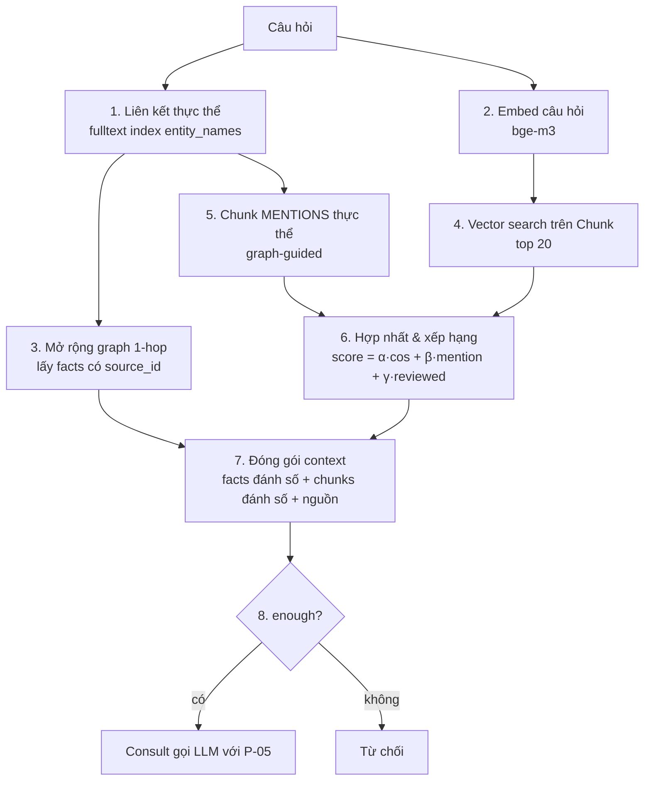
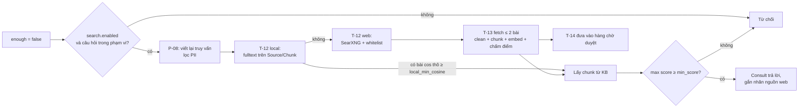

# 06 — RAG giao tiếp với KB như thế nào

> **Mục đích:** giải thích và đặc tả luồng RAG truy vấn KB (Neo4j) để bổ sung context trước khi sinh câu trả lời.
> **Giai đoạn:** 6 · **Input:** agent cần dữ liệu y tế · **Output:** agent nhận context từ Neo4j (graph + vector)
> **Cập nhật:** 2026-11-11

> **Trạng thái triển khai (2026-11-12):** ✅ KB + vector index + MENTIONS trên Neo4j; ✅ hợp nhất xếp hạng + cờ `enough` (T-04); ✅ sinh câu trả lời có trích dẫn (AG-07, P-05); ✅ AG-12 chạy với SearXNG thật (Giai đoạn 6).

---

## 1. Ý tưởng

KB và kho vector **nằm chung trong Neo4j**:

- Tri thức có cấu trúc: node `Disease`, `Symptom`, `Drug`… và quan hệ có nguồn.
- Tri thức phi cấu trúc: node `Chunk` (đoạn văn Vinmec/Bộ Y tế/WHO) có `embedding` và vector index.
- Cầu nối: `(:Chunk)-[:MENTIONS]->(thực thể)`.

Nhờ vậy một truy vấn có thể đi **graph → văn bản** (thực thể → đoạn văn nói về nó) và **văn bản → graph** (đoạn văn → thực thể → quan hệ lân cận).

## 2. Luồng truy xuất `hybrid_retrieve` (T-04)



### Bước 1 — Liên kết thực thể

```cypher
CALL db.index.fulltext.queryNodes('entity_names', $q) YIELD node, score
WHERE score >= $min_link_score
RETURN node.id AS id, labels(node)[0] AS label, node.name_vi AS name, score
ORDER BY score DESC LIMIT 5
```

### Bước 3 — Graph facts (1-hop, có lọc theo ý định)

```cypher
UNWIND $entity_ids AS eid
MATCH (e {id: eid})-[r]-(x)
WHERE type(r) IN $relations          // lọc theo ý định: hỏi thuốc → TREATS; triệu chứng → HAS_SYMPTOM...
  AND r.source_id IS NOT NULL
RETURN e.name_vi AS s, type(r) AS rel, coalesce(x.name_vi, x.name) AS o,
       r.source_id AS source_id, r.prob AS prob
LIMIT $max_facts
```

Fact được chuyển thành câu bằng template theo `rel` (ví dụ `TREATS` → "{s} được dùng điều trị {o}.").

### Bước 4 + 5 — Vector search có định hướng bởi graph

```cypher
CALL db.index.vector.queryNodes('chunk_embedding', 20, $q_emb) YIELD node AS c, score
OPTIONAL MATCH (c)-[:MENTIONS]->(e) WHERE e.id IN $entity_ids
WITH c, score, count(e) AS n_mention
MATCH (c)-[:FROM_SOURCE]->(s:Source)
RETURN c.id, c.text, score, n_mention, s.id, s.title, s.url, s.reviewed
```

### Bước 6 — Xếp hạng

```text
final = 1,0 · cosine + 0,02 · min(n_mention, 2)/2 + 0,01 · reviewed        (cosine theo thang Neo4j (1+cos)/2)
```

Cosine của vector index bị nén trong dải hẹp: các ứng viên tốt chỉ chênh nhau khoảng 0,01–0,05. Vì vậy điểm cộng chỉ là tiêu chí phụ khi cosine gần bằng nhau.
- Bản đầu dùng trọng số 0,7 / 0,2 / 0,1 đã đẩy chunk khớp chính xác (cos 1,0) xuống hạng 5 (`tests/integration/test_tools_neo4j.py`).
- Hệ số đặt ở `configs/settings.yaml → rag`, tinh chỉnh ở Giai đoạn 8.
- Giữ `k_chunks = 5`; tối đa **2 chunk mỗi nguồn**.

### Bước 8 — Cờ `enough`

```text
enough = (số facts ≥ 1 và có thực thể khớp ý định)  HOẶC  (max cosine ≥ min_score)
```

`min_score` mặc định 0,55 (với bge-m3), chọn lại bằng đường cong tỉ lệ từ chối đúng / Recall ở Giai đoạn 8.

> **Quan sát thực tế (2026-11-11, `python -m diabetes_mas.rag.vector_search`):** với bge-m3, câu trong phạm vi có top-1 cosine 0,80–0,87. Câu ngoài phạm vi "Cách chữa ung thư phổi" vẫn có top-1 = 0,81, vì có bài Vinmec về bệnh nhân tiểu đường mắc ung thư phổi, còn các kết quả sau là 0,73–0,74. Hệ quả:
> - Ngưỡng 0,55 là **vô hiệu**: mọi câu đều vượt.
> - **Chỉ dùng ngưỡng cosine thì không tách được** trong và ngoài phạm vi. Cờ `enough` phải kết hợp thêm: (a) Router trả `out_of_scope`; (b) câu hỏi có liên kết được tới thực thể trong KB hay không (T-02); (c) khoảng cách giữa top-1 và trung bình top-k.
> - Giai đoạn 8 phải quét lại ngưỡng trong khoảng 0,70–0,90. Khi `enough = false`, Consult chuyển sang bước 9; nếu vẫn không đủ thì **không gọi LLM** và từ chối.

### Bước 9 — Tìm bài viết bổ sung (AG-12, chỉ khi `enough = false`)



Nguyên tắc:
- Câu hỏi ngoài phạm vi (Router trả `out_of_scope`) **không** kích hoạt tìm kiếm.
- Chunk từ web dùng cùng `min_score` (thang (1+cos)/2) và cùng cách xếp hạng, nhưng `reviewed = 0`.
- Bài **trong kho** (T-12 local, fulltext) phải qua thêm cổng cosine **thô** ≥ `search.local_min_cosine` (0,75) giữa truy vấn và tiêu đề + snippet. Lý do (đo GĐ 6): fulltext khớp cụm chung "người tiểu đường" nên câu về tirzepatide nhận về "Các món cháo cho người tiểu đường" (cos 0,52); trước khi sửa, Consult coi đó là đủ căn cứ. Câu về sầu riêng vẫn nhận đúng bài (cos 0,77). Không qua cổng ⇒ lên web.
- Vòng đời một bài web: *tìm thấy → dùng tạm trong phiên → hàng chờ duyệt → (approved) ingest ở lần build KB sau → có `Source`, `Chunk`, `MENTIONS` như mọi bài khác*. Nhờ vậy KB lớn dần theo đúng các câu hỏi thực tế mà vẫn kiểm soát được chất lượng.

## 3. Ví dụ đầu–cuối

Câu hỏi: *"Metformin có tác dụng phụ gì?"*

| Bước | Kết quả |
|---|---|
| 1 | `METFORMIN` (Drug, score 4.2) |
| 3 | `Metformin được dùng điều trị Đái tháo đường típ 2. [VMC-0002]` |
| 4–6 | `[2] Vinmec – "Tác dụng phụ của metformin"` (0,78), `[3] Bộ Y tế QĐ 3280 – mục Metformin` (0,71) |
| 8 | `enough = true` → P-05 |
| Trả lời | "Tác dụng phụ thường gặp là rối loạn tiêu hóa như buồn nôn, tiêu chảy [2]… Metformin là thuốc đầu tay cho ĐTĐ típ 2 [1][3]." + danh sách nguồn |

## 4. KB phục vụ phần chẩn đoán như thế nào

Không chỉ RAG, phần chẩn đoán cũng lấy từ KB:

| Nơi dùng | Lấy gì từ KB | Tool |
|---|---|---|
| Work-Agent | Không gian hành động = danh sách slot theo nhóm | T-01 |
| NLG | `question_vi` của slot | T-01 |
| Main Classifier | Tiêu chuẩn chẩn đoán (ngưỡng xét nghiệm) | T-03 |
| Patient Simulator | Sinh ca bệnh từ `HAS_SYMPTOM.prob` và khoảng ngưỡng | script `simulator/cases.py` |
| Consult (giải thích) | Căn cứ + nguồn | T-03, T-04 |

→ Cập nhật KB (thêm bài Vinmec, sửa ngưỡng) là hệ thống thay đổi theo, không cần sửa code.

## 5. Tiêu chí hoàn thành

- [ ] Ba câu Cypher ở mục 2 chạy được trên KB thật, có test tích hợp.
- [ ] Mỗi câu trả lời Consult truy ngược được về `source_id` → URL.
- [ ] Chọn `min_score` dựa trên số liệu, ghi lại trong `08_EVALUATION.md`.
