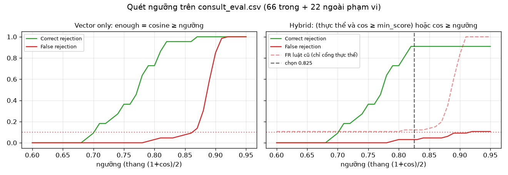
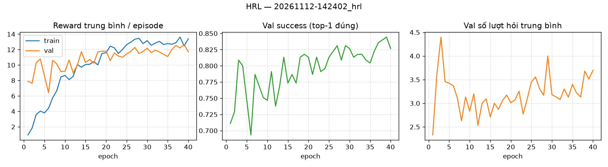
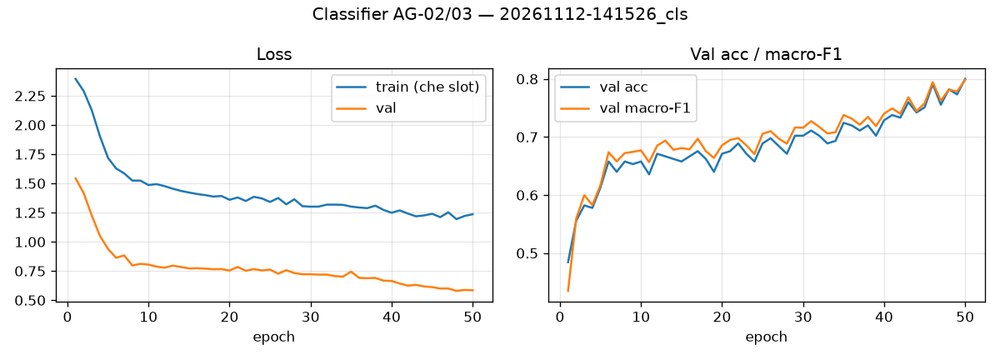

# 08 — Đánh giá & cải tiến

> **Mục đích:** định nghĩa metric, quy trình chạy thí nghiệm, nơi lưu kết quả và nhật ký cải tiến.
> **Giai đoạn:** 8 · **Input:** kết quả kiểm thử · **Output:** điều chỉnh prompt, tool, ngưỡng `min_score`, siêu tham số
> **Cập nhật:** 2026-11-12 (v2: Giai đoạn 8 — đã chạy, có số liệu §3–§5)

> **Trạng thái triển khai (2026-11-12): ✅ đã chạy** — truy hồi/tư vấn (§3, §4.2), classifier (§4.1), baseline B0 Random / B0' / B1 Flat DQN / B2 (§4.1), DL (§4.3), báo cáo FR-21 (`devtools/eval_report.py`). **Chưa chạy:** HRL − entropy, D2 Logistic Regression. Faithfulness chỉ chấm **mẫu 20 câu**. Độ trễ trả lời p95 **11,6 s** (đo khi máy rảnh) — không đạt ≤ 5 s. Mọi mô hình RL **chỉ 1 seed**.

---

## 1. Metric

### 1.1 Chẩn đoán (trên `data/cases/test.jsonl`)

| Metric | Định nghĩa | Mục tiêu |
|---|---|---|
| Diagnosis accuracy | top1 đúng / tổng ca | ≥ 0,85 |
| Top-3 accuracy | bệnh thật nằm trong top 3 | ≥ 0,95 |
| Avg turns | số lượt hỏi trung bình (không tính 3 câu intake) | ≤ 6 |
| Slot recall | slot implicit được hỏi / tổng slot implicit | theo dõi |
| Avg reward | reward trung bình mỗi episode | tăng theo epoch |
| Entropy cuối | H(p_T) trung bình | giảm theo epoch |
| Macro-F1 | F1 trung bình 5 lớp | ≥ 0,80 |

**Baseline bắt buộc để so sánh:**

| Baseline | Mô tả | Trạng thái |
|---|---|---|
| B0 — Random | Hỏi slot ngẫu nhiên, T_max lượt rồi phân loại (`rl/baselines.py`) | ✅ |
| B0' — Luật | W2 → W1 → W3 → W4, hỏi đủ T_max (`policy.RulePolicy`, 02 §8) | ✅ |
| B1 — Flat DQN | Một DQN duy nhất chọn trong 28 slot + CLASSIFY, không phân cấp; cùng env/reward/luật/siêu tham số với HRL (`rl/baselines.py`) | ✅ |
| B2 — Upper bound | Classifier thấy **toàn bộ** slot (không cần hỏi) | ✅ (`test_full_rules`) |
| **HRL (đề xuất)** | Main Agent + Work-Agents + reward entropy | ✅ |
| HRL − entropy | Bỏ thành phần λ·ΔH (ablation) | ⏳ chưa chạy |

### 1.2 Tư vấn (RAG)

| Metric | Định nghĩa | Mục tiêu |
|---|---|---|
| Recall@k (k = 1, 3, 5) | Có chunk chứa ý đúng trong top k | Recall@5 ≥ 0,85 |
| Fact hit | Có graph fact đúng cho câu cần KB | ≥ 0,90 |
| Correct rejection | Câu ngoài phạm vi bị từ chối | ≥ 0,90 |
| False rejection | Câu trong phạm vi bị từ chối | ≤ 0,10 |
| Citation validity | Mọi `[n]` trỏ đúng context | 1,00 |
| Faithfulness | Ý trong câu trả lời có chứng cứ trong context (chấm tay 30 câu hoặc LLM-judge) | ≥ 0,90 |
| Latency p95 | Thời gian phản hồi (không tìm web) | ≤ 5 s |
| Search rescue rate | Câu `enough=false` được cứu nhờ AG-12 và trả lời đúng | theo dõi |
| Search precision | Bài web được dùng thực sự liên quan (chấm tay) | ≥ 0,80 |
| Latency p95 có tìm web | Thời gian phản hồi khi AG-12 chạy | ≤ 15 s |
| PII leak | Truy vấn ra web chứa thông tin cá nhân | 0 |

Bộ đánh giá ✅ `data/eval/consult_eval.csv` — **88 câu: 66 trong phạm vi + 22 ngoài phạm vi** (TC-25). Cột:
`id, question, type (answerable|no_answer), expect_chunk_substr, expect_source, expect_fact, reference_answer`.

- Chấm theo **nội dung**, không theo chỉ số chunk: Hit@k khi một trong k chunk đầu chứa một cụm trong `expect_chunk_substr` (nhiều phương án, phân cách `|`, không phân biệt hoa thường). `expect_source` chỉ để tham khảo (source@5).
- Cụm kỳ vọng chọn **đặc thù** cho câu hỏi; tránh từ chung như "hạ đường huyết" (có trong 181/2.359 chunk).
- `tests/unit/test_eval_consult.py` kiểm: đủ ≥ 60 + ≥ 20 câu; mọi câu trong phạm vi có ít nhất một chunk vừa thuộc `expect_source` vừa chứa cụm kỳ vọng.
- Câu ngoài phạm vi gồm cả câu "gần phạm vi": *ung thư phổi ở người tiểu đường* (N006), *bảo hiểm cho người tiểu đường* (N016), *Parkinson có di truyền không* (N017).
- `examination_50_questions_v2.pdf` **không** dùng ở đây vì đó là đề vấn đáp môn học.

### 1.3 Mô hình Deep Learning (AG-13, FR-17)

Dữ liệu SRC-KAGGLE, **khử 3.854 dòng trùng trước** khi chia train/val/test phân tầng 70/15/15.

| Metric | Định nghĩa | Ghi chú |
|---|---|---|
| Recall lớp dương | TP / (TP + FN) | Chỉ số chính: bỏ sót ca bệnh là lỗi nặng nhất |
| Precision, F1 lớp dương | | |
| PR-AUC | Diện tích dưới đường precision–recall | Phù hợp khi lớp dương chỉ 8,5 % |
| ROC-AUC | | Tham khảo |
| Accuracy | | **Chỉ báo cáo kèm**, không dùng chọn mô hình (Q9: luôn đoán "không" đã đạt 91,5 %) |
| Ma trận nhầm lẫn | Tại ngưỡng đã chọn trên val | |

**Baseline:** D0 luôn âm · D1 luật ngưỡng (HbA1c ≥ 6,8 hoặc glucose ≥ 220) · D2 Logistic Regression (⏳ chưa chạy) · **D3 MLP** · D3-mask (che xét nghiệm). Kết quả ở §4.3.

## 2. Quy trình chạy thí nghiệm

Chạy trong `diabetes_mas/` với `../.venv`. Bước có (KB) cần `docker compose up -d neo4j searxng`; bước có (LLM) cần Ollama `qwen2.5:3b`.

```bash
python -m diabetes_mas.simulator.cases                 # sinh ca → data/cases/{train,val,test}.jsonl
python -m diabetes_mas.rl.train_classifier             # AG-02/03 → experiments/runs/<id>_cls, sao chép best/
python -m diabetes_mas.rl.train_hrl                    # AG-01 + W1..W4 → runs/<id>_hrl; best/hrl chỉ khi val tốt hơn (--force để ép)
python -m diabetes_mas.devtools.compare_classifiers    # NB vs MLP → experiments/eval/classifiers.json
python -m diabetes_mas.devtools.run_dialogs --n 225    # E2E câu mẫu → experiments/eval/e2e.json
python -m diabetes_mas.devtools.run_dialogs --n 20 --llm --keep-logs   # E2E Qwen (KB, LLM) → e2e_llm.json
python -m diabetes_mas.devtools.eval_consult [--answer] [--research]   # TC-25 (KB[, LLM]) → consult.json
python -m diabetes_mas.devtools.plot_eval              # biểu đồ → docs/assets/
python -m diabetes_mas.devtools.eval_report --since "YYYY-MM-DD HH:MM" # TC-45 / FR-21 → experiments/eval/report.md
```

Mỗi run huấn luyện lưu `experiments/runs/<YYYYMMDD-HHMMSS>_<loại>/` gồm checkpoint, `metrics.json` (có bản sao cấu hình), `curve.csv`. Không ghi đè run cũ. `experiments/best/` là bản đang dùng cho API/demo.

## 3. Chọn ngưỡng `min_score` ✅

Quét trên `consult_eval.csv` (`devtools/eval_consult`, thang điểm (1 + cos)/2 của vector index Neo4j, 0,60 → 0,95 bước 0,01). Biểu đồ: `docs/assets/min_score_sweep.png`.



**Phát hiện:**

1. **`min_score` = 0,75 (giá trị tạm từ Giai đoạn 0) không có tác dụng.** Mọi ngưỡng 0,60–0,78 cho cùng kết quả, vì câu nào qua được cổng thực thể cũng có cosine ≥ 0,78.
2. **Toàn bộ False rejection của luật cũ đến từ cổng thực thể.** 7/66 câu hợp lệ không chứa thực thể KB nào (SGLT2, bàn chân Charcot, chỉ số GI, LADA, căng thẳng, adrenalin, thời điểm đo đường huyết) ⇒ FR 0,106 > 0,10.
3. **Cosine tách trong/ngoài phạm vi tốt hơn ước tính ở GĐ 0** (trước đó: "ngoài phạm vi vẫn 0,81"). Vector thuần ở ngưỡng 0,82: CR 0,955, FR 0,045. Câu ngoài phạm vi không có thực thể có cosine cao nhất 0,818 (N008 *trầm cảm điều trị bằng thuốc gì*); câu hợp lệ không thực thể thấp nhất 0,789 (LADA), kế tiếp 0,798 (Charcot) rồi 0,830 (SGLT2).

**Quyết định:** thêm nhánh thứ hai vào `decide_enough` (T-04):

> đủ căn cứ ⇔ (có thực thể/fact **và** cosine ≥ `min_score` = 0,75) **hoặc** cosine ≥ `min_score_no_entity` = **0,825**

Mọi ngưỡng 0,82–0,83 cho cùng kết quả; chọn 0,825 ở giữa để có biên hai phía. **Lưu ý:** biên rất hẹp (0,818 ↔ 0,830) và ngưỡng chọn trên chính 88 câu này ⇒ số liệu có thể lạc quan; cần bộ câu độc lập để xác nhận.

| Luật | Correct rejection | False rejection |
|---|---|---|
| Cũ: cổng thực thể và cos ≥ 0,75 | 0,909 | 0,106 ❌ |
| Vector thuần, cos ≥ 0,82 | 0,955 | 0,045 |
| **Mới: cổng thực thể hoặc cos ≥ 0,825** | **0,909** | **0,030** ✅ |

Chọn luật mới thay vì vector thuần: giữ được căn cứ KB cho câu có thực thể (fact hit 0,905). Vector thuần CR cao hơn 1 câu nhưng mất ràng buộc "có thực thể KB".

**Còn nhận nhầm (giới hạn đã biết):** N006 *ung thư phổi ở người tiểu đường* — kho thật sự có bài VMC-0135 về đúng trường hợp này nên khó coi là ngoài phạm vi; N016 *bảo hiểm cho người tiểu đường* — chứa thực thể "tiểu đường". Cổng thực thể không phân biệt được "câu về bệnh" với "câu có nhắc tên bệnh".

## 4. Bảng kết quả

### 4.1 Chẩn đoán

**Classifier AG-02/03** (225 ca test, bộ ca v2 — §5 dòng `risk_override`; `devtools/compare_classifiers`):

| Mô hình | Che slot | Che slot + luật | Đủ slot | Đủ slot + luật (= B2 upper bound) |
|---|---|---|---|---|
| Naive Bayes từ KB (`kb_naive_bayes`) | acc 0,644 / F1 0,663 | 0,716 / 0,726 | 0,724 / 0,749 | 0,831 / 0,842 |
| **MLP** (74.585 tham số) | **0,738 / 0,744** | **0,764 / 0,771** | **0,831 / 0,842** | **0,853 / 0,862** |

MLP vượt NB rõ nhất khi thiếu thông tin (che slot: +0,094 acc), đúng tình huống hội thoại. Khi đủ slot + luật, hai mô hình gần nhau (0,853 so với 0,831) vì luật KB quyết định phần lớn.

**Bảng chính — cấu hình cuối, mọi mô hình đo CÙNG điều kiện** (2026-11-12 17:05, sau mọi sửa đổi §5: `labs_ready`, W2, `confident_stop` 0,95, `nlu.DURATION`, `it_van_dong`; bộ ca v2; `experiments/eval/diag_final.json`). Môi trường huấn luyện, 225 ca; **mỗi mô hình RL 1 seed**:

| Mô hình | Val acc | Val lượt | **Test acc** | **Test lượt** |
|---|---|---|---|---|
| B0 Random | 0,756 | 11,39 | 0,698 | 11,54 |
| B0' Luật (W2 → W1 → W3 → W4) | 0,884 | 10,46 | **0,853** | 10,70 |
| B1 Flat DQN (run 164238) | 0,853 | 3,56 | 0,751 | 3,54 |
| **HRL** (run 142402 + luật W2) | **0,862** | **3,16** | **0,782** | **3,32** |
| B2 Upper bound (classifier đủ slot + luật) | — | — | 0,853 | — (không hỏi) |
| E2E câu mẫu qua toàn hệ thống (HRL) | — | — | 0,796 | 3,48 |

Với `confident_stop`, B0 Random/B0' cũng dừng sớm khi đã chắc (11,5 / 10,7 lượt thay vì 12). B1 không đổi (mask của B1 không dùng `workers_ok`). Các bảng dưới là **lịch sử** từng bước sửa, đo ở điều kiện lúc đó.

**Điều phối HRL** — đánh giá trong môi trường huấn luyện (`rl/env.py`, slot đi thẳng vào state): *(lịch sử)*

| Run | Bộ ca | Luật điều phối | HRL success | HRL lượt TB | B0' success (12 lượt) | Ghi chú |
|---|---|---|---|---|---|---|
| 20261112-072602 | v1 | — (GĐ 7) | 0,698 | 3,59 | 0,716 | 44/225 ca kết luận khi chưa hỏi xét nghiệm |
| 20261112-134340 | v1 | `labs_asked` | 0,751 | 4,54 | 0,716 | HRL vượt B0' với ít hơn 2,6× lượt |
| 20261112-142402 | v2 | `labs_ready` | 0,787 | 3,66 | **0,853** | B0' vượt HRL; 17/225 ca E2E đi vòng tới T_max |
| 20261112-144423 | v2 | `labs_ready` + W2 (train lại) | 0,756 | 3,51 | 0,853 | val 0,827 < best ⇒ **không** lên best |
| **best = 142402 + luật W2** | v2 | `labs_ready` + W2 (chỉ đổi luật lúc chạy) | **0,782** | **3,40** | 0,853 | val 0,862; cấu hình đang dùng |
| B0 Random (`rl/baselines.py`) | v2 | `labs_ready` | — | — | — | test **0,716** / 12 lượt; val 0,724 |
| B1 Flat DQN (run 20261112-164238, 104.733 tham số, 29 hành động) | v2 | `labs_ready` | — | — | — | test **0,751** / 3,54 lượt; val **0,853** / 3,56 (epoch 18/40) |

So sánh chỉ hợp lệ **trong cùng bộ ca**: bộ v2 có ít ca típ 1 ≥ 45 tuổi hơn nên dễ hơn cho mọi mô hình (B0' tăng từ 0,716 lên 0,853).

**E2E qua toàn hệ thống** (NLU → Router → … → Safety, `devtools/run_dialogs`):

| Cấu hình | Ca | Acc | Lượt TB | Vượt T_max | Hỏi lặp | Kết luận khi chưa có xét nghiệm |
|---|---|---|---|---|---|---|
| GĐ 7, câu mẫu | 225 (v1) | 0,693 | 4,05 | 0 | 0 | 44 |
| `labs_asked`, câu mẫu | 225 (v1) | 0,720 | 4,39 | 0 | 0 | 0 |
| `labs_ready`, câu mẫu | 225 (v2) | 0,773 | 3,90 | 0 | 0 | 0 (17 ca chạm T_max, acc 0,53) |
| **best + W2, câu mẫu** | 225 (v2) | **0,796** | **3,57** | 0 | 0 | 0 (14 ca chạm T_max, acc 0,50) |
| GĐ 7, Qwen | 20 (v1) | 0,600 | 4,50 | 0 | 1 | — |
| **best + W2, Qwen** (`--resume`, 5 đợt) — **đo TRƯỚC khi sửa `nlu.DURATION` và thêm `confident_stop`**; 2/5 ca sai do lỗi DURATION | 20 (v2) | **0,750** | **3,70** | 0 | 0 | — · ~2 phút/hội thoại trên CPU |

**Vì sao E2E Qwen (0,750) thấp hơn E2E câu mẫu (0,796)?** Đọc log T-10 của 5 ca sai (`logs/agent_runs/`):

| Ca | Đúng → hệ ra | Nguyên nhân | Loại |
|---|---|---|---|
| C-00065 | típ 2 → Không ĐTĐ | NLU ghi `OGTT_2H = 2,0` cho câu "sau **2 giờ** là 10,3" (lấy số đầu câu) | **Lỗi NLU luật — đã sửa** (`nlu.DURATION`, §5) |
| C-00067 | típ 1 → típ 2 | Cùng lỗi OGTT 2,0; sau đó HbA1c 8,8, 42 tuổi ⇒ classifier chọn típ 2 | Lỗi NLU (đã sửa) + phân biệt típ 1/2 |
| C-00038 | ĐTĐ thai kỳ → tiền ĐTĐ | Hệ **không hỏi "có đang mang thai không"** (W3 không chọn slot này); OGTT 2h 9,9 không thai ⇒ tiền ĐTĐ | Giới hạn policy (§7) |
| C-00107 | típ 2 → típ 1 | Glucose bất kỳ 15,5 ghi đúng ở lượt 1 (`labs_ready` thỏa, **không phải lỗi luật**); 31 tuổi + sụt cân + bệnh tự miễn ⇒ típ 1 0,94 | Phân biệt típ 1/2 theo giả định sinh ca |
| C-00030 | típ 2 → típ 1 | Chạm T_max 12 lượt | Policy |

Câu mẫu của simulator luôn ghi số trước đơn vị ("10,3 mmol/L"), nên lỗi OGTT chỉ lộ ra khi Qwen nói tự nhiên — đúng mục đích của E2E `--llm`. 20 ca quá ít để kết luận chênh lệch 0,05 (1 ca = 0,05).

Policy train lại với luật W2 (run 144423) **kém hơn** policy cũ chạy cùng luật W2 trên cả val (0,827 so với 0,862) lẫn test (0,756 so với 0,782). `train_hrl` giữ best nhờ cơ chế so sánh mới (§5). Một lần train duy nhất mỗi cấu hình, chưa lặp seed ⇒ chênh 0,03 có thể là nhiễu huấn luyện.

Đường học (run 142402 đang là best): `docs/assets/curve_hrl.png`; classifier: `docs/assets/curve_classifier.png`.





### 4.2 Tư vấn (88 câu, `experiments/eval/consult.json`)

| Retriever | R@1 | R@3 | R@5 | Fact hit (21 câu) | Correct rej. | False rej. |
|---|---|---|---|---|---|---|
| vector only (cos ≥ 0,75) | 0,849 | 0,970 | 1,000 | — | 0,364 | 0,000 |
| graph only (chunk MENTIONS + facts) | 0,394 | 0,470 | 0,470 | 0,905 | 0,909 | 0,106 |
| hybrid, luật cũ | 0,849 | 0,970 | 1,000 | 0,905 | 0,909 | 0,106 |
| **hybrid, luật mới (§3)** | **0,849** | **0,970** | **1,000** | **0,905** | **0,909** | **0,030** |

Trả lời đầy đủ qua AG-07 với Qwen 2.5 3B (`--answer`, không tìm web):

| Metric | Kết quả | Mục tiêu |
|---|---|---|
| Citation validity | **1,00** (mọi `[n]` trong context) | 1,00 ✅ |
| Phương thức | LLM 56 · trích xuất 10 (LLM không qua kiểm trích dẫn) · từ chối 22 | — |
| Latency p95 truy hồi T-04 | 0,38–0,98 s | — |
| Latency p95 trả lời (không web) — **đo lại khi máy rảnh** (xong lúc 17:19, chỉ chạy phép đo này) | **11,6 s** ❌ (lần đầu khi đang train: 11,5 s ⇒ không phải do tranh CPU) | ≤ 5 s |
| Theo phương thức (đo lại) | LLM 57 câu: trung vị 4,2 s, p95 8,2 s · trích xuất 9 câu (LLM sai trích dẫn 2 lần ⇒ gọi 2 lần): trung vị 9,2 s, tối đa 62 s (nhiều khả năng lần nạp model đầu) · từ chối: 0,2 s | — |
| Faithfulness — **chấm tay MẪU 20/56 câu LLM** (seed 42, `experiments/eval/faithfulness_sample.csv`) | Nội dung có căn cứ trong context **19/20 = 0,95**; đúng hoàn toàn 11, lỗi nhỏ 8, không trung thực 1 (C050) | ≥ 0,90 ✅ (mẫu) |
| Trích dẫn **đúng nguồn** (mẫu 20 câu) | 13/20 = 0,65 — 5 câu một phần `[n]` trỏ sai fact, 2 câu sai hẳn | — (chưa có mục tiêu) |

**Phát hiện từ chấm mẫu:** "Citation validity 1,00" chỉ đảm bảo `[n]` **nằm trong** context, không đảm bảo `[n]` trỏ **đúng** nguồn chứa ý. Qwen 3B thường chép đúng nội dung của một chunk nhưng gắn số của fact đứng gần (C044 chép nguyên văn VMC-0105 nhưng dẫn fact biến chứng võng mạc). Muốn đo tự động cần kiểm câu–nguồn (vd. so khớp từ khóa giữa câu và nguồn được dẫn) — chưa làm. Chấm mẫu do một người (Claude) chấm, chưa đối chiếu người thứ hai.

Graph only có R@5 thấp (0,47) vì 7 câu không có thực thể và chunk MENTIONS chỉ xếp theo số lần nhắc thực thể — đúng vai trò bổ trợ, không dùng một mình.

### 4.3 Deep Learning AG-13 (test, `experiments/best/dl/metrics.json`)

| Mô hình | PR-AUC | ROC-AUC | Recall | Precision | F1 |
|---|---|---|---|---|---|
| D3 MLP đủ đặc trưng | 0,885 | 0,977 | 0,911 | 0,476 | 0,625 |
| D3-mask che xét nghiệm | 0,336 | 0,839 | 0,922 | 0,172 | 0,291 |
| D1 luật ngưỡng của dataset | — | — | 0,694 | 1,000 | **0,820** |

D3 **không** vượt D1 về F1: D1 chính là ngưỡng sinh nhãn của dataset (precision 1,00). D3 chọn ngưỡng theo recall ≥ 0,90 trên val, nên đổi precision lấy recall. Phần lớn tín hiệu nằm trong ngưỡng xét nghiệm; khi che xét nghiệm, PR-AUC chỉ còn 0,336. Vì vậy AG-13 chỉ là tín hiệu tham khảo, không thay luật KB (ADR-002).

### 4.4 Báo cáo FR-21 (TC-45)

`python -m diabetes_mas.devtools.eval_report --since "<thời điểm>"` gom đủ 6 nhóm (DL, truy xuất, độ đúng câu trả lời, điều phối, thời gian phản hồi, độ tin cậy) vào `experiments/eval/report.md`. Nhóm thiếu nguồn bị ghi "chưa có số liệu", không tự điền. Bản cuối (17:21, `--since "2026-11-12 15:54"` = lúc bắt đầu E2E Qwen; `experiments/eval/report.md`):

- **Độ tin cậy:** 1.890 tool call / 125 phiên, **tỉ lệ lỗi tool 0** (Neo4j, Ollama đều bật suốt cửa sổ đo). Lần chạy trước (14:00–14:25): 13.641 call / 318 phiên, lỗi 0.
- **Độ trễ theo tool (p95, log T-10):** T-04 10,1 s — gồm lần nạp bge-m3 đầu mỗi tiến trình (E2E Qwen chạy 5 đợt `--resume` = 5 lần nạp); đo riêng truy hồi khi đã nạp: p95 0,38 s. T-08 55 ms, T-15 6 ms, các tool còn lại ≤ 4 ms.
- Nhóm 1–4 trùng với §4.1–4.3.

## 5. Nhật ký cải tiến (Changelog)

Mỗi thay đổi một dòng; chỉ giữ thay đổi khi metric chính không giảm.

| Ngày | Thay đổi | Lý do (test/metric nào) | Trước | Sau | Giữ? |
|---|---|---|---|---|---|
| 2026-11-12 | AG-07: chuẩn hóa trích dẫn `(1)`, `(1, 2)`, `[3, 2]` → `[n]` trước khi kiểm (`consult.normalize_citations`) | P-05 với KB thật: Qwen 3B trích đúng số nhưng sai dạng | LLM dùng 3/9 câu, ngoài context 0 | LLM dùng 9/10 câu, ngoài context 0 | ✅ |
| 2026-11-12 | AG-12: bài kho (T-12 local) phải có cosine thô ≥ `search.local_min_cosine` = 0,75 | Câu tirzepatide nhận 3 bài lạc đề (cos 0,42–0,52) và được coi là đủ căn cứ | 3 bài lạc đề | 0 bài lạc đề ⇒ lên web, tìm được bài Mounjaro (3 đoạn ≥ min_score); câu sầu riêng vẫn giữ đúng bài (0,77) | ✅ |
| 2026-11-12 | T-13: chỉ nhúng tối đa `search.max_embed_chunks` = 8 đoạn, lọc trước theo từ khóa | Nhúng cả bài trên CPU chậm | — | Top-3 đoạn của bài Mounjaro không đổi | ✅ |
| 2026-11-12 | `tools.call`: `timeout_s` chuyển vào input khi tool có trường đó | T-13 luôn `timeout` với web thật | 0/2 bài tải được | 2/2 | ✅ (sửa lỗi) |
| 2026-11-12 | Luật điều phối `require_lab_before_classify` (`state.main_mask`), bản 1 `labs_asked`: chưa hỏi xét nghiệm nào thì chưa CLASSIFY. Train lại HRL | TC-30 (07 §6 lỗi #8): reward −1/lượt khiến policy kết luận sau 1 câu, chưa hỏi xét nghiệm | Test 0,698 / 3,59 lượt; E2E 0,693; 44/225 ca không xét nghiệm | Test 0,751 / 4,54 lượt; E2E 0,720; 0/225 | ✅ rồi thay bằng bản 2 |
| 2026-11-12 | `train_hrl`: chỉ ghi đè `experiments/best/hrl/` khi val tốt hơn checkpoint hiện tại (đánh giá lại theo luật hiện hành); `--force` để ép | 07 §6: mọi lần train đều ghi đè best | Luôn ghi đè | So sánh `(success, −lượt)` trên val | ✅ |
| 2026-11-12 | T-04 `decide_enough`: thêm nhánh `min_score_no_entity` = 0,825 cho câu không có thực thể KB; T-04 trả thêm `max_cosine` | §3: FR 0,106 > 0,10 do cổng thực thể | CR 0,909 / FR 0,106 | CR 0,909 / FR 0,030 | ✅ |
| 2026-11-12 | `consult_eval.csv` C027: thêm phương án "tiểu albumin", "nước tiểu để làm xét nghiệm" vào `expect_chunk_substr` | Lần chạy đầu: 5 chunk trả về đều đúng chủ đề (VMC-0061/0175/0267…) nhưng kho viết "tiểu albumin", nhãn ghi "albumin niệu" — **lỗi nhãn, không phải lỗi truy hồi** | R@5 0,985 | R@5 1,000 | ✅ (sửa nhãn — ghi rõ để không bị coi là tối ưu trên tập test) |
| 2026-11-12 | Bộ sinh ca: `PRIORS.risk_override` P(tuổi ≥ 45 \| típ 1) = 0,10 (trước: tỉ lệ nền dân số 0,35). **Không** thêm cạnh vào KB. Sinh lại 1.500 ca (bản cũ: `data/cases_v1_gd7`), train lại classifier + HRL | TC-30: classifier ra típ 1 72 % cho người 55 tuổi BMI 27 — ~21 % ca típ 1 mô phỏng ≥ 45 tuổi, cộng P(sụt cân \| típ 1) 0,7 ≫ 0,2. VMC-0001: típ 1 thường khởi phát < 30 tuổi | Típ 1 ≥ 45 tuổi 21,3 %; TC-30 típ 1 72 % | 6,8 %; TC-30 típ 2 60 % | ✅ |
| 2026-11-12 | Luật xét nghiệm bản 2 `labs_ready`: CLASSIFY khi đã có ≥ 1 **giá trị** xét nghiệm, hoặc đã hỏi hết xét nghiệm hỏi được | E2E Qwen: policy hỏi 1 xét nghiệm, nhận "không biết", kết luận ngay (bộ ca có `p_lab_unknown` = 0,5) | Kết luận không có chỉ số nào | Test 0,787 / 3,66 lượt; E2E 0,773 | ✅ |
| 2026-11-12 | W2 không được RETURN khi `labs_ready` sai và còn xét nghiệm hỏi được (`state.worker_mask`) — "W2" | TC-31: W2 trả quyền sau 2 câu "không biết", policy đi vòng tới T_max, không hỏi glucose lúc đói; 17/225 ca E2E chạm T_max (acc 0,53) | Test 0,787 / 3,66; E2E 0,773; 17 ca T_max; TC-31 trượt | best + W2: test 0,782 / 3,40; E2E **0,796** / 3,57; 14 ca T_max; TC-31 qua | ✅ |
| 2026-11-12 | AG-07 `explain_ok`: câu giải thích P-06 phải chứa đúng tên kết luận và xác suất, sai ⇒ dùng template | E2E Qwen: kết luận "Không mắc ĐTĐ" 54 % nhưng Qwen viết "khả năng mắc đái tháo đường là 54%" (bỏ chữ "Không") | Đảo ngược kết luận | Chặn, dùng template | ✅ |
| 2026-11-12 | Baseline B0 Random, B1 Flat DQN (`rl/baselines.py`) | 08 §6 cần đủ baseline | — | B0 0,716 / 12; B1 0,751 / 3,54 (test) | ✅ |
| 2026-11-12 | NLU (luật): bỏ cụm thời gian ("2 giờ", "2h", "28 tuần"…) trước khi lấy con số cho slot số (`nlu.DURATION`) | E2E Qwen: "sau 2 giờ là 10,3" ⇒ `OGTT_2H = 2,0` (C-00065, C-00067) | 2,0 | 10,3 | ✅ (sửa lỗi; `test_nlu_numeric_answer_ignores_durations`) |
| 2026-11-12 | Luật điều phối `confident_stop` = 0,95: đã có xét nghiệm (`labs_ready`) và max p ≥ 0,95 ⇒ CLASSIFY | Chạy thử demo ca thai kỳ: classifier chắc 98 % sau câu đầu nhưng policy hỏi đủ 12 câu | Test 0,782 / 3,40; E2E 0,796 / 3,57 | Test 0,782 / 3,32; E2E 0,796 / 3,48 (ngưỡng 0,90: acc 0,778 / 0,791 ⇒ không dùng) | ✅ |
| 2026-11-12 | `DialogState.update`: đang mang thai ⇒ tự ghi giới tính nữ (không hỏi) | Chạy thử demo: hỏi giới tính người vừa nói đang mang thai | Hỏi | Không hỏi | ✅ |
| 2026-11-12 | Đổi câu hỏi `it_van_dong` thành "Anh/chị có ít vận động, ít tập thể dục (ngồi nhiều) không?" (seed, `.cypher`, Neo4j) | Câu cũ "có thường xuyên tập thể dục không?" ⇒ người dùng đáp "Không" bị NLU ghi `it_van_dong = no` — **đảo nghĩa**. Không ảnh hưởng huấn luyện (env đưa slot thẳng vào state) | Đảo nghĩa | "Có" = có yếu tố nguy cơ | ✅ |
| 2026-11-12 | Giải thích kết luận: tên tiếng Việt thay mã slot (`consult.slot_names`, `hit_text`) | Chạy thử demo: "Căn cứ: uong_nhieu, tieu_nhieu…; HBA1C = 7.1" | Mã thô | "Uống nhiều, Tiểu nhiều…; HbA1c = 7,1 (ngưỡng HbA1c > 6,5 %, nguồn VMC-0002)" | ✅ |

## 6. Tiêu chí hoàn thành

- [ ] Đủ 5 dòng chẩn đoán và 3 dòng retriever trong mục 4. — Retriever ✅ (4 dòng). Chẩn đoán: B0 Random, B0', B1 Flat DQN, B2, HRL ✅; **HRL − entropy chưa chạy**.
- [x] `min_score` được chọn bằng số liệu, có biểu đồ (§3).
- [x] HRL vượt B0, B1 về accuracy hoặc số lượt hỏi; có giải thích nếu không. — Test: HRL 0,782 / 3,40 lượt vượt B0 Random (0,716 / 12) và B1 Flat DQN (0,751 / 3,54). **Nhưng** trên val B1 0,853 ≈ HRL 0,862, và mỗi mô hình chỉ 1 seed ⇒ chênh lệch với B1 **chưa đủ để kết luận** HRL tốt hơn. B0' (luật, hỏi đủ 12 lượt) 0,853 vượt HRL về acc, HRL ít hơn 3,5× lượt (reward −1/lượt đánh đổi acc lấy lượt). Lợi ích của phân cấp ngoài acc: giải thích được (biết đang hỏi nhóm nào — W1 triệu chứng, W2 xét nghiệm…), luật điều phối gắn được theo nhóm (W2 không RETURN sớm), không gian hành động mỗi cấp nhỏ (Main 5, Worker 5–14 so với 29 của B1), và đúng kiến trúc yêu cầu (R-T11).

## 7. Giới hạn đã biết

- **Ngưỡng tư vấn chọn trên chính tập đánh giá** (88 câu, biên 0,818 ↔ 0,830) — cần bộ câu độc lập.
- **Cổng thực thể nhận câu "có nhắc tên bệnh"** (N006, N016).
- **Độ trễ trả lời không đạt ≤ 5 s**: Qwen 3B trên CPU p95 11,6 s khi máy rảnh (trung vị câu LLM 4,2 s). Phần đuôi do LLM sai trích dẫn phải gọi lại lần 2 và lần nạp model đầu (demo có bước làm nóng — `09_DEMO_SCRIPT` §0.2). Hội thoại chẩn đoán với Qwen ~2 phút / ca.
- **Dữ liệu chẩn đoán là mô phỏng** từ xác suất `team_estimate` trong KB và `PRIORS` của nhóm; số liệu §4.1 đo độ khớp với giả định đó, không phải độ chính xác lâm sàng.
- **TC-21** (glucose lúc đói 6,5 ⇒ tiền ĐTĐ): luật Bộ Y tế bắt đúng, nhưng classifier (cả bản cũ lẫn mới) nghiêng nhẹ về típ 2 khi chỉ có chỉ số này (0,44 so với 0,40); policy kết luận sau khi hỏi HbA1c (không biết). Đã thử luật "có giá trị xét nghiệm nhưng không đạt tiêu chuẩn ĐTĐ ⇒ loại típ 1/2" (đúng tinh thần QĐ 3280): classifier đủ slot + luật 0,853 → 0,858 nhưng **E2E 0,796 → 0,742** (loại oan ca ĐTĐ chỉ biết một chỉ số ở ngưỡng tiền ĐTĐ) ⇒ không dùng; TC-21 để xfail.
- **Hệ không chủ động hỏi "có đang mang thai không"**: slot `dang_mang_thai` thuộc W3 và policy hiếm khi chọn. Phụ nữ mang thai không tự nói ra sẽ bị chẩn đoán như người không mang thai (C-00038). Hướng sửa (chưa làm): đưa `dang_mang_thai` vào intake cho nữ 18–45 tuổi — đổi phân phối trạng thái nên phải train lại.
- **Ca thai kỳ cần nhiều lượt**: dù câu đầu đã có glucose lúc đói, policy vẫn hỏi ~6 câu triệu chứng/nguy cơ trước khi xác suất vượt 0,95.
- **NLU câu tự do nhận OGTT chưa tốt**: "OGTT, sau 2 giờ đường huyết 10,3" trong câu mở đầu được ghi thành glucose bất kỳ (câu trả lời cho câu hỏi OGTT thì đúng).
- **Phân biệt típ 1/típ 2** phụ thuộc mạnh vào giả định sinh ca (`PRIORS`, xác suất `team_estimate`) — nguồn sai chính còn lại (C-00067, C-00107, TC-21).
