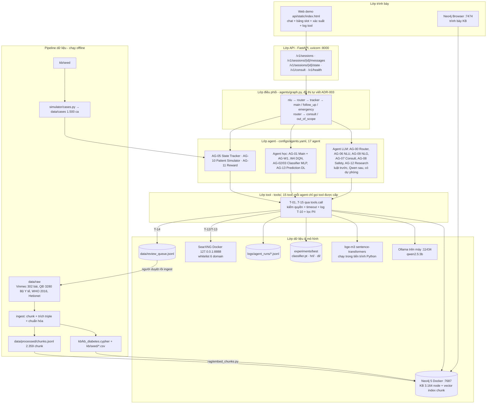
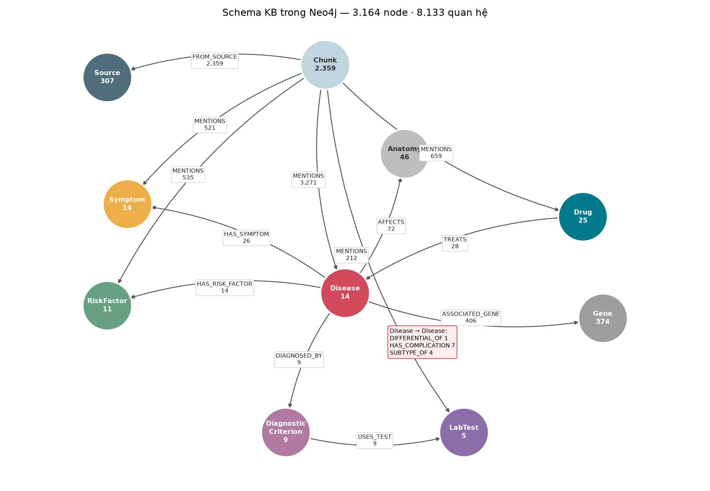
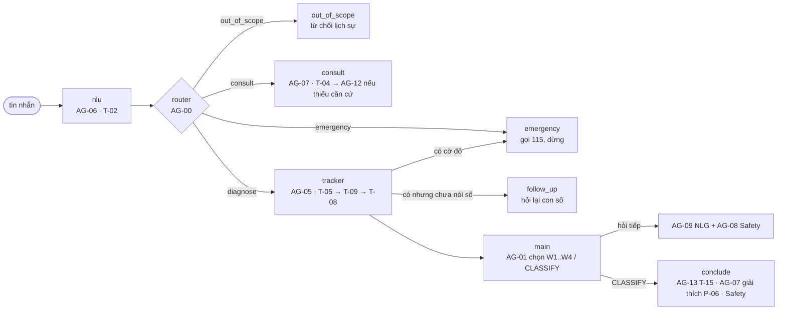

# 09 — Kiến trúc tổng thể

> **Mục đích:** sơ đồ kiến trúc toàn hệ thống (triển khai, thành phần, dữ liệu) để trình bày và làm chuẩn khi phát triển.
> **Giai đoạn:** 9 · **Cập nhật:** 2026-11-12 (v2: đối chiếu với code đang chạy)

> **Trạng thái triển khai (2026-11-12): ✅ đã có code và đã chạy** — mọi thành phần dưới đây đối chiếu với `diabetes_mas/` (không còn mục "dự kiến"). Số liệu đánh giá: `08_EVALUATION.md`. Sửa so với bản thiết kế 2026-11-11 ở §8.

---

## 1. Kiến trúc phân lớp



Ảnh PNG cho slide: `assets/arch_1.png` (sơ đồ này), `assets/arch_2.png` (§2), `assets/kb_schema.png` (schema KB thật trong Neo4j), `assets/kb_dtd_tip2.png` (đồ thị con quanh ĐTĐ típ 2). Sinh lại: `devtools/render_diagrams --doc 09_ARCHITECTURE.md --prefix arch` (cần mermaid-cli) và `devtools/plot_kb` (cần Neo4j).



**Nguyên tắc xuyên suốt:**

| Nguyên tắc | Hiện thực |
|---|---|
| Agent chỉ hành động qua tool | `tools.call(tool_id, agent_id=…)` kiểm `configs/agents.yaml`; gọi ngoài danh sách ⇒ lỗi. `check_docs` [9] kiểm sơ đồ ↔ quyền tool |
| Luật trước, LLM sau | NLU/Router/Safety chạy regex + từ điển KB trước; Qwen chỉ xử lý phần còn lại |
| LLM hỏng không làm sập hệ thống | Ollama lỗi ⇒ NLU/Router dùng luật, NLG dùng câu mẫu, Consult trả lời **trích xuất** (liệt kê nguồn `[n]`), không bịa |
| Hạ tầng hỏng thì nói rõ | Neo4j lỗi ⇒ `kb_unavailable` + `UNAVAILABLE_TEXT` (04 Luồng D); tiêu chuẩn chẩn đoán rơi về `kb/seed` |
| Mọi câu trả lời y khoa có nguồn | Consult bắt buộc `[n]` trong context; giải thích chẩn đoán kèm `rule_hits` (nguồn Bộ Y tế/Vinmec) |
| Kết luận cần căn cứ xét nghiệm | Luật điều phối `require_lab_before_classify` (`state.main_mask`, `worker_mask`) — 08 §5 |

## 2. Đồ thị điều phối một lượt (`agents/graph.py`)



Mỗi lượt trả về: `reply`, `stage` (`asking` | `concluded` | `emergency` | …), `path` (các node đã đi), `state` (slot, xác suất, entropy, `risk_dl`), `tool_calls` (vết T-10) — web demo hiển thị cả bốn.

## 3. Triển khai

### 3.1 Trên máy demo (Windows 11, 16 GB RAM, chỉ CPU)

| Thành phần | Chạy ở đâu | Cổng | Ghi chú |
|---|---|---|---|
| `neo4j` | Docker (`docker compose up -d neo4j`) | `127.0.0.1:7474` Browser, `127.0.0.1:7687` Bolt (chỉ máy local) | `./neo4j_data:/data`, `./kb:/import:ro`; heap tối đa 1 GB |
| `searxng` | Docker (`docker compose up -d searxng`) | `127.0.0.1:8888` → 8080 trong container | Chỉ cần cho AG-12 tìm web; 8080 trên máy bị `httpd` chiếm nên đổi qua `SEARXNG_PORT` |
| Ollama | **Cài trực tiếp** (winget), không dùng container | 11434 | Model `qwen2.5:3b`. Compose có service `ollama` nhưng **không bật** trên máy này (trùng cổng 11434) |
| API + web demo | Tiến trình Python trên máy: `uvicorn diabetes_mas.api.app:app --port 8000` | 8000 | Nạp bge-m3, checkpoint PyTorch; **không** có container `app` |

```bash
cd diabetes_mas
docker compose up -d neo4j searxng
../.venv/Scripts/python -m uvicorn diabetes_mas.api.app:app --port 8000
# mở http://localhost:8000
```

### 3.2 Biến môi trường (`.env`, mẫu ở `.env.example` — không commit `.env`)

```text
NEO4J_URI=bolt://localhost:7687
NEO4J_USER=neo4j
NEO4J_PASSWORD=…
OLLAMA_URL=http://localhost:11434
LLM_MODEL=qwen2.5:3b
EMBED_MODEL=BAAI/bge-m3
SEARXNG_URL=http://localhost:8888
SEARXNG_PORT=8888
SEARXNG_SECRET=…
SEARCH_ENABLED=true
```

Tham số còn lại ở `configs/`: `settings.yaml` (RAG, tìm web, timeout), `slots.yaml` (slot, T_max = 12, luật điều phối), `train.yaml` (siêu tham số), `agents.yaml` (quyền tool).

### 3.3 Ngân sách tài nguyên (đo 2026-11-12)

| Thành phần | RAM | Thời gian |
|---|---|---|
| Python API (torch + bge-m3 + checkpoint) | ~3 GB (ước tính) | lượt đầu chậm hơn do nạp model (ca E2E Qwen đầu tiên 59 s, các ca sau ~2 phút vì dài hơn) |
| Qwen 2.5 3B (Ollama) | ~2,5 GB (ước tính) | **~2 phút cho một hội thoại chẩn đoán** (E2E 20 ca), câu hỏi tư vấn p95 11,5 s khi máy bận (đo lại ⏳) |
| Neo4j | ~1,1 GB | T-04 p95 0,4–1,0 s |
| Máy ảo WSL của Docker | ~1,2 GB | |

Tổng ~8 GB ⇒ trên máy 16 GB phải đóng IDE/trình duyệt nặng khi demo. Chế độ dự phòng không LLM: gửi `use_llm: false` trong `POST /v1/sessions/{id}/messages` hoặc `/v1/consult` (luật + câu mẫu + trả lời trích xuất) — chi tiết ở `09_DEMO_SCRIPT.md` §3.

## 4. Thành phần và mô hình

| Nhóm | Thành phần | Hiện thực | Checkpoint / dữ liệu |
|---|---|---|---|
| KB | Đồ thị tri thức | Neo4j: 14 Disease, 14 Symptom, 11 RiskFactor, 5 LabTest, 9 DiagnosticCriterion, 25 Drug, 374 Gene, 46 Anatomy, 307 Source, 2.359 Chunk; 8.133 quan hệ (MENTIONS 5.198, FROM_SOURCE 2.359, ASSOCIATED_GENE 406…) | `data/processed/kb_stats.json` |
| RAG | Truy hồi lai T-04 | Liên kết thực thể (từ điển KB) → graph facts theo ý định → vector index + chunk MENTIONS → xếp hạng → `decide_enough` | `rag.min_score` 0,75, `min_score_no_entity` 0,825 |
| Chẩn đoán | AG-01 + W1..W4 | DQN phân cấp (options/SMDP), double DQN + target net | `experiments/best/hrl/hrl.pt` (run 20261112-142402) |
| | AG-02/03 | MLP 74.585 tham số + luật KB (`apply_rules`) | `experiments/best/classifier.pt` |
| | AG-13 | MLP 3.137 tham số trên Kaggle diabetes prediction (khử trùng lặp); chỉ là tín hiệu tham khảo (ADR-002) | `experiments/best/dl/` |
| Ngôn ngữ | AG-00/06/09/07/08/12, AG-10 | Prompt P-01..P-08 (`agents/prompts/`), Qwen qua `agents/llm.py` (`/api/chat`, JSON mode khi cần) | — |
| Mô phỏng | AG-10 + bộ sinh ca | Ca sinh từ xác suất trong KB + `PRIORS` (giả định của nhóm) | `data/cases/{train,val,test}.jsonl` (1.050/225/225) |

## 5. Luồng dữ liệu tóm tắt

| Thời điểm | Luồng | Lệnh |
|---|---|---|
| Offline (1 lần / khi có dữ liệu mới) | raw → chunk & triple → Cypher → Neo4j → embed chunk | `ingest.*`, `kb.*`, `rag.embed_chunks` |
| Sinh dữ liệu huấn luyện | KB seed + `PRIORS` → 1.500 ca | `simulator.cases` |
| Huấn luyện | ca bệnh → classifier; ca → Simulator ↔ HRL → checkpoint + `curve.csv` | `rl.train_classifier`, `rl.train_hrl`, `dl.train` |
| Online (demo) | người dùng → API → đồ thị → tool → Neo4j/Ollama/bge-m3/checkpoint → câu trả lời + log T-10 | `uvicorn …` |
| Mở rộng kho | AG-12 tìm web → T-14 đưa bài vào `review_queue.jsonl` → **người duyệt** → ingest | thủ công |
| Đánh giá | `devtools/*` → `experiments/eval/` → `docs/08` | xem `08_EVALUATION.md` §2 |

## 6. Cấu trúc mã nguồn

```text
diabetes_mas/
├── configs/            agents.yaml · slots.yaml · settings.yaml · train.yaml · searxng/
├── kb/                 schema.cypher · kb_diabetes.cypher · seed/*.csv
├── data/               raw/ · processed/ · cases/ · eval/consult_eval.csv · review_queue.jsonl
├── src/diabetes_mas/
│   ├── agents/         graph.py (điều phối) · policy.py · classifiers.py · state.py · nlu/router/nlg/consult/safety/research.py · prompts/
│   ├── tools/          base.py (tools.call, quyền, log) · kg_tools · retrieve_tools · dialog_tools · research_tools · predict_tools · pii · errors
│   ├── rl/             env.py · networks.py · reward.py · train_classifier.py · train_hrl.py · baselines.py
│   ├── dl/             model.py · train.py (AG-13)
│   ├── rag/ (embed_chunks, vector_search) · kb/ (build_cypher, criteria, hetionet, neo4j_io, seed) · ingest/ (fetch_vinmec, parse_vinmec, chunk …) · simulator/
│   ├── api/            app.py · static/index.html
│   └── devtools/       check_docs · run_dialogs · eval_consult · eval_report · plot_eval · compare_classifiers …
├── tests/              unit/ · integration/ (Neo4j, web) · e2e/ (hội thoại, tái lập huấn luyện)
└── experiments/        runs/<id>_{cls,hrl,dl,flatdqn}/ · best/ · eval/
```

## 7. Liên kết tài liệu

| Thành phần | Tài liệu chi tiết |
|---|---|
| Nguồn dữ liệu, pipeline | `00_DATA_SOURCES.md` |
| Schema KB, Cypher | `00_KB_GRAPH.md` |
| Yêu cầu | `01_REQUIREMENTS.md` |
| Agent | `02_AGENT_DESIGN.md` |
| Tool, API | `03_TOOL_SPEC.md` |
| Luồng | `04_SEQUENCE.md` (ảnh `assets/seq_A..D.png`) |
| Prompt | `05_PROMPTS.md` |
| RAG ↔ KB | `06_KB_RAG_INTEGRATION.md` |
| Kiểm thử | `07_TEST_PLAN.md` |
| Đánh giá | `08_EVALUATION.md` |
| Mạng & huấn luyện | `09_MODEL_NOTES.md` |
| Kịch bản demo | `09_DEMO_SCRIPT.md` |
| Quyết định | `decisions/ADR-*.md` |

## 8. Thay đổi so với bản thiết kế 2026-11-11

| Bản thiết kế | Thực tế | Lý do |
|---|---|---|
| Router → NLU | **NLU → Router** | Router cần slot NLU để nhận câu "đường huyết của tôi 6,5" là chẩn đoán (04 §6) |
| Tool T-01..T-11 | **T-01..T-15** | Thêm tìm web (T-12/13/14) và dự đoán DL (T-15) |
| Ollama chạy cả Qwen và bge-m3 | bge-m3 chạy bằng `sentence-transformers` trong tiến trình Python (`rag/vector_search.py`) | Đã triển khai theo cách này từ GĐ 5; Ollama chỉ chạy Qwen. Lý do gốc chưa ghi trong ADR |
| `qwen2.5:7b-instruct` | **`qwen2.5:3b`** | Máy 16 GB, chỉ CPU |
| Ollama trong Docker; có container `app` | Ollama cài trực tiếp; API chạy bằng uvicorn trên máy | Trùng cổng 11434; dễ gỡ lỗi |
| `CHECKPOINT=experiments/runs/<best>/…` | Đọc cố định từ `experiments/best/` | `train_*` sao chép run tốt nhất sang `best/` (HRL: chỉ khi val tốt hơn) |
| LangGraph | Đồ thị tự viết | LangGraph không cài được trên Python 3.15 (ADR-003) |
