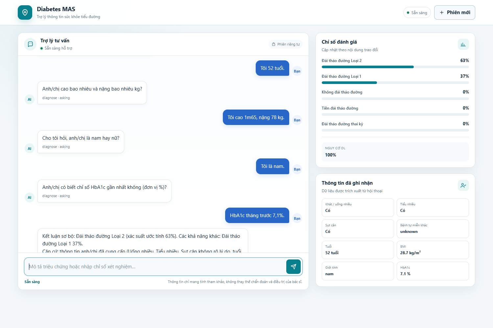

# 09 — Kịch bản demo

> **Mục đích:** trình tự demo bám checklist của thầy, kèm lệnh chạy, câu nói mẫu và phản hồi **đã chạy thử**.
> **Giai đoạn:** 9 · **Cập nhật:** 2026-11-12 (v2: chạy thử trên máy demo, Windows 11 / 16 GB RAM / chỉ CPU)
> Tổng thời lượng dự kiến: 15 phút.

> **Trạng thái triển khai (2026-11-12): ✅ đã chạy thử** — phản hồi ở §2 lấy từ lần chạy thử với `use_llm=false` (luật + câu mẫu). Bật Qwen thì câu chữ hỏi/giải thích tự nhiên hơn nhưng kết luận, xác suất và nguồn giống nhau. ✅ Đã chạy thử có bấm giờ qua API cả hai chế độ (§2.6). ✅ Đã chạy thử trên giao diện web mới với Qwen (§2.6.1, §2.5). ⏳ Còn quay video dự phòng.
>
> **Giao diện trình diễn (22:30, theo yêu cầu người dùng):**
> - Mặc định chỉ hiện: khung chat, xác suất 5 lớp, **Nguy cơ DL** và **Thông tin đã ghi nhận**. LLM luôn bật.
> - Bị ẩn: ô "Dùng LLM", chỉ số **Lượt hỏi / Entropy / Policy**, khung **Nguồn trích dẫn**, ô slot "Bệnh tự miễn khác" và khung "Phân tích lượt vừa rồi" (luồng agent + bảng tool call). Cập nhật 22:50: ẩn thêm nguồn và ba chỉ số này. Cập nhật 23:00: ẩn thêm ô "Bệnh tự miễn khác", vì ô này đôi khi hiện giá trị thô "unknown".
> - **Nhấp vào tên "Diabetes MAS"** ở góc trái trên để hiện lại tất cả; nhấp lần nữa để ẩn.
> - Nhãn giao diện và lời chat hiển thị "Đái tháo đường Loại 2" thay cho "ĐTĐ típ 2". Panel nguồn giữ **nguyên văn** nguồn, nên vẫn ghi "típ".
> - Backend, API và log không đổi.

---

## 0. Chuẩn bị (trước giờ demo)

### 0.1 Tối hôm trước (KB đã nạp sẵn trong `./neo4j_data`, không cần nạp lại)

```bash
cd diabetes_mas
docker compose up -d neo4j searxng           # KHÔNG bật service ollama (Ollama cài trên máy, cổng 11434)
ollama list                                   # phải có qwen2.5:3b
../.venv/Scripts/python -m diabetes_mas.kb.neo4j_io check   # 4/4 kiểm tra chất lượng KB
../.venv/Scripts/python -m pytest -q -m "not network"        # 180+ passed, 1 xfailed (TC-21)
```

Nạp KB lại từ đầu (chỉ khi `neo4j_data` hỏng — mất khoảng 42 giây + embed chunk vài phút):

```bash
docker compose exec neo4j sh -c 'cypher-shell -u neo4j -p "$KB_PASS" -f /import/schema.cypher'
docker compose exec neo4j sh -c 'cypher-shell -u neo4j -p "$KB_PASS" -f /import/kb_diabetes.cypher'
../.venv/Scripts/python -m diabetes_mas.rag.embed_chunks
```

Không pipe file bằng `cat … |` trong PowerShell 5.1 (hỏng tiếng Việt) — dùng `-f` như trên hoặc `python -m diabetes_mas.kb.neo4j_io load`.

### 0.2 Sáng hôm demo (máy 16 GB RAM)

1. **Đóng PyCharm, Chrome thừa, Zalo, Discord** (PyCharm ~2 GB). Cần ~8 GB cho Neo4j + Python + Qwen.
2. Bật dịch vụ và API:
   ```bash
   cd diabetes_mas
   docker compose up -d neo4j searxng
   ../.venv/Scripts/python -m uvicorn diabetes_mas.api.app:app --port 8000
   ```
3. Kiểm tra: `curl http://localhost:8000/v1/health` — Neo4j, Ollama, checkpoint classifier/HRL/DL đều ok (web demo hiện cùng thông tin ở thanh trạng thái).
4. **Làm nóng** (tránh lượt đầu chậm vì nạp model): mở `http://localhost:8000`, gửi một câu tư vấn bất kỳ ("Tiền đái tháo đường là gì?") rồi tạo phiên mới.

Mở sẵn các tab: Web demo `http://localhost:8000` · Neo4j Browser `http://localhost:7474` (chỉ mở được trên chính máy demo; đăng nhập user `neo4j`, mật khẩu = `NEO4J_PASSWORD` trong `diabetes_mas/.env`) · `docs/09_ARCHITECTURE.md` · `docs/02_AGENT_DESIGN.md` · `docs/08_EVALUATION.md` · `diabetes_mas/logs/agent_runs/samples/demo-story1-chan-doan.md`.

## 1. Trình tự

| # | Thời gian | Nội dung | Mục checklist của thầy | Thao tác |
|---|---|---|---|---|
| 1 | 1′ | Bài toán & nguồn dữ liệu: Vinmec (302 bài, nguồn tiếng Việt chính), QĐ 3280/2011 Bộ Y tế, WHO 2016, Hetionet | — | `00_DATA_SOURCES.md` mục 1 |
| 2 | 2′ | Kiến trúc tổng thể: 6 lớp, 17 agent, 15 tool; luật trước – LLM sau | Giải thích kiến trúc | `09_ARCHITECTURE.md` §1–2 |
| 3 | 1′ | Nạp KB từ file `.cypher` | Khởi động Neo4j, nạp KB | Chiếu `kb/kb_diabetes.cypher`, chiếu lệnh §0.1 (không chạy lại — 42 s + embed) |
| 4 | 1′ | Giải thích schema | Mở file KB_Graph | `00_KB_GRAPH.md` mục 1–3 |
| 5 | 2′ | Show đồ thị | Show Neo4j Browser | Chạy truy vấn ở `00_KB_GRAPH.md` mục 7 (toàn cảnh típ 2; triệu chứng phân biệt típ 1/2; tiêu chuẩn chẩn đoán kèm nguồn) |
| 6 | 2′ | Đa agent phân cấp: Main + 4 Work-Agent, reward entropy, luật điều phối "chưa có xét nghiệm thì chưa kết luận" | Giải thích kiến trúc đa agent | `02_AGENT_DESIGN.md` mục 1–2, 6 |
| 7 | 2′ | Demo tư vấn: TC-20, TC-22, TC-23 (§2.2) | Demo KB + RAG | Web demo, mở panel "nguồn" và "tool call" |
| 8 | 1′ | RAG giao tiếp với KB: liên kết thực thể → graph fact → vector + chunk MENTIONS → `enough` | Cơ chế RAG ↔ KB | `06_KB_RAG_INTEGRATION.md` mục 2 + `08_EVALUATION.md` §3 (biểu đồ ngưỡng) |
| 9 | 2′ | Demo chẩn đoán: Story 1 (§2.1), rồi ca cấp cứu (§2.3) | Demo end-to-end | Web demo, chỉ bảng slot và xác suất. **Nhấp "Diabetes MAS"** để hiện entropy, lượt hỏi, policy, nguồn và log tool (bảng tool call có dòng T-15) |
| 10 | 1′ | Mô hình: layer, epoch, đường học, bảng baseline | Mô hình bổ sung | `09_MODEL_NOTES.md`, `08_EVALUATION.md` §4 (`assets/curve_hrl.png`) |

## 2. Câu nói mẫu và phản hồi đã chạy thử

### 2.1 Story 1 — chẩn đoán (4 câu hỏi, ~4 lượt)

| Lượt | Người dùng gõ | Hệ thống (chạy thử `use_llm=false`) |
|---|---|---|
| 1 | "Dạo này tôi khát nước suốt, đi tiểu nhiều, sụt 3 kg trong tháng." | "Anh/chị năm nay bao nhiêu tuổi?" (NLU đã ghi: uống nhiều, tiểu nhiều, sụt cân) |
| 2 | "Tôi 52 tuổi." | "Anh/chị cao bao nhiêu và nặng bao nhiêu kg?" |
| 3 | "Tôi cao 1m65, nặng 78 kg." | "Cho tôi hỏi giới tính của anh/chị?" (BMI 28,7 tự tính) |
| 4 | "Tôi là nam." | "Anh/chị có biết chỉ số HbA1c gần nhất không (đơn vị %)?" — W2 xét nghiệm được chọn ngay |
| 5 | "HbA1c tháng trước 7,1%." | **"Kết luận sơ bộ: Đái tháo đường típ 2 (xác suất ước tính 63%). Các khả năng khác: Đái tháo đường típ 1 37%. Căn cứ: … HbA1c = 7,1 (ngưỡng HbA1c > 6,5 %, nguồn VMC-0002) [10]. Khuyến nghị: đi khám chuyên khoa Nội tiết – Đái tháo đường…"** + dòng "Mô hình học sâu (tham khảo)" + câu miễn trừ |

Điểm cần chỉ khi demo: 3 câu đầu là **intake cố định** (không tính T_max); câu 4 là **policy HRL** chọn W2; hệ **không được kết luận khi chưa có giá trị xét nghiệm** (`labs_ready`); kết luận dựa trên luật KB có nguồn (`rule_hits`), mô hình DL chỉ tham khảo.

> Nếu ai hỏi "sao không hỏi tiền sử gia đình?": khi đã có HbA1c đạt tiêu chuẩn và classifier đủ chắc, policy học được rằng hỏi thêm không đổi kết luận (reward −1/lượt). Kết luận vẫn khuyên đi khám xác định.

### 2.2 Tư vấn (đo 20:10–20:18: ~6,4 s không LLM — toàn bộ là T-04; với Qwen 14–21 s — xem §2.6)

| TC | Người dùng gõ | Kỳ vọng (đã chạy thử) |
|---|---|---|
| TC-20 | "Tiêu chuẩn chẩn đoán tiểu đường là gì?" | Liệt kê glucose đói ≥ 7 mmol/L, OGTT 2h ≥ 11,1, glucose bất kỳ ≥ 11,1, HbA1c > 6,5 % — mỗi ý có `[n]` (Bộ Y tế QĐ 3280 / Vinmec) |
| TC-22 | "Metformin có tác dụng phụ gì?" | Graph fact "Metformin được dùng điều trị ĐTĐ típ 2" + đoạn QĐ 3280 về Metformin, có `[n]` |
| TC-23 | "Cách chữa ung thư phổi?" | **Từ chối phạm vi** ngay ở Router (luật, cả hai chế độ): "Xin lỗi, tôi chỉ hỗ trợ các câu hỏi liên quan đến bệnh đái tháo đường (tiểu đường)…" — đường đi `nlu → router → out_of_scope`, **không** qua RAG. Câu từ chối "Tôi chưa có đủ thông tin đáng tin cậy…" (cosine < 0,825) chỉ xảy ra với câu *trong phạm vi* nhưng KB không có căn cứ (`08` §4.2) |

### 2.3 Cấp cứu (1 lượt)

"Tôi đường huyết 25 mmol/L, đang buồn nôn, thở dốc" ⇒ dừng ngay, không hỏi thêm: "Các dấu hiệu bạn mô tả có thể là biến chứng cấp tính của đái tháo đường cần được cấp cứu. Hãy gọi 115…" (TC-34).

### 2.4 Ca dự trữ — thai kỳ (dài, chỉ dùng nếu được hỏi)

"Tôi đang mang thai 28 tuần, đường huyết lúc đói 5,3 mmol/L, có bị tiểu đường thai kỳ không?" ⇒ hỏi tuổi, chiều cao/cân nặng (không hỏi giới tính), rồi **~6 câu triệu chứng/nguy cơ** (trả lời "Không ạ") ⇒ "Đái tháo đường thai kỳ (95%) … Glucose huyết tương lúc đói = 5,3 (ngưỡng ≥ 5,1 mmol/L, nguồn VMC-0003)". Giới hạn đã biết: ca thai kỳ cần nhiều lượt (`08` §7).

### 2.5 Ảnh minh họa (chụp lại 2026-11-12 22:35 với giao diện trình diễn)

Ảnh chụp bằng Chrome headless (puppeteer, script kiểm tra ở scratchpad phiên này):

- Story 1 chạy với Qwen.
- TC-20 và TC-34 chạy với `?llm=0`.

`scripts/shots.js` cũ bấm vào ô `#useLlm`, nay ô này đã ẩn. Vì vậy chỉ chạy được khi không truyền `--no-llm`.

| Ảnh | Nội dung |
|---|---|
| `assets/demo_story1.png` | Story 1, giao diện trình diễn. Bên trái là khung chat, kết luận "Đái tháo đường Loại 2 (63%)". Bên phải gồm: **Chỉ số đánh giá** (xác suất 5 lớp — Loại 2 63 %, Loại 1 37 %; nguy cơ DL 100 %) và **Thông tin đã ghi nhận** (slot: uống nhiều, tiểu nhiều, sụt cân, 52 tuổi, BMI 28,7, nam, HbA1c 7,1 %) |
| `assets/demo_story1_chitiet.png` | Cùng Story 1 sau khi nhấp "Diabetes MAS". Hiện thêm:<br>– ô "Dùng LLM";<br>– lượt hỏi 1/12, entropy 0,66, policy `hrl_dqn`;<br>– **Nguồn trích dẫn** [1]–[10] (nguyên văn);<br>– **Phân tích lượt vừa rồi**: luồng `nlu → router → tracker → main`, bảng tool call có T-08, **T-15**, T-03, T-04, T-09 |
| `assets/demo_tuvan.png` | TC-20 (`?llm=0`): tiêu chuẩn chẩn đoán kèm `[n]` (QĐ 3280, Vinmec). Danh sách nguồn ẩn, nhấp tên để xem |
| `assets/demo_capcuu.png` | TC-34: cảnh báo cấp cứu (khung đỏ) ngay lượt đầu; slot Buồn nôn, Thở nhanh, Đường huyết bất kỳ 25 mmol/L; T-09 `RED FLAG` |
| `assets/kb_dtd_tip2.png`, `assets/kb_schema.png` | Thay ảnh Neo4j Browser nếu không mở được (vẽ từ dữ liệu Neo4j thật, `devtools/plot_kb`) |

Ảnh Story 1 (chụp lại) cho thấy T-04 mất **6,7 s** ở lượt kết luận dù đã làm nóng — đo khi máy chỉ còn ~1,4 GB RAM trống (`08` §7). Ảnh cũ (lần nạp bge-m3 đầu tiên) là 12,6 s ⇒ vẫn phải **làm nóng** (§0.2) và tắt ứng dụng nặng trước khi demo.



### 2.6 Biên bản chạy thử có bấm giờ (2026-11-12, `scripts/rehearse_demo.py`, gọi API như web demo)

Điều kiện: máy demo, Neo4j + uvicorn + Ollama `qwen2.5:3b` (`keep_alive` 30 phút), **còn ~1,4 GB RAM trống** (Codex, PyCharm, pytest chạy song song) — số đo là trường hợp xấu; đo lại sáng hôm demo sau khi tắt ứng dụng nặng. Đã làm nóng trước (câu tư vấn đầu 25,8 s; lần sau 6–10 s).

| Bước | Câu | Qwen (20:16, s) | Không LLM (20:12, s) | Kết quả |
|---|---|---|---|---|
| Story 1 · 1 | "Dạo này tôi khát nước suốt…" | 16,1 | 0,0 | ✅ hỏi tuổi; uống nhiều, tiểu nhiều, sụt cân |
| Story 1 · 2 | "Tôi 52 tuổi." | 2,6 | 0,0 | ✅ hỏi chiều cao/cân nặng |
| Story 1 · 3 | "Tôi cao 1m65, nặng 78 kg." | 2,4 | 0,0 | ✅ BMI 28,7; hỏi giới tính |
| Story 1 · 4 | "Tôi là nam." | 2,6 | 0,0 | ✅ hỏi HbA1c (W2) |
| Story 1 · 5 | "HbA1c tháng trước 7,1%." | 12,9 | 6,4 | ✅ ĐTĐ típ 2 63 %, HbA1c = 7,1 (VMC-0002) — xem lưu ý dưới |
| TC-20 | "Tiêu chuẩn chẩn đoán tiểu đường là gì?" | 20,9 | 6,4 | ✅ có `[n]` |
| TC-22 | "Metformin có tác dụng phụ gì?" | 14,5 | 6,4 | ✅ có `[n]` |
| TC-23 | "Cách chữa ung thư phổi?" | 4,6 | 0,0 | ✅ từ chối phạm vi (Router) |
| TC-34 | "Tôi đường huyết 25 mmol/L, đang buồn nôn, thở dốc" | 3,0 | 0,0 | ✅ cảnh báo cấp cứu, gọi 115 |
| **Tổng** | | **79,6** | **19,2** | 9/9 |

**Lưu ý Story 1 · 5 (lỗi `07` §6 #15):** lần chạy 20:10 Qwen viết "HbA1c của bạn là **7,4%**" (người dùng gõ 7,1). Đã thêm `consult.numbers_ok` ⇒ câu có số lạ bị loại, dùng template; lần chạy 20:16 lượt này ra đúng template như chế độ không LLM.

#### 2.6.1 Chạy thử sau đóng băng (22:05–22:14, code `demo-freeze` = `27b280e`, Qwen)

Điều kiện: uvicorn vừa khởi động lại; RAM trống 3,0 GB lúc bắt đầu và **0,7 GB** lúc chạy lần 2 (PyCharm 1,6 GB, Chrome vẫn mở). Có hai lần chạy:

- **(a) Giao diện web thật:** Chrome headless (puppeteer) gõ từng câu vào `http://localhost:8000`, ô "Dùng LLM" được chọn. **Cố ý không làm nóng.**
- **(b) API:** chạy `scripts/rehearse_demo.py`, có làm nóng 10,4 s. Kết quả ở `logs/rehearsal_llm_2214.json`.

| Bước | (a) Web, chưa làm nóng (s) | (b) API, đã làm nóng (s) | T-04 ở (b) (s) | Kết quả |
|---|---|---|---|---|
| Story 1 · 1 | 14,0 | 5,8 | — | ✅ hỏi tuổi |
| Story 1 · 2–4 | 2,7 / 2,5 / 2,6 | 2,6 / 2,4 / 2,6 | — | ✅ hỏi chiều cao/cân nặng → giới tính → HbA1c |
| Story 1 · 5 | **34,4** (T-04 **26,1**) | 14,1 | 6,5 | ✅ ĐTĐ típ 2 63 %, HbA1c = 7,1 (VMC-0002), DL 100 % |
| TC-20 | 22,9 | 21,7 | 6,5 | ✅ có `[n]` |
| TC-22 | 14,2 | 13,4 | 6,4 | ✅ có `[n]` |
| TC-23 | 4,6 | 4,5 | — | ✅ từ chối phạm vi |
| TC-34 | 3,2 | 3,0 | — | ✅ cảnh báo cấp cứu, gọi 115 |
| **Tổng** | **101,2** | **70,1** | | 9/9 ở cả hai lần; web không có lỗi console hay HTTP ≥ 400 |

Kết luận:

- Giao diện mới chạy đúng với Qwen. Panel xác suất, slot, luồng agent, tool call và nguồn đều hiển thị.
- **Lần gọi T-04 đầu tiên sau khi khởi động uvicorn mất khoảng 26 s** (nạp bge-m3). Vì vậy **bắt buộc làm nóng (§0.2)** sau mỗi lần khởi động lại server. Nếu không, lượt kết luận Story 1 sẽ vượt ngưỡng 30 s ở §3.
- Chất lượng câu Qwen ở TC-20: có ý lặp lại (HbA1c > 6,5 % xuất hiện nhiều lần). Mọi ý vẫn có `[n]` và không có số lạ.

## 3. Phương án dự phòng

| Sự cố | Dấu hiệu | Xử lý |
|---|---|---|
| **Qwen chậm / thiếu RAM** | Một lượt > 30 s, máy giật | **Chuyển chế độ không LLM**. Trong web demo, ô "Dùng LLM" đang ẩn, có hai cách:<br>(1) Gõ địa chỉ **`http://localhost:8000/?llm=0`** rồi Enter. Trang mở phiên mới và gửi `use_llm: false`; đã thử thật lúc 22:35, request gửi `use_llm=false`.<br>(2) **Nhấp "Diabetes MAS"** để hiện ô, rồi bỏ chọn ô "Dùng LLM". Cách này giữ nguyên phiên đang chạy.<br>Cũng có thể gọi API trực tiếp: `curl -X POST localhost:8000/v1/sessions/<id>/messages -H "Content-Type: application/json" -d "{\"text\": \"…\", \"use_llm\": false}"`. Hệ chạy bằng luật + câu mẫu + trả lời trích xuất — kết luận, xác suất, nguồn không đổi (§2 chạy thử ở chế độ này) |
| **Lượt kết luận ở chế độ Qwen nghi ngờ sai số liệu** | Câu giải thích có con số khác với số người dùng đã gõ | Nhấp **"Diabetes MAS"** rồi bỏ chọn ô **"Dùng LLM"** trước khi gõ câu xét nghiệm cuối (Story 1 lượt 5): kết luận dùng template — đúng số, đúng nguồn, như §2.1. Hệ đã tự chặn số lạ có đơn vị (`numbers_ok`, `07` §6 #15) |
| Ollama tắt hẳn | `/v1/health` báo Ollama lỗi | Hệ tự dùng dự phòng (NLU/Router luật, NLG câu mẫu, Consult trích xuất) — không cần làm gì; nói rõ khi demo |
| Neo4j lỗi | Câu tư vấn trả "Hệ thống tra cứu đang tạm gián đoạn" | `docker compose restart neo4j`, chờ healthcheck (~30 s). Còn hỏng: nạp dump `neo4j-admin database load` (⏳ tạo dump khi sao lưu) |
| Web demo lỗi | Trang trắng / 500 | Chiếu log mẫu `logs/agent_runs/samples/demo-story1-chan-doan.md`, `demo-story3-tu-van.md`, `demo-story5-cap-cuu.md` hoặc video dự phòng |
| Mất mạng | — | Không ảnh hưởng (chỉ AG-12 tìm web cần mạng; câu demo không cần) |

`use_llm` mặc định `true` (ô được chọn sẵn, đang ẩn; `?llm=0` để tắt). URL `?chitiet` mở sẵn khung chi tiết. Thanh trạng thái trên web demo hiện `Neo4j ✓ · Ollama ✓ (qwen2.5:3b) · classifier ✓ · HRL ✓ · DL ✓` — kiểm tra trước khi bắt đầu.

## 4. Câu hỏi giám khảo có thể hỏi

| Câu hỏi | Trả lời ngắn | Nguồn |
|---|---|---|
| Khi nào hệ dừng hỏi? | (1) Đã có ít nhất một giá trị xét nghiệm hoặc đã hỏi hết xét nghiệm (`labs_ready`) **và** Main chọn CLASSIFY; (2) đã có xét nghiệm và classifier chắc ≥ 0,95 (`confident_stop`); (3) hết T_max = 12 câu; (4) có dấu hiệu cấp cứu | `02_AGENT_DESIGN.md` §6, `configs/slots.yaml` |
| HRL có tốt hơn không phân cấp? | Test HRL 0,782 / 3,4 lượt, Flat DQN 0,751 / 3,5, Random 0,716 / 12; nhưng val gần bằng nhau và chỉ 1 seed — chưa đủ kết luận. Lợi ích chính: giải thích được, gắn luật theo nhóm | `08_EVALUATION.md` §4.1, §6 |
| Có bịa không? | Tư vấn bắt buộc `[n]` trong context; chấm mẫu 20 câu: nội dung có căn cứ 0,95, nhưng `[n]` trỏ đúng nguồn chỉ 0,65 | `08` §4.2 |
| Sao HbA1c dùng ">" mà không "≥"? | Theo đúng nguồn Vinmec VMC-0002; ADA dùng "≥"; QĐ 3280/2011 không có tiêu chí HbA1c — đã ghi trong `kb/seed/criteria.csv` | `00_KB_GRAPH.md` |
| Mô hình DL dùng làm gì? | Chỉ tham khảo, không thay luật KB (ADR-002); F1 0,625 < luật ngưỡng 0,820 vì nhãn dataset sinh từ chính ngưỡng đó | `08` §4.3 |

## 5. Checklist cuối

- [ ] Khởi động Neo4j, nạp KB từ `kb_diabetes.cypher` (chiếu lệnh; dữ liệu đã nạp sẵn)
- [ ] Mở `00_KB_GRAPH.md` giải thích cấu trúc đồ thị
- [ ] Show Neo4j Browser — visualize nodes/relationships
- [ ] Chạy demo KB + RAG end-to-end với câu hỏi mẫu (§2.2)
- [ ] Demo chẩn đoán Story 1 (§2.1) và cấp cứu (§2.3)
- [ ] Giải thích kiến trúc đa agent
- [ ] Giải thích cơ chế RAG giao tiếp với KB
- [ ] Trình bày layer/epoch và kết quả huấn luyện
