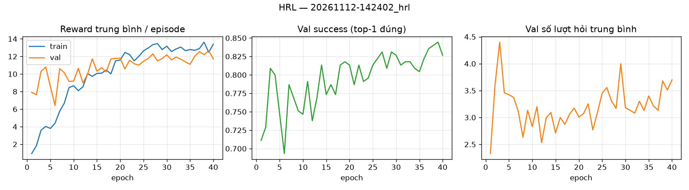
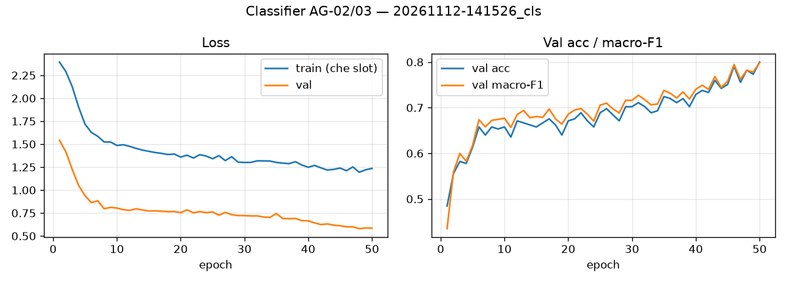

# 09 — Ghi chú mô hình: kiến trúc mạng, layer, epoch, siêu tham số

> **Mục đích:** mô tả các mạng học được trong hệ (số layer, kích thước), cách huấn luyện (epoch, batch…) — phần "Mô hình — Bổ sung" thầy yêu cầu.
> **Giai đoạn:** 5 (thiết kế) & 9 (trình bày) · **Cập nhật:** 2026-11-12
> §2–3 là cấu hình đã chạy (`configs/train.yaml`); §5 ghi epoch thực tế và run tốt nhất (`experiments/best/`).

> **Trạng thái triển khai (2026-11-12): ✅ đã có code và đã huấn luyện** tất cả các mạng ở §2 và §2b; đường học ở §4 đã vẽ (`docs/assets/curve_*.png`). Đồng bộ với `experiments/best/*_meta.json` và bảng chính `08_EVALUATION.md` §4.1 (bộ ca v2, GĐ 8).

---

## 1. Thuật ngữ

| Thuật ngữ | Nghĩa trong dự án này |
|---|---|
| **Epoch** | Classifier: 1 lượt duyệt hết `train.jsonl`. HRL: 1 epoch = `episodes_per_epoch` hội thoại mô phỏng (mặc định = số ca train), sau mỗi epoch chạy đánh giá trên `val.jsonl`. |
| **Layer** | Lớp ẩn fully-connected trong MLP. "2 layer × 256" = hai lớp ẩn, mỗi lớp 256 nơ-ron. |
| **Episode** | Một hội thoại từ lượt đầu tới khi kết luận hoặc chạm T_max. |
| **Step** | Một hành động của agent (một câu hỏi hoặc một lần giao quyền). |

Lưu ý: Qwen (LLM) và bge-m3 (embedding) là mô hình **có sẵn, không huấn luyện lại**; chỉ nêu số layer để tham khảo. Phần huấn luyện của dự án là các mạng ở mục 2.

## 2. Các mạng huấn luyện

`d_s` = **122** (chốt ở `02_AGENT_DESIGN.md` §3; in lại bằng `python -m diabetes_mas.agents.slots`). Không gian hành động: Main 5; Worker W1..W4 lần lượt 5 / 6 / 14 / 7 (kể cả `RETURN`).

| Mạng | Agent | Input | Kiến trúc (layer) | Output | Hàm mất mát |
|---|---|---|---|---|---|
| Main policy | AG-01 | `d_s` | Linear(d_s,256) → ReLU → Linear(256,256) → ReLU → Linear(256, H+1) | Q-value cho W1..W4, CLASSIFY | Huber (DQN, double + target net) |
| Worker policy h | AG-Wh | `d_s` (mỗi Worker một mạng riêng, **không** dùng one-hot h) | Linear(d_s,256) → ReLU → Linear(256,128) → ReLU → Linear(128, N_h + 1) | Q-value cho slot nhóm h + RETURN | Huber (DQN, double + target net) |
| Sub-classifier h | AG-03-h | phần mã hóa slot nhóm h (W1..W4: 12 / 15 / 52 / 18 chiều) | Linear → 64 → ReLU → Dropout(0.2) → 5 | logits 5 lớp | Cross-entropy |
| Main classifier | AG-02 | phần **slot** của trạng thái (109 chiều, không gồm `p_t`, lượt, Worker) + 4×5 sub-probs = 129 | Linear → 256 → ReLU → Dropout(0.3) → 128 → ReLU → 5 | logits 5 lớp | Cross-entropy (main) + 0,5 × trung bình CE (sub) |

Tổng: 2 lớp ẩn cho policy và Main classifier, 1 lớp ẩn cho Sub-classifier. Số tham số đếm được: Main policy 98.565; Worker W1..W4 65.029 / 65.158 / 66.190 / 65.287; bộ classifier (AG-02 + 4 AG-03-h) 74.585. Tất cả huấn luyện trên CPU.

AG-02 không nhận `s_t` đầy đủ vì `p_t` nằm trong `s_t` chính là đầu ra của nó (vòng lặp), còn lượt và Worker đang giữ quyền không mang thông tin bệnh.

## 2b. Mô hình Deep Learning dự đoán nguy cơ (AG-13, FR-17)

| Thành phần | Thiết kế |
|---|---|
| Dữ liệu | SRC-KAGGLE, khử trùng → 96.146 dòng; chia phân tầng 70/15/15; seed 42 |
| Đặc trưng đầu vào | 6 số (`age, bmi, HbA1c_level, blood_glucose_level, hypertension, heart_disease`) chuẩn hóa z-score (thống kê từ train) + one-hot `gender` (3) và `smoking_history` (6) → **15 chiều** (biến thể `no_labs`: 13 chiều) |
| Kiến trúc | Linear(15→64) → ReLU → Dropout(0.2) → Linear(64→32) → ReLU → Dropout(0.2) → Linear(32→1) → Sigmoid |
| Số **layer** | 2 lớp ẩn (64, 32) + 1 lớp ra; 3.137 tham số (`no_labs`: 3.009) |
| Hàm mất mát | Binary Cross-Entropy có `pos_weight` = N_âm / N_dương = 10,34 trên tập train (bù mất cân bằng) |
| Tối ưu | Adam, lr 1e-3, batch 256 (mini-batch gradient descent — Q7) |
| **Epoch** | Tối đa 50; early stopping patience 5 theo **PR-AUC trên val** (Q8) |
| Ngưỡng quyết định | Chọn trên val để recall lớp dương ≥ 0,90, sau đó tối đa precision |
| Đầu ra | `P(diabetes = 1)` |
| Lưu | `experiments/runs/<run_id>/dl/` (checkpoint, scaler, `metrics.json`, `curve.csv`) |

Mô hình nhỏ có chủ đích: dữ liệu bảng 8 cột không cần mạng sâu. Phải so với baseline luật D1 (`08_EVALUATION.md` §1.3) để biết mạng học được gì ngoài ngưỡng có sẵn trong dataset.

## 3. Siêu tham số khởi điểm (`configs/train.yaml`)

```yaml
seed: 42
classifier:
  epochs: 50
  batch_size: 128
  lr: 1.0e-3                       # Adam
  weight_decay: 1.0e-4
  early_stopping_patience: 5       # theo val macro-F1
  slot_mask_prob: [0.0, 0.8]       # che ngẫu nhiên slot khi train → mô phỏng thông tin chưa đầy đủ
  sub_loss_weight: 0.5             # loss = CE(main) + 0,5 · mean CE(sub_h)
hrl:
  epochs: 40                       # khởi điểm 100; 40 đủ hội tụ (§5)
  episodes_per_epoch: 700
  # T_max, max_sub_turns, intake_slots: KHÔNG khai báo ở đây — nguồn duy nhất là configs/slots.yaml → dialog
  gamma: 0.95
  lr: 5.0e-4
  batch_size: 64
  replay_size: 50000
  warmup_steps: 500
  train_every: 2
  target_update_every: 500         # step
  epsilon: {start: 1.0, end: 0.05, decay_epochs: 20}
  val_episodes: 225
  reward: {turn: -1, hit: 1, entropy_lambda: 2.0, success: 20, fail: -20}
  classifier_finetune: false       # v1: giữ classifier cố định trong HRL để reward ổn định
```

Quy trình: (1) huấn luyện có giám sát classifier trước với `slot_mask_prob` → (2) huấn luyện HRL với classifier **cố định** (`classifier_finetune: false`) → (3) chọn checkpoint theo **val success cao nhất, hòa thì ít lượt hơn**; `train_hrl` chỉ thay `experiments/best/hrl/` khi val tốt hơn best hiện tại (GĐ 8).

## 4. Kết quả huấn luyện (biểu đồ)

| Biểu đồ | File | Sinh bằng |
|---|---|---|
| HRL: reward train/val, val success, val số lượt theo epoch | `docs/assets/curve_hrl.png` | `devtools/plot_eval` |
| Classifier: loss train/val, val acc / macro-F1 theo epoch | `docs/assets/curve_classifier.png` | `devtools/plot_eval` |
| Quét ngưỡng tư vấn | `docs/assets/min_score_sweep.png` | `devtools/plot_eval` |
| Entropy trung bình theo lượt | ⏳ chưa vẽ | — |





Đọc biểu đồ HRL: ε giảm tuyến tính tới epoch 20 nên reward train tăng dần rồi ổn định; val success dao động 0,70–0,85 và chọn epoch 39 (val 0,844). Loss train của classifier cao hơn val vì lúc train **che slot ngẫu nhiên** (p ~ U(0; 0,8)), còn val đánh giá trên trạng thái cố định.

**Ma trận nhầm lẫn classifier** (test 225 ca, che slot + luật KB, acc 0,764; `experiments/best/classifier_metrics.json` → `test_masked_rules`):

| Thật \ Dự đoán | Không ĐTĐ | Tiền ĐTĐ | Típ 1 | Típ 2 | Thai kỳ |
|---|---|---|---|---|---|
| **Không ĐTĐ** | 40 | 12 | 0 | 3 | 3 |
| **Tiền ĐTĐ** | 8 | 32 | 0 | 3 | 6 |
| **Típ 1** | 0 | 0 | 22 | 4 | 0 |
| **Típ 2** | 1 | 5 | 6 | 52 | 1 |
| **Thai kỳ** | 1 | 0 | 0 | 0 | 26 |

Nhầm nhiều nhất giữa **Không ĐTĐ ↔ Tiền ĐTĐ** (khi che xét nghiệm, hai lớp gần như chỉ khác nhau ở chỉ số) và **típ 1 ↔ típ 2** (08 §7).

## 5. Bảng ghi lại cấu hình cuối

| Mạng | Layer ẩn | Nơ-ron | Epoch thực tế | Batch | LR | Run |
|---|---|---|---|---|---|---|
| Main policy (AG-01) | 2 | 256, 256 | 40 (tốt nhất: epoch 39) | 64 | 5e-4 | `20261112-142402_hrl` |
| Worker policy W1..W4 | 2 | 256, 128 | như Main (huấn luyện chung) | 64 | 5e-4 | `20261112-142402_hrl` |
| Main classifier (AG-02) | 2 | 256, 128 | 50 (chạy đủ, không dừng sớm) | 128 | 1e-3 | `20261112-141526_cls` |
| Sub-classifier (AG-03-h) | 1 | 64 | 50 (huấn luyện chung với AG-02) | 128 | 1e-3 | `20261112-141526_cls` |
| DL `full` (AG-13) | 2 | 64, 32 | 32 (early stopping) | 256 | 1e-3 | `20261112-072147_dl` |
| DL `no_labs` (AG-13) | 2 | 64, 32 | 21 (early stopping) | 256 | 1e-3 | `20261112-072147_dl` |
| Baseline B1 Flat DQN | 2 | 256, 256 | 40 (tốt nhất: epoch 18); 29 hành động; 104.733 tham số | 64 | 5e-4 | `20261112-164238_flatdqn` |

Kết quả tương ứng (bộ ca v2, cấu hình cuối; chi tiết và so sánh baseline ở `08_EVALUATION.md` §4.1):

| Mạng | Chỉ số chọn checkpoint (val) | Test |
|---|---|---|
| HRL (+ luật điều phối `labs_ready`, W2, `confident_stop`) | success 0,862, 3,16 lượt | success **0,782**, 3,32 lượt. So sánh: B0' luật 0,853 / 10,7 lượt; B1 Flat DQN 0,751 / 3,54; B0 Random 0,698 / 11,5. **1 seed** |
| Classifier | macro-F1 (masked) 0,7985 | acc che slot + luật **0,764**; đủ slot + luật **0,853** (NB từ KB: 0,716 / 0,831) |
| DL `full` | PR-AUC | PR-AUC 0,885, F1 0,625, recall 0,91 (baseline luật D1: F1 0,820) |
| DL `no_labs` | PR-AUC | PR-AUC 0,336 |
| E2E qua toàn hệ thống (HRL) | — | câu mẫu 225 ca: 0,796 / 3,48 lượt; Qwen 20 ca: 0,750 / 3,70 (đo trước sửa `nlu.DURATION`) |

Run cũ (bộ ca v1, GĐ 7): HRL `20261112-072602_hrl` (test 0,698 / 3,6 lượt), classifier `20261112-071840_cls` (che slot + luật 0,707) — lịch sử ở `08_EVALUATION.md` §4.1, §5.

Checkpoint đang dùng nằm ở `experiments/best/` (`classifier.pt`, `hrl/hrl.pt`, `dl/full.pt`, `dl/no_labs.pt`), kèm `*_meta.json` ghi `run_id`.
