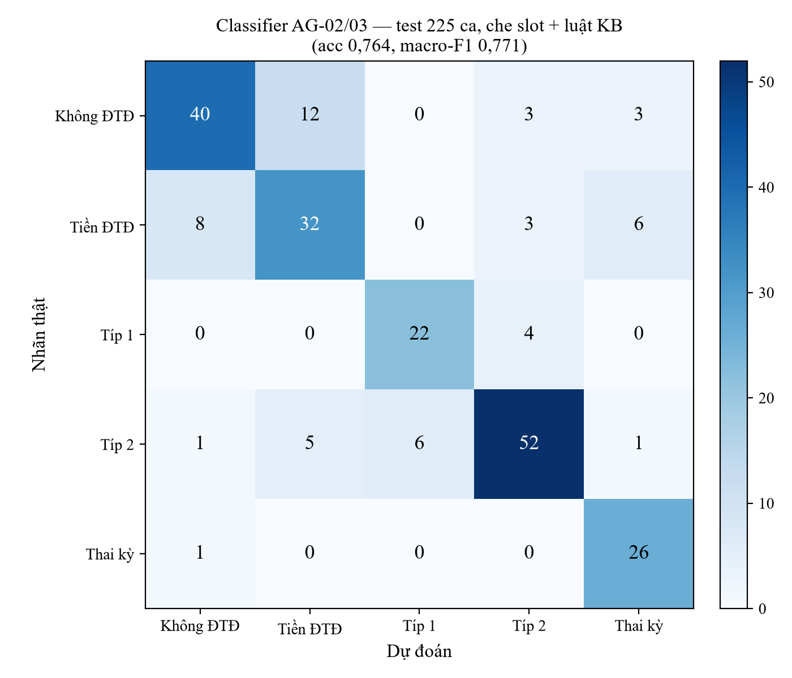
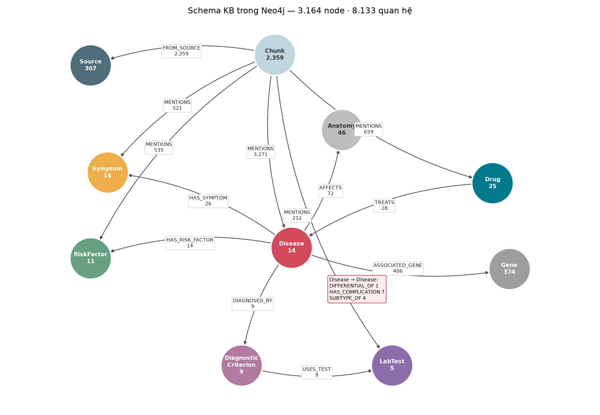
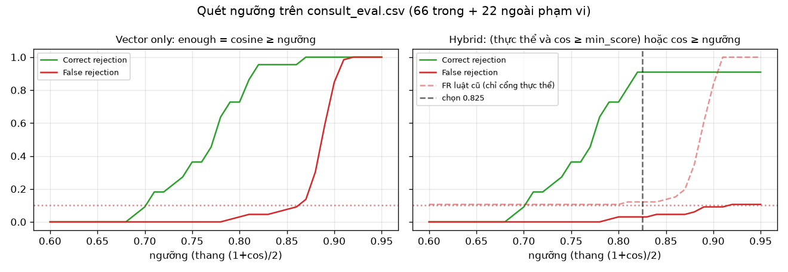
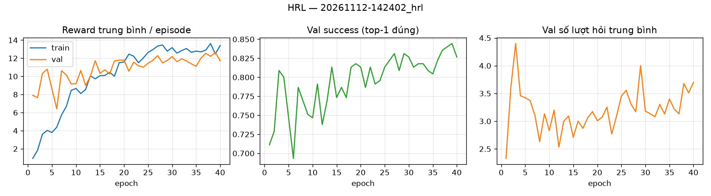
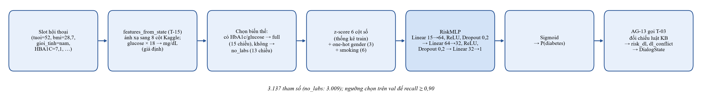
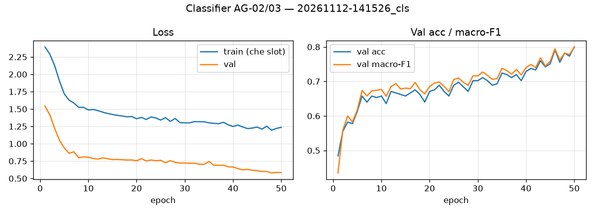
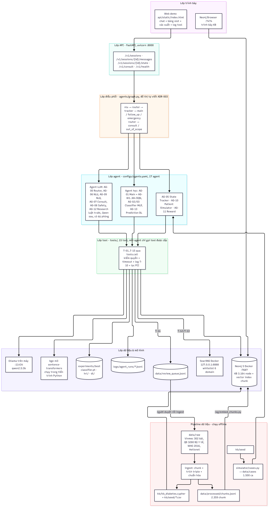

# TIỂU LUẬN — HỌC MÁY, BIỂU DIỄN TRI THỨC VÀ HỆ ĐA AGENT (ỨNG DỤNG: CHẨN ĐOÁN VÀ TƯ VẤN TIỂU ĐƯỜNG)

> **Bản làm việc.** Bố cục theo mẫu tiểu luận của học phần: Phần I và II là nền tảng có thực nghiệm, Phần III là phát triển hệ thống.
>
> **Phạm vi nội dung:** phần thực nghiệm và hệ thống **chỉ lấy từ `docs/` và tệp kết quả của repo này** (hệ `diabetes_mas`, cập nhật tới 2026-11-13). Mẫu tham khảo có các thực nghiệm mà dự án này **không có** (CNN, RNN/LSTM, GNN/Cora, dự báo chứng khoán/vàng, giá nhà). Các chương đó chỉ trình bày **lý thuyết**, không có kết quả thực nghiệm. Đây đúng là phạm vi đã chốt trong `docs/01_REQUIREMENTS.md` §2.2 và §10: Q1–Q18 (ML/DL, CNN/RNN/LSTM) trả lời bằng lý thuyết.
>
> Quy ước trong file:
> - `📝 Lý thuyết` — đoạn kiến thức nền chung, **không lấy từ docs của dự án**.
> - `✍️ Thiếu` — thông tin không có trong repo; ghi rõ thiếu gì, không bịa.
> - `⚠` — lưu ý về điều kiện đo của một số liệu.
> - Cuối mỗi mục có dòng **Nguồn:** chỉ tới tài liệu gốc.
>
> **Phân vai với báo cáo Project 01** (`docs/BAO_CAO_PROJECT01.md`): tiểu luận giải thích **nền tảng học và cách đánh giá** (vì sao chọn mô hình, phép chia, chỉ số, cách đọc kết quả); Project 01 đi sâu vào **đường đi của yêu cầu, triển khai, kiểm thử và thao tác demo**. Cùng số liệu, khác góc nhìn — tránh chép nguyên đoạn giữa hai file.

---

## Trang bìa

| Mục | Nội dung |
|---|---|
| Trường | HỌC VIỆN CÔNG NGHỆ BƯU CHÍNH VIỄN THÔNG |
| Khoa | KHOA CÔNG NGHỆ THÔNG TIN 1 |
| Tên báo cáo | TIỂU LUẬN — Học máy, biểu diễn tri thức và hệ đa agent (ứng dụng: Diabetes MAS) |
| Học phần | PHÁT TRIỂN CÁC HỆ THỐNG THÔNG MINH |
| Giảng viên | PGS.TS. Trần Đình Quế |
| Sinh viên | Nguyễn Trường Giang |
| Mã sinh viên | B23DCCN259 |
| Nhóm học phần | 06 |
| Nhóm thực hiện | 16 |
| Thời gian | Hà Nội, tháng 11 năm 2026 |

---

## Mục lục

- Mở đầu
- Danh mục từ viết tắt
- Dữ liệu và phạm vi thực nghiệm
- **Phần I. Nền tảng và tổng hợp**
  1. Lịch sử và phát triển AI
  2. Các kỹ thuật machine learning cơ bản (thực nghiệm: MLP dự đoán nguy cơ, classifier 5 lớp)
  3. Mạng nơ-ron tích chập CNN (chỉ lý thuyết)
  4. Mạng nơ-ron hồi tiếp RNN (chỉ lý thuyết)
- **Phần II. Biểu diễn tri thức và hệ đa agent**
  5. Knowledge graph và RAG (thực nghiệm: KB + RAG tiểu đường)
  6. Học sâu trên đồ thị (chỉ lý thuyết)
  7. Agent, hệ đa agent và học tăng cường (thực nghiệm: HRL trên Patient Simulator)
- **Phần III. Phát triển thực nghiệm và hệ thống**
  8. Thiết kế thực nghiệm tiểu đường
  9. Các mạng học được và phân tích kết quả
  10. Tích hợp mô hình với KB, Neo4j và RAG
  11. Kiểm chứng, tái lập và phát triển tiếp
- Kết luận và hướng phát triển
- Tài liệu tham khảo
- Phụ lục A. Mã nguồn tái lập (chỉ mục)
- Phụ lục B. Mã nguồn chính có chú thích (chỉ mục)

---

## Mở đầu

Tiểu luận nghiên cứu cách kết hợp **học máy**, **học tăng cường** và **biểu diễn tri thức** trong một hệ thống hỗ trợ người dùng, qua một bài toán cụ thể: hệ đa tác tử hội thoại tiếng Việt về bệnh tiểu đường, chạy offline trên laptop.

Bài toán được chọn vì nó buộc phải giải cùng lúc ba câu hỏi:
1. **Học từ dữ liệu:** dự đoán nguy cơ từ dữ liệu bảng (MLP), phân loại 5 lớp bệnh từ thông tin chưa đầy đủ (MLP + luật).
2. **Ra quyết định tuần tự:** hỏi gì tiếp theo để kết luận với ít lượt nhất — một bài toán học tăng cường phân cấp (DQN).
3. **Dùng tri thức có nguồn:** mọi ngưỡng chẩn đoán và mọi câu tư vấn phải truy ngược được về tài liệu y khoa (Neo4j + RAG).

Phần I trình bày nền tảng AI và học máy; thực nghiệm dữ liệu bảng là mô hình dự đoán nguy cơ AG-13 và bộ phân loại AG-02/03. Phần II đi từ Knowledge Graph, RAG tới agent và học tăng cường; thực nghiệm là KB tiểu đường trên Neo4j và chính sách hỏi phân cấp huấn luyện trên Patient Simulator. Phần III ghép các thành phần thành hệ thống, kiểm chứng và nêu giới hạn.

Mọi kết quả trong tiểu luận chỉ có ý nghĩa trong phạm vi dữ liệu và phép chia đã nêu. Dữ liệu chẩn đoán là **mô phỏng**; hệ là công cụ học thuật, **không thay thế** chẩn đoán của nhân viên y tế.

Các chương 1, 3, 4, 6 chỉ trình bày lý thuyết: dự án không có thực nghiệm ảnh, chuỗi thời gian hay học sâu trên đồ thị, và không đưa các mô hình đó vào hệ chỉ để phủ đề mục.

---

## Danh mục từ viết tắt

| Viết tắt | Ý nghĩa |
|---|---|
| AI | Trí tuệ nhân tạo |
| ML / DL | Học máy / học sâu |
| MLP | Mạng nơ-ron nhiều lớp (Multilayer Perceptron) |
| CNN / RNN / LSTM / GRU | Mạng tích chập / hồi tiếp / hai kiến trúc hồi tiếp có cổng |
| KB / KG | Cơ sở tri thức / đồ thị tri thức |
| RAG | Truy xuất tăng cường cho quá trình sinh câu trả lời |
| GNN / GCN | Mạng nơ-ron đồ thị / mạng tích chập đồ thị |
| RL / HRL | Học tăng cường / học tăng cường phân cấp |
| MDP / SMDP | Quá trình quyết định Markov / bán Markov (options) |
| DQN | Deep Q-Network |
| MAS | Hệ đa tác tử (Multi-Agent System) |
| LLM | Mô hình ngôn ngữ lớn |
| ĐTĐ | Đái tháo đường (tiểu đường) |
| OGTT | Nghiệm pháp dung nạp glucose đường uống |
| IFG / IGT | Rối loạn glucose lúc đói / rối loạn dung nạp glucose |
| PR-AUC / ROC-AUC | Diện tích dưới đường precision–recall / ROC |
| F1 | Trung bình điều hòa của precision và recall |
| R@k | Recall tại k (có chunk đúng trong k kết quả đầu) |
| CR / FR | Correct rejection / False rejection (từ chối đúng / từ chối nhầm) |
| AG-xx / T-xx | Mã agent / mã tool trong hệ |
| API | Giao diện lập trình ứng dụng |

---

## Dữ liệu và phạm vi thực nghiệm

| Dữ liệu | Nguồn | Nhiệm vụ | Chương |
|---|---|---|---|
| Diabetes Prediction Dataset | Kaggle `iammustafatz/diabetes-prediction-dataset`, 100.000 dòng (96.146 sau khử trùng) | Phân loại nhị phân có/không ĐTĐ (AG-13) | 2, 9 |
| Ca bệnh mô phỏng | Sinh từ KB + giả định `PRIORS` của nhóm, 1.500 ca (1.050 / 225 / 225) | Phân loại 5 lớp (AG-02/03); huấn luyện chính sách hỏi (HRL); kiểm thử E2E | 2, 7, 9 |
| Kho tri thức tiểu đường | Vinmec (nguồn tiếng Việt chính), Bộ Y tế QĐ 3280/2011, WHO 2016, Hetionet v1.0 | KB trên Neo4j, truy xuất có nguồn | 5, 10 |
| Bộ câu tư vấn tự xây | 88 câu (66 trong phạm vi + 22 ngoài phạm vi) | Đánh giá truy xuất, từ chối, trích dẫn | 5 |
| ✍️ Dữ liệu ảnh / chuỗi / đồ thị | — | **Không có trong dự án này** | 3, 4, 6 |

Đầu ra lưu ở `diabetes_mas/experiments/` (`runs/<id>/`, `best/`, `eval/`). Các chỉ số chỉ có ý nghĩa trong phạm vi từng dữ liệu và phép chia đã công bố.

**Nguồn:** `docs/00_DATA_SOURCES.md` §1, §4–5; `docs/08_EVALUATION.md` §1.2.

---

# Phần I. Nền tảng và tổng hợp

## Chương 1. Lịch sử và phát triển AI

### 1.1 AI là gì

📝 Lý thuyết. Trí tuệ nhân tạo là ngành khoa học máy tính nghiên cứu cách xây dựng hệ thống thực hiện được những việc thường đòi hỏi trí tuệ con người: nhận thức, suy luận, học từ kinh nghiệm, hiểu ngôn ngữ và ra quyết định trong điều kiện bất định. Thuật ngữ ra đời ở Hội thảo Dartmouth năm 1956. Russell và Norvig (*Artificial Intelligence: A Modern Approach*) phân loại các hướng tiếp cận theo hai trục: *suy nghĩ ↔ hành động* và *giống con người ↔ hợp lý*. Từ đó có bốn hướng: suy nghĩ như người, hành động như người (phép thử Turing), suy nghĩ hợp lý (logic), hành động hợp lý (tác tử hợp lý). Hệ trong tiểu luận theo hướng thứ tư: mỗi agent chọn hành động để tối đa một mục tiêu đo được.

### 1.2 Các giai đoạn phát triển

📝 Lý thuyết.

| Giai đoạn | Đặc trưng | Giới hạn dẫn tới giai đoạn sau |
|---|---|---|
| 1956–1970s: AI biểu tượng | Tìm kiếm, logic, chứng minh định lý | Bùng nổ tổ hợp; tri thức phải viết tay |
| 1970s–1980s: hệ chuyên gia | Luật nếu–thì do chuyên gia cung cấp (vd. MYCIN trong y khoa) | Khó bảo trì, giòn khi gặp ca ngoài luật ⇒ "mùa đông AI" |
| 1990s–2000s: học máy thống kê | SVM, cây quyết định, mô hình xác suất; học từ dữ liệu | Phụ thuộc đặc trưng thiết kế tay |
| 2012–nay: học sâu | Mạng nhiều lớp học biểu diễn trực tiếp từ dữ liệu thô | Cần nhiều dữ liệu, khó giải thích |
| 2017–nay: Transformer, mô hình ngôn ngữ lớn | Tiền huấn luyện quy mô lớn, sinh văn bản | Có thể "bịa" (hallucination) ⇒ cần truy xuất có nguồn (RAG) |

### 1.3 Bản đồ phân loại kỹ thuật AI

📝 Lý thuyết. Có thể chia các kỹ thuật AI thành các nhóm sau:
- Tìm kiếm và lập kế hoạch.
- Biểu diễn tri thức và suy luận: luật, logic, ontology, đồ thị tri thức.
- Học máy: có giám sát, không giám sát, học tăng cường.
- Học sâu: MLP, CNN, RNN, Transformer, GNN.
- Xử lý ngôn ngữ tự nhiên.
- Hệ đa tác tử.

Dự án dùng các nhóm sau:
- Biểu diễn tri thức (KB Neo4j).
- Học có giám sát (MLP).
- Học tăng cường (DQN).
- Xử lý ngôn ngữ tự nhiên (Qwen, bge-m3).
- Hệ đa tác tử.

### 1.4 Ba trụ cột của học sâu sau 2012

📝 Lý thuyết. Học sâu bùng nổ sau 2012 nhờ ba yếu tố đến cùng lúc:
- **Dữ liệu lớn có nhãn** (ImageNet).
- **Phần cứng song song** (GPU).
- **Cải tiến thuật toán**: ReLU, dropout, khởi tạo tốt, Adam, batch normalization.

Dự án ở phía ngược lại: dữ liệu nhỏ, chỉ có CPU. Vì vậy các mạng đều nhỏ (3 nghìn – 100 nghìn tham số), và LLM chỉ dùng bản 3B có sẵn.

### 1.5 Phân loại AI theo năng lực và trường phái

📝 Lý thuyết.

**Theo năng lực:**
- AI hẹp: giỏi một nhiệm vụ.
- AI tổng quát: chưa tồn tại.
- Siêu trí tuệ: giả thuyết.

**Theo trường phái:**

| Trường phái | Đặc điểm | Mạnh | Yếu |
|---|---|---|---|
| Biểu tượng | Tri thức tường minh, suy luận bằng luật | Giải thích được | Khó mở rộng |
| Kết nối | Mạng nơ-ron học từ dữ liệu | Linh hoạt | Khó giải thích |

Hệ trong tiểu luận là **lai** (neuro-symbolic): luật KB quyết định kết luận, mạng nơ-ron xử lý phần bất định.

### 1.6 AI tại Việt Nam và thách thức

📝 Lý thuyết. Ứng dụng AI tiếng Việt trong y tế gặp ba khó khăn:
- Thiếu dữ liệu y khoa tiếng Việt có cấu trúc và có giấy phép rõ ràng.
- Yêu cầu riêng tư dữ liệu bệnh nhân.
- Yêu cầu giải thích được và chịu trách nhiệm.

Dự án xử lý như sau:
- **Dữ liệu:** dùng nguồn công khai (Vinmec, Bộ Y tế) có trích nguồn.
- **Riêng tư:** chạy hoàn toàn local, lọc thông tin cá nhân trước khi tìm web.
- **Trách nhiệm:** mọi kết luận đều kèm câu miễn trừ trách nhiệm.

✍️ Thiếu: số liệu/chính sách AI quốc gia của Việt Nam (không có trong repo).

### 1.7 Mối liên hệ giữa các giai đoạn phát triển

Hệ này dùng đồng thời cả ba "thế hệ" kỹ thuật, mỗi loại cho đúng việc của nó:

| Thế hệ kỹ thuật | Trong hệ | Vì sao dùng ở đó |
|---|---|---|
| Biểu diễn tri thức bằng luật | Tiêu chuẩn chẩn đoán trong KB (T-03), Safety, luật điều phối (`labs_ready`, T_max, cấp cứu) | Ngưỡng y khoa phải đúng nguyên văn nguồn và giải thích được; an toàn không được phụ thuộc chất lượng huấn luyện |
| Học từ dữ liệu | MLP dự đoán nguy cơ, MLP phân loại 5 lớp, DQN chọn câu hỏi | Học xác suất từ thông tin chưa đầy đủ; tối ưu số lượt hỏi |
| Mô hình ngôn ngữ + truy xuất | Qwen 2.5 3B viết câu chữ; bge-m3 + vector index truy xuất đoạn văn | Giao tiếp tự nhiên bằng tiếng Việt, trả lời có trích nguồn |

Nguyên tắc xuyên suốt "**luật trước, LLM sau**" là một lựa chọn thiết kế cụ thể cho bài toán này: luật quyết định kết luận và an toàn, mô hình học quyết định thứ tự hỏi, LLM chỉ là lớp ngôn ngữ và hệ phải chạy được khi tắt LLM.

**Nguồn:** `docs/09_ARCHITECTURE.md` §1; `docs/02_AGENT_DESIGN.md` §6–7; `CLAUDE.md`.

### 1.8 Tiểu kết

Không có kỹ thuật nào phù hợp mọi việc. Luật mạnh ở chỗ cần đúng tuyệt đối và giải thích được. Học máy mạnh ở chỗ thông tin bất định và cần tối ưu. Mô hình ngôn ngữ mạnh ở giao tiếp, nhưng phải được neo vào nguồn. Các chương sau đi qua từng nhóm kỹ thuật, theo thứ tự: nền tảng, thực nghiệm, rồi tích hợp.

---

## Chương 2. Các kỹ thuật machine learning cơ bản

### 2.1 Cơ sở lý thuyết học máy

📝 Lý thuyết.

**2.1.1 Khái niệm và các dạng học máy.** Học máy là xây dựng hàm f(x) ≈ y từ dữ liệu, thay vì viết luật tay. Có ba dạng chính:
- **Có giám sát:** dữ liệu có nhãn; gồm phân loại và hồi quy.
- **Không giám sát:** dữ liệu không nhãn; gồm phân cụm và giảm chiều.
- **Học tăng cường:** học từ phần thưởng khi tương tác với môi trường (chương 7).

**2.1.2 Quy trình chuẩn:** định nghĩa bài toán và chỉ số → thu thập và kiểm toán dữ liệu → chia train/val/test → tiền xử lý (chỉ fit trên train) → chọn mô hình và đối chứng → huấn luyện → chọn siêu tham số trên val → báo cáo một lần trên test → triển khai và theo dõi.

**2.1.3 Hạ gradient.** Cập nhật θ ← θ − η ∇L(θ):
- Batch: dùng toàn bộ dữ liệu cho mỗi bước.
- Stochastic: dùng một mẫu cho mỗi bước.
- **Mini-batch:** dùng một nhóm nhỏ mẫu; cách phổ biến nhất.
- Adam: thêm momentum và tốc độ học thích nghi theo từng tham số.

**2.1.4 Hồi quy tuyến tính.** ŷ = wᵀx + b, tối thiểu MSE. Có nghiệm đóng (phương trình chuẩn) hoặc giải bằng hạ gradient.

**2.1.5 Hồi quy logistic và softmax.**
- Nhị phân: p = σ(wᵀx + b), loss là binary cross-entropy.
- Đa lớp: softmax, loss là cross-entropy.
- Đây là "một nơ-ron"; MLP xếp chồng nhiều lớp phi tuyến lên trên.

**2.1.6 Thuật toán kinh điển.**

| Thuật toán | Ý tưởng | Ưu | Nhược |
|---|---|---|---|
| k-NN | Bỏ phiếu theo láng giềng gần | Đơn giản, không cần huấn luyện | Chậm khi suy luận, nhạy với thang đo |
| Naive Bayes | Bayes với giả định đặc trưng độc lập | Nhanh; dựng được từ xác suất có sẵn | Giả định độc lập thường sai |
| Cây quyết định | Chia không gian theo ngưỡng | Dễ giải thích | Dễ overfit |
| Random Forest / Gradient Boosting | Tổ hợp nhiều cây | Mạnh trên dữ liệu bảng | Khó giải thích hơn |
| SVM | Siêu phẳng lề cực đại, kernel | Tốt với dữ liệu vừa | Khó mở rộng cho dữ liệu lớn |

**2.1.7 Overfitting, underfitting và điều chuẩn.**
- Overfitting: train tốt, val kém.
- Underfitting: cả train và val đều kém.
- Cách điều chuẩn: L1/L2 (weight decay), dropout, early stopping, tăng dữ liệu.

**2.1.8 Từ học máy truyền thống đến mạng nơ-ron sâu.** MLP gồm nhiều lớp Linear xen kẽ hàm kích hoạt phi tuyến (ReLU). Mạng được huấn luyện bằng lan truyền ngược. Theo định lý xấp xỉ phổ quát, MLP đủ rộng xấp xỉ được mọi hàm liên tục.

**2.1.9 Kiểm định chéo và chọn siêu tham số.**
- k-fold: luân phiên dùng từng phần làm tập kiểm định.
- Stratified: giữ tỉ lệ lớp trong mỗi phần.
- Group: không để cùng một nhóm xuất hiện ở hai tập.
- Siêu tham số chọn trên val, **không** trên test.

**2.1.10 Thước đo đánh giá.**
- Accuracy.
- Precision = TP/(TP+FP), Recall = TP/(TP+FN).
- F1 = trung bình điều hòa của precision và recall.
- Macro-F1 = trung bình F1 của các lớp.
- ROC-AUC, PR-AUC (hợp với dữ liệu mất cân bằng).
- Ma trận nhầm lẫn.

Với lớp hiếm, accuracy dễ gây hiểu nhầm: mô hình luôn đoán lớp đa số vẫn đạt accuracy cao.

Bảng sau ánh xạ các khái niệm trên sang những chỗ **được dùng thật trong dự án**:

| Khái niệm | Hiện thân trong dự án |
|---|---|
| Học có giám sát, phân loại nhị phân | AG-13: P(diabetes) từ 8 đặc trưng (BCE) |
| Phân loại đa lớp, softmax | AG-02: 5 lớp bệnh (cross-entropy) |
| Mini-batch gradient descent, Adam | DL batch 256, classifier batch 128, lr 1e-3 |
| Điều chuẩn | Dropout 0,2–0,3; weight decay 1e-4; early stopping |
| Mất cân bằng lớp | `pos_weight` = 10,34; chọn PR-AUC thay accuracy |
| Chọn ngưỡng quyết định | Ngưỡng chọn trên val để recall ≥ 0,90 |
| Mô hình đơn giản làm đối chứng | Naive Bayes từ KB; luật ngưỡng D1 |
| Học tăng cường không mô hình | DQN (chương 7) |

### 2.2 Phân tích và chuẩn bị dữ liệu thực nghiệm

#### 2.2.1 Định nghĩa mẫu, nhãn và đơn vị

**Dataset Kaggle (AG-13):** mỗi dòng là một người; đặc trưng `gender, age, hypertension, heart_disease, smoking_history, bmi, HbA1c_level, blood_glucose_level` (mg/dL, không ghi thời điểm đo); nhãn `diabetes` ∈ {0, 1}.

**Ca bệnh mô phỏng (AG-02/03):** mỗi ca là một "mục tiêu bệnh nhân" gồm 25 slot hỏi được (triệu chứng, xét nghiệm, nguy cơ, hồ sơ), phần `explicit` (tự kể) và `implicit` (chỉ nói khi được hỏi); nhãn là 1 trong 5 lớp. Tên slot trùng id node trong KB (`HBA1C`, `GLUCOSE_DOI`, `uong_nhieu`…).

#### 2.2.2 Kiểm toán dữ liệu bảng trước khi học

| Phát hiện (đo 2026-11-11) | Số liệu | Hệ quả cho thiết kế |
|---|---|---|
| Mất cân bằng lớp | 8,5 % dương | Không dùng accuracy chọn mô hình: luôn đoán "không" đã đạt 91,5 % |
| Nhãn gần như do ngưỡng quyết định | HbA1c ≤ 5,0 → 0 % dương; HbA1c ≥ 6,8 → 100 %; glucose ≥ 220 → 100 %; luật "HbA1c ≥ 7,0 hoặc glucose ≥ 220" bắt 62 % ca dương, 0 dương tính giả | Phải so với **baseline luật** và có lần đánh giá **che xét nghiệm** |
| Dải giữa phi lâm sàng | HbA1c 5,7–6,6: tỉ lệ dương ≈ 7–8 % bất kể giá trị (HbA1c 6,5 ≈ 5,7) | DL không dùng để kết luận chẩn đoán |
| Trùng lặp | 3.854 dòng trùng hoàn toàn | Khử trùng **trước** khi chia |
| Nguồn gốc | Giấy phép chưa xác minh; không rõ thật hay tổng hợp | Không mô tả là "dữ liệu bệnh nhân thật" |

Phát hiện thứ hai là điểm mấu chốt: một mô hình đạt điểm cao trên dataset này có thể chỉ đang học lại ngưỡng sinh nhãn. Vì vậy thiết kế đánh giá phải tách được "mô hình học được gì ngoài ngưỡng".

#### 2.2.3 Pipeline và kiểm soát rò rỉ giữa các tập

- Khử 3.854 dòng trùng → 96.146 dòng → chia **phân tầng** 70/15/15, seed 42.
- Chuẩn hóa z-score 6 đặc trưng số bằng thống kê **chỉ từ train**; one-hot `gender` (3) và `smoking_history` (6) → 15 chiều (biến thể che xét nghiệm: 13 chiều).
- Ca mô phỏng: chia 70/15/15 cố định seed; khi đổi bộ sinh ca (v1 → v2), mọi so sánh chỉ hợp lệ trong cùng bộ ca.

**Nguồn:** `docs/01_REQUIREMENTS.md` §7.2; `docs/09_MODEL_NOTES.md` §2b; `docs/00_DATA_SOURCES.md` §4; ADR-002.

### 2.3 So sánh và lựa chọn mô hình

**(a) Dự đoán nguy cơ (AG-13)** — bốn mức đối chứng:

| Mã | Mô hình | Vai trò |
|---|---|---|
| D0 | Luôn đoán âm | Cho thấy vì sao accuracy vô nghĩa (91,5 %) |
| D1 | Luật ngưỡng của dataset (HbA1c ≥ 6,8 hoặc glucose ≥ 220) | Cận "học lại ngưỡng" |
| D2 | Logistic Regression | ⏳ **chưa chạy** |
| D3 | MLP 15 → 64 → 32 → 1 | Mô hình đề xuất |
| D3-mask | MLP che HbA1c và glucose | Đo tín hiệu ngoài xét nghiệm |

Mô hình nhỏ (3.137 tham số) có chủ đích: dữ liệu bảng 8 cột không cần mạng sâu.

**(b) Phân loại 5 lớp (AG-02/03)** — so Naive Bayes dựng trực tiếp từ xác suất trong KB với MLP học từ ca bệnh, ở 4 điều kiện (che slot / đủ slot, có / không áp luật KB).

**Nguồn:** `docs/08_EVALUATION.md` §1.3, §4.1; `docs/09_MODEL_NOTES.md` §2b.

### 2.4 Kết quả test độc lập và phân tích sai số

**(a) AG-13 trên tập test:**

| Mô hình | PR-AUC | ROC-AUC | Recall | Precision | F1 |
|---|---|---|---|---|---|
| D3 MLP đủ đặc trưng | 0,885 | 0,977 | 0,911 | 0,476 | 0,625 |
| D3-mask che xét nghiệm | 0,336 | 0,839 | 0,922 | 0,172 | 0,291 |
| D1 luật ngưỡng | — | — | 0,694 | 1,000 | **0,820** |

Đọc kết quả:
- D3 **không** vượt D1 về F1. D1 chính là ngưỡng sinh nhãn nên precision tuyệt đối; D3 chọn ngưỡng theo recall ≥ 0,90 trên val, đổi precision lấy recall (ưu tiên không bỏ sót ca bệnh).
- Khi che xét nghiệm, PR-AUC rơi từ 0,885 xuống 0,336: phần lớn tín hiệu nằm trong ngưỡng xét nghiệm, các đặc trưng còn lại (tuổi, BMI, huyết áp, tim, hút thuốc) chỉ mang tín hiệu yếu.
- Kết luận thiết kế: AG-13 chỉ là **tín hiệu tham khảo**, không ghi đè luật KB; khi mâu thuẫn thì bật cờ `dl_conflict`.

**(b) Classifier AG-02/03** (225 ca test, bộ ca v2):

| Mô hình | Che slot | Che slot + luật | Đủ slot | Đủ slot + luật |
|---|---|---|---|---|
| Naive Bayes từ KB | acc 0,644 / F1 0,663 | 0,716 / 0,726 | 0,724 / 0,749 | 0,831 / 0,842 |
| **MLP** (74.585 tham số) | **0,738 / 0,744** | **0,764 / 0,771** | **0,831 / 0,842** | **0,853 / 0,862** |

- MLP vượt NB rõ nhất khi **thiếu thông tin** (che slot: +0,094 acc) — đúng tình huống hội thoại, nơi phần lớn slot chưa được hỏi.
- Khi đủ slot + luật, hai mô hình gần nhau (0,853 so với 0,831) vì luật KB quyết định phần lớn.
- Huấn luyện có **che slot ngẫu nhiên** `p ~ U(0; 0,8)` để mô hình quen với trạng thái thiếu thông tin; vì vậy loss train cao hơn loss val.
- Hạn chế của NB: mọi xác suất là `team_estimate`, dùng chung tỉ lệ nền với simulator nên là baseline lạc quan; xét nghiệm bình thường không làm giảm xác suất ĐTĐ.

#### 2.4.1 Hiệu năng từng lớp và tác động của nhầm lẫn

Ma trận nhầm lẫn (che slot + luật, acc 0,764):



Hình 2.1 — Ma trận nhầm lẫn của bộ phân loại 5 lớp trên tập test (225 ca, che slot + luật KB; số liệu `experiments/best/classifier_metrics.json` → `test_masked_rules.confusion`).

| Thật \ Dự đoán | Không ĐTĐ | Tiền ĐTĐ | Típ 1 | Típ 2 | Thai kỳ |
|---|---|---|---|---|---|
| Không ĐTĐ | 40 | 12 | 0 | 3 | 3 |
| Tiền ĐTĐ | 8 | 32 | 0 | 3 | 6 |
| Típ 1 | 0 | 0 | 22 | 4 | 0 |
| Típ 2 | 1 | 5 | 6 | 52 | 1 |
| Thai kỳ | 1 | 0 | 0 | 0 | 26 |

Hai cặp nhầm chính:
- **Không ĐTĐ ↔ Tiền ĐTĐ:** khi che xét nghiệm, hai lớp gần như chỉ khác nhau ở chỉ số.
- **Típ 1 ↔ típ 2:** phân biệt dựa vào tuổi, sụt cân, bệnh tự miễn — các xác suất này là giả định của nhóm khi sinh ca.

Precision/recall/F1 từng lớp (tính từ ma trận trên; macro-F1 = 0,771, khớp `experiments/best/classifier_metrics.json` → `test_masked_rules.macro_f1` = 0,7706): xem bảng ở §9.3. Ảnh heatmap của ma trận: mô tả ở Phụ lục C, Hình C.2.

#### 2.4.2 Hai tình huống sử dụng trên web

- Story 6 (nam 52 tuổi, nặng 78 kg cao 1m65, hút thuốc, HbA1c 6,2 %): theo thiết kế, luật KB **không** kết luận ĐTĐ vì HbA1c chưa > 6,5 %, còn AG-13 vẫn cho một mức nguy cơ ⇒ giải thích nêu cả hai tín hiệu và gợi ý xét nghiệm glucose lúc đói. TC-43 kiểm được AG-01 kích hoạt T-15 và câu giải thích có dòng "Mô hình học sâu". ✍️ Thiếu: repo không lưu bản ghi câu giải thích thật của Story 6, nên giá trị nguy cơ cụ thể chưa có.
- Story 1 (HbA1c 7,1 %): AG-13 báo "nguy cơ ước tính 100 %" vì nhãn dataset sinh từ chính ngưỡng HbA1c — chỉ hiển thị như tham khảo.

**Nguồn:** `docs/08_EVALUATION.md` §4.1, §4.3, §7; `docs/09_MODEL_NOTES.md` §4; `docs/03_TOOL_SPEC.md` T-08; `docs/01_REQUIREMENTS.md` §11.

### 2.5 Kết luận chương

- Trên dữ liệu bảng có nhãn sinh từ ngưỡng, mô hình phức tạp hơn không bảo đảm tốt hơn luật; đối chứng luật và đánh giá che đặc trưng là bắt buộc.
- Chọn chỉ số theo chi phí sai: bỏ sót ca bệnh nặng hơn báo nhầm ⇒ recall và PR-AUC, không phải accuracy.
- MLP có giá trị rõ nhất khi thông tin thiếu, đúng bối cảnh hội thoại.

---

## Chương 3. Mạng nơ-ron tích chập CNN

> **Chỉ lý thuyết** — dự án không có thực nghiệm CNN (`docs/01_REQUIREMENTS.md` §10).

### 3.1 Lý thuyết CNN

📝 Lý thuyết.

**3.1.1 Tại sao cần CNN.** Ảnh có rất nhiều chiều. Ví dụ, ảnh 224×224×3 ≈ 150.000 giá trị; nếu dùng MLP thì một lớp ẩn 1.000 nơ-ron đã cần khoảng 150 triệu trọng số. MLP còn bỏ qua cấu trúc không gian của ảnh. CNN khai thác hai tính chất:
- **Tính cục bộ:** mỗi nơ-ron chỉ nhìn một vùng nhỏ.
- **Chia sẻ trọng số:** cùng một bộ lọc quét toàn ảnh.

Nhờ vậy số tham số giảm mạnh, và mạng nhận ra cùng một mẫu ở nhiều vị trí (tương biến khi tịnh tiến).

**3.1.2 Phép tích chập.** Một bộ lọc k×k trượt trên ảnh với bước (stride) s và đệm (padding) p, tạo ra một feature map. Kích thước ra là ⌊(n + 2p − k)/s⌋ + 1. Mỗi lớp tích chập có C_out bộ lọc, mỗi bộ lọc có k×k×C_in trọng số và một bias.

**3.1.3 Pooling.**
- Max/average pooling giảm kích thước không gian, tăng vùng nhìn (receptive field) và tăng tính bất biến khi tịnh tiến nhỏ.
- Global average pooling thay các lớp fully-connected lớn ở cuối mạng.

**3.1.4 Kiến trúc điển hình:** [Conv → ReLU → (BatchNorm) → Pool] × N → Flatten/GAP → FC → Softmax.

**3.1.5 Kiến trúc tiêu biểu.**

| Kiến trúc | Năm | Điểm mới |
|---|---|---|
| LeNet-5 | 1998 | CNN đầu tiên cho chữ số viết tay |
| AlexNet | 2012 | ReLU, dropout, GPU; thắng ImageNet |
| VGG | 2014 | Chồng nhiều conv 3×3 |
| GoogLeNet / Inception | 2014 | Nhiều nhánh kích thước bộ lọc song song |
| ResNet | 2015 | Kết nối tắt (residual) cho phép mạng rất sâu |
| EfficientNet | 2019 | Mở rộng cân bằng độ sâu / độ rộng / độ phân giải |

**3.1.6 Lan truyền ngược, loss và optimizer.** Gradient qua lớp tích chập cũng là một phép tích chập; gradient qua max-pool chỉ đi về vị trí có giá trị cực đại. Loss phân loại là cross-entropy. Optimizer thường dùng SGD có momentum hoặc Adam.

**3.1.7 Transfer learning và data augmentation.**
- Transfer learning: dùng mạng đã huấn luyện trên ImageNet làm bộ trích đặc trưng, rồi tinh chỉnh các lớp cuối khi dữ liệu ít.
- Data augmentation: lật, xoay, cắt, đổi màu ảnh để tăng dữ liệu và giảm overfitting.

### 3.2 Liên hệ với dự án

Hệ **không đọc ảnh** (phiếu xét nghiệm, ảnh võng mạc). Việc này nằm ngoài phạm vi theo `01` §10. Hai hướng mở rộng có thể dùng CNN:
- Đọc ảnh phiếu xét nghiệm (OCR + CNN) để điền slot HbA1c/glucose.
- Sàng lọc biến chứng võng mạc từ ảnh đáy mắt.

Cả hai đều cần dữ liệu ảnh có nhãn, mà dự án không có.

✍️ Thiếu: thực nghiệm CNN (dữ liệu, kiến trúc, kết quả) — repo không có.

---

## Chương 4. Mạng nơ-ron hồi tiếp RNN

> **Chỉ lý thuyết** — dự án không có thực nghiệm RNN/LSTM/GRU.

### 4.1 Lý thuyết RNN

📝 Lý thuyết.

**4.1.1 Dữ liệu tuần tự.** Văn bản, chuỗi thời gian và hội thoại có thứ tự và độ dài thay đổi. Một mô hình cho dữ liệu này cần nhớ được ngữ cảnh trước đó.

**4.1.2 Vanilla RNN.** h_t = tanh(W_x x_t + W_h h_{t−1} + b); y_t = W_y h_t. Cùng một bộ trọng số được dùng ở mọi bước thời gian.

**4.1.3 LSTM.** Thêm ô nhớ c_t và ba cổng sigmoid:
- Cổng quên f: c_t = f ⊙ c_{t−1} + i ⊙ c̃_t.
- Cổng vào i: quyết định ghi bao nhiêu thông tin mới c̃_t.
- Cổng ra o: h_t = o ⊙ tanh(c_t).

Đường cộng qua c_t giúp gradient đi xa mà không bị triệt tiêu.

**4.1.4 GRU.** Gộp lại thành hai cổng: cổng cập nhật z và cổng reset r. GRU có ít tham số hơn LSTM, và hiệu năng thường tương đương.

| | RNN | LSTM | GRU |
|---|---|---|---|
| Số cổng | 0 | 3 + ô nhớ | 2 |
| Phụ thuộc xa | Kém | Tốt | Tốt |
| Tham số (cùng kích thước ẩn) | Ít nhất | Nhiều nhất (khoảng 4× RNN) | Khoảng 3× RNN |

**4.1.5 Cửa sổ trượt và các kiểu đầu vào/đầu ra.** Có các kiểu many-to-one (phân loại câu, dự báo một bước), one-to-many, và many-to-many (gán nhãn chuỗi, dịch máy). Với chuỗi thời gian, mỗi mẫu được cắt bằng một cửa sổ trượt; phải chia train/val/test **theo thứ tự thời gian** và so với baseline persistence (giá trị ngày mai = giá trị hôm nay).

**4.1.6 BPTT và ổn định gradient.** Mạng được huấn luyện bằng lan truyền ngược qua thời gian (BPTT). Gradient là tích của nhiều ma trận Jacobian nên có thể triệt tiêu hoặc bùng nổ. Cách xử lý:
- Gradient clipping.
- Kiến trúc có cổng (LSTM, GRU).
- Truncated BPTT.

### 4.2 Liên hệ với dự án

✍️ Thiếu: thực nghiệm RNN (dữ liệu, cấu hình, kết quả) — repo không có.

Hội thoại là dữ liệu tuần tự, nhưng hệ **không** dùng RNN để mã hóa lịch sử. Thay vào đó, State Tracker tóm tắt toàn bộ lịch sử thành một vector trạng thái cố định 122 chiều, gồm: slot đã biết, lượt, Worker đang giữ quyền, phân phối xác suất và entropy. Đây là giả định Markov của MDP (chương 7).

Lý do chọn cách này:
- Thông tin cần cho quyết định (slot nào đã biết, giá trị gì) có cấu trúc rõ ràng.
- Vector cố định giúp DQN học nhanh trên CPU.
- Trạng thái đọc được nên giải thích được.

Hướng thay thế: dùng LSTM/GRU mã hóa chuỗi câu hỏi–trả lời thành trạng thái ẩn. Cách này có thể giữ được sắc thái mà slot bỏ sót, nhưng mất khả năng giải thích và cần nhiều dữ liệu hơn.

**Nguồn:** `docs/02_AGENT_DESIGN.md` §3–4.

---

# Phần II. Biểu diễn tri thức và hệ đa agent

## Chương 5. Knowledge graph và RAG

### 5.1 Mở đầu

📝 Lý thuyết.

**5.1.1 Lịch sử knowledge graph.**
- Mạng ngữ nghĩa (1960s) và hệ chuyên gia với cơ sở tri thức luật (1970s–80s).
- Web ngữ nghĩa với RDF/OWL (2000s); các KB mở như DBpedia, Freebase, Wikidata.
- Google Knowledge Graph (2012) phổ biến thuật ngữ "knowledge graph".
- Trong y sinh: UMLS, SNOMED CT, Hetionet (đồ thị dị thể nối bệnh–gen–thuốc–giải phẫu).

**5.1.2 Lịch sử RAG.**
- Truy xuất thông tin cổ điển: TF-IDF, BM25.
- Truy xuất dày đặc (dense retrieval) bằng embedding (DPR, 2020).
- Lewis và cộng sự (2020) đặt tên RAG: ghép bộ truy xuất với bộ sinh để câu trả lời dựa trên tài liệu ngoài mô hình.
- GraphRAG (2024) kết hợp truy xuất văn bản với cấu trúc đồ thị.

**5.1.3 Vai trò trong AI.**
- KG cho tri thức có cấu trúc, kiểm chứng được.
- RAG giảm "bịa" của LLM, cập nhật được tri thức mà không cần huấn luyện lại, và cho phép trích nguồn.

**5.1.4 Phạm vi chương.**
- 5.2–5.3: lý thuyết.
- 5.4: thực nghiệm KB + RAG cho tiểu đường.
- 5.7–5.8: triển khai và đánh giá.

Câu hỏi của chương, đặt theo dự án: **làm sao để mọi ngưỡng chẩn đoán và mọi câu tư vấn đều truy ngược được về một câu trong tài liệu y khoa, và hệ biết từ chối khi không có căn cứ?**

### 5.2 Knowledge graph — knowledge base

📝 Lý thuyết.
- **5.2.1 Bộ ba, thực thể và quan hệ.** Tri thức biểu diễn bằng bộ ba (chủ thể, quan hệ, đối tượng). Thực thể có kiểu (lớp) và thuộc tính. Ontology định nghĩa các lớp, các quan hệ hợp lệ và ràng buộc giữa chúng.
- **5.2.2 Lõi của một hệ KG:** lưu trữ đồ thị, chỉ mục (theo id, fulltext, vector), ngôn ngữ truy vấn, và bộ nạp/cập nhật có kiểm tra ràng buộc.
- **5.2.3 RDF và labeled property graph.**

| | RDF | Labeled property graph (Neo4j) |
|---|---|---|
| Đơn vị lưu trữ | Bộ ba URI; thuộc tính cũng là bộ ba | Node và quan hệ đều có nhãn và thuộc tính |
| Ngôn ngữ truy vấn | SPARQL | Cypher |
| Gắn thuộc tính lên quan hệ | Cần reification | Gắn trực tiếp |
| Thế mạnh | Suy luận OWL | Truy vấn đường đi nhanh |

- **5.2.4 Chất lượng và quản trị tri thức:** độ đúng, độ đầy đủ, tính nhất quán, nguồn gốc (provenance) và phiên bản.

Ví dụ bộ ba thật trong KB (mỗi quan hệ mang `source_id` và câu trích nguyên văn):

| Chủ thể | Quan hệ | Đối tượng | Thuộc tính / nguồn |
|---|---|---|---|
| `DTD_TIP_2` | `HAS_SYMPTOM` | `uong_nhieu` | `prob` 0,4 (`team_estimate`), evidence "Uống nhiều (hay khát nước)", VMC-0002 |
| `DTD` | `DIAGNOSED_BY` | `CRIT_DTD_GLUCOSE_DOI` (glucose lúc đói ≥ 7,0 mmol/L) | MOH-3280-2011, evidence "Mức glucose huyết tương lúc đói ≥ 7,0 mmol/l (≥ 126 mg/dl)" |
| `DTD` | `DIAGNOSED_BY` | `CRIT_DTD_HBA1C` (HbA1c > 6,5 %) | VMC-0002, evidence "HbA1C (định lượng bằng phương pháp sắc kí lỏng) >6,5%" |
| `DTD_THAI_KY` | `DIAGNOSED_BY` | `CRIT_DTD_THAI_KY_DOI` (glucose đói ≥ 5,1, điều kiện `dang_mang_thai`) | VMC-0003 |
| `METFORMIN` | `TREATS` | `DTD_TIP_2` | Bộ Y tế / Hetionet |
| `DTD_TIP_1`, `DTD_TIP_2` | `SUBTYPE_OF` | `DTD` | Bộ Y tế |

(Id và câu trích lấy nguyên văn từ `diabetes_mas/kb/seed/criteria.csv`.)

Vì sao chọn **labeled property graph (Neo4j)**: quan hệ mang thuộc tính (nguồn, câu trích, xác suất); truy vấn nhiều bước bằng Cypher; KB và vector index nằm chung một CSDL nên một truy vấn kết hợp được graph + vector (quyết định D2, D3).

**Quản trị chất lượng tri thức** (ADR-001): KB chẩn đoán lõi **không** trích bằng LLM, vì sai một ngưỡng là sai kết luận. Seed được tuyển tay, mỗi dòng bắt buộc có câu trích nguyên văn; script kiểm câu trích có xuất hiện trong văn bản **của đúng nguồn**, sai thì không build. Xác suất định lượng (`prob`) không có nguồn nên ghi rõ `team_estimate`. Khi kiểm nguồn còn phát hiện file "QĐ 5481/2020" thực chất là QĐ 3280/2011, và các ngưỡng nhóm viết từ trí nhớ (IFG 5,6; HbA1c tiền ĐTĐ 5,7–6,4) **không có nguồn** ⇒ không đưa vào KB.

**Nguồn:** `docs/00_KB_GRAPH.md` §1–5; `docs/TAI_LIEU_PHAT_TRIEN.md` D2–D4; ADR-001.

### 5.3 RAG — retrieval-augmented generation

📝 Lý thuyết.
- **5.3.1 Nạp, lập chỉ mục và truy xuất:**
  - Tách tài liệu thành đoạn (chunk) theo cấu trúc hoặc độ dài, có overlap.
  - Nhúng mỗi đoạn thành vector.
  - Lưu vào chỉ mục ANN (HNSW).
  - Khi hỏi: nhúng câu hỏi, lấy top-k theo cosine; có thể kết hợp BM25 (hybrid).
- **5.3.2 Truy xuất đồ thị và suy luận nhiều bước:**
  - Liên kết thực thể trong câu hỏi với node.
  - Mở rộng k-hop theo các quan hệ liên quan.
  - Duyệt đường đi để trả lời câu hỏi nhiều bước (ví dụ Disease → Criterion → LabTest → Source).
- **5.3.3 Tổng hợp câu trả lời có căn cứ:**
  - Đưa context đánh số vào prompt và yêu cầu trích dẫn.
  - Kiểm hậu kỳ để chặn trích dẫn sai.
  - Từ chối khi context không đủ.
  - Tách rõ "dữ liệu" và "chỉ dẫn" trong prompt để chống prompt injection.
- **5.3.4 Đánh giá RAG và GraphRAG:**
  - Truy xuất: Recall@k, MRR.
  - Câu trả lời: faithfulness (có căn cứ trong context), answer relevance, citation precision.
  - Khả năng từ chối: correct rejection, false rejection.

Ba kiểu truy xuất trong hệ (Q27):

| Kiểu | Hiện thực | Mạnh | Yếu |
|---|---|---|---|
| Keyword | Fulltext index `entity_names`, `source_text` (Lucene) | Khớp tên chính xác | Điểm không chuẩn hóa; khớp cụm chung ("người tiểu đường") gây lạc đề |
| Vector | bge-m3 1024 chiều, vector index `chunk_embedding` (cosine) | Hiểu ngữ nghĩa, không cần thực thể | Cosine bị nén trong dải hẹp; khó tách trong/ngoài phạm vi |
| Graph | Liên kết thực thể → fact 1-hop theo ý định; chunk `MENTIONS` thực thể | Có cấu trúc, có nguồn, giải thích được | Câu không có thực thể KB thì không dùng được |

Cầu nối giữa KB và RAG là quan hệ `(:Chunk)-[:MENTIONS]->(thực thể)`, sinh bằng **cùng từ điển** dùng để liên kết thực thể trong câu hỏi, nên hai phía khớp nhau.

**Nguồn:** `docs/06_KB_RAG_INTEGRATION.md` §1–2; `docs/03_TOOL_SPEC.md` T-02, T-04.

### 5.4 KB và RAG cho bệnh tiểu đường

#### 5.4.1 Ontology và xử lý dữ liệu y tế

Schema gồm 10 loại node (Disease, Symptom, LabTest, DiagnosticCriterion, RiskFactor, Drug, Gene, Anatomy, Source, Chunk) và 12 loại quan hệ. Thuộc tính `group` của Symptom/RiskFactor gắn mỗi triệu chứng với một Work-Agent (W1 triệu chứng kinh điển, W2 xét nghiệm, W3 tiền sử–nguy cơ, W4 biến chứng); nhóm `canh_bao` không ai hỏi, chỉ Safety dùng để phát hiện cấp cứu. Như vậy **ontology quyết định luôn không gian hành động** của các agent.

Pipeline văn bản: HTML/PDF → làm sạch → chunk theo heading (~400 token, overlap 15 %) → 2.359 chunk (Vinmec 2.186, WHO 136, Bộ Y tế 37; trung vị 157 từ) → bge-m3 → vector index.

Thống kê KB: 3.164 node / 8.133 quan hệ; quan hệ y khoa lõi 69 dòng seed; Hetionet bổ sung 406 cạnh gen, 72 cạnh giải phẫu, 20 cạnh thuốc mới.



**Nguồn:** `docs/00_KB_GRAPH.md` §1–3, §10; `docs/00_DATA_SOURCES.md` §3, §5.

#### 5.4.2 Thực nghiệm hỏi đáp y tế

**Thiết kế đánh giá.** Bộ 88 câu tự xây (66 trong phạm vi + 22 ngoài phạm vi), chấm theo **nội dung**: Hit@k khi một trong k chunk đầu chứa cụm kỳ vọng (chọn cụm đặc thù, tránh từ chung như "hạ đường huyết" có trong 181/2.359 chunk). Ngoài phạm vi gồm cả câu "gần phạm vi" (ung thư phổi ở người tiểu đường; bảo hiểm cho người tiểu đường; Parkinson có di truyền không). Đề vấn đáp của môn **không** dùng làm bộ đánh giá.

**So sánh ba kiểu truy xuất:**

| Retriever | R@1 | R@3 | R@5 | Fact hit | CR | FR |
|---|---|---|---|---|---|---|
| Vector only | 0,849 | 0,970 | 1,000 | — | 0,364 | 0,000 |
| Graph only | 0,394 | 0,470 | 0,470 | 0,905 | 0,909 | 0,106 |
| Hybrid, luật cũ | 0,849 | 0,970 | 1,000 | 0,905 | 0,909 | 0,106 |
| **Hybrid, luật mới** | **0,849** | **0,970** | **1,000** | **0,905** | **0,909** | **0,030** |

Đọc bảng:
- Vector thuần tìm đúng đoạn tốt nhưng **không biết từ chối** (CR 0,364).
- Graph thuần từ chối tốt nhưng bỏ sót câu không có thực thể (R@5 0,470) — đúng vai trò bổ trợ.
- Hybrid lấy được cả hai; luật mới giảm từ chối nhầm từ 0,106 xuống 0,030 mà không đổi CR.

**Chọn ngưỡng bằng số liệu** (quét 0,60 → 0,95):



1. Ngưỡng tạm 0,75 không có tác dụng: câu nào qua cổng thực thể cũng có cosine ≥ 0,78.
2. Toàn bộ từ chối nhầm đến từ cổng thực thể: 7/66 câu hợp lệ không chứa thực thể KB (SGLT2, Charcot, chỉ số GI, LADA…).
3. Cosine tách trong/ngoài phạm vi tốt hơn ước tính ban đầu (ban đầu đo "ngoài phạm vi vẫn 0,81"): câu ngoài phạm vi không thực thể cao nhất 0,818, câu hợp lệ không thực thể thấp nhất 0,789 (LADA) rồi 0,798, 0,830.

Quyết định: **đủ căn cứ ⇔ (có thực thể/fact và cosine ≥ 0,75) hoặc cosine ≥ 0,825.** Biên rất hẹp (0,818 ↔ 0,830) và chọn trên chính 88 câu ⇒ có thể lạc quan, cần bộ câu độc lập.

**Sinh câu trả lời với Qwen 2.5 3B:** citation validity 1,00 (mọi `[n]` nằm trong context); 56 câu do LLM viết, 10 câu trả lời trích xuất (LLM không qua kiểm trích dẫn), 22 câu từ chối. Faithfulness chấm tay **mẫu 20/56**: nội dung có căn cứ 0,95, nhưng `[n]` trỏ **đúng** nguồn chỉ 0,65 — Qwen 3B thường chép đúng nội dung một chunk nhưng gắn số của fact đứng gần. "Citation validity" vì vậy là điều kiện cần, chưa đủ.

**Nguồn:** `docs/08_EVALUATION.md` §1.2, §3, §4.2.

#### 5.4.3 Giới hạn và hướng mở rộng y tế

- Thiếu văn bản Bộ Y tế mới (QĐ 5481/2020, tiền ĐTĐ, típ 1); tiêu chuẩn hiện theo WHO-1999 cộng HbA1c từ Vinmec (ghi "> 6,5 %", ADA dùng "≥").
- Cổng thực thể không phân biệt "câu về bệnh" với "câu có nhắc tên bệnh" (bảo hiểm cho người tiểu đường bị nhận nhầm).
- Chưa có đồ thị bệnh nhân (`:Patient`, `:Measurement`, `:Recommendation`) và truy vấn đa bước từ bệnh nhân tới khuyến nghị (FR-20 ⏳).
- Mở rộng KB qua hàng chờ duyệt: bài web chỉ vào KB sau khi người duyệt chấp nhận.

**Nguồn:** `docs/08_EVALUATION.md` §7; ADR-001; `docs/01_REQUIREMENTS.md` FR-20.

### 5.5 KB và RAG cho chứng khoán · 5.6 KB và RAG cho giá vàng

> Không thuộc dự án này (`docs/01_REQUIREMENTS.md` §10, Q41: "ngoài phạm vi repo này"). Mẫu tham khảo có hai mục này vì gộp nhiều bài tập; tiểu luận này giữ một miền ứng dụng là tiểu đường. ✍️ Thiếu: nếu giảng viên yêu cầu đủ ba miền thì cần dữ liệu và thực nghiệm chứng khoán/vàng — repo không có.

### 5.7 Triển khai (deployment)

- Mọi thành phần chạy local: Neo4j 5 (Docker, chỉ bind `127.0.0.1`), Ollama `qwen2.5:3b` (cài trực tiếp), bge-m3 trong tiến trình Python, FastAPI + web demo.
- Ngân sách RAM khoảng 8 GB trên máy 16 GB; LLM chạy CPU nên p95 trả lời tư vấn 11,6 s (không đạt mục tiêu ≤ 5 s).
- Hệ vẫn trả lời khi tắt LLM: câu trả lời **trích xuất** (câu đầu của từng nguồn kèm `[n]`), không sinh nội dung mới.

**Nguồn:** `docs/09_ARCHITECTURE.md` §3; `docs/08_EVALUATION.md` §4.2.

### 5.8 Đánh giá tổng hợp

#### 5.8.1 Theo dõi một câu hỏi qua các bước truy xuất

Câu "Metformin có tác dụng phụ gì?" (TC-22) đi qua các bước:

1. Liên kết thực thể → `METFORMIN` (Drug).
2. Ý định "thuốc" → quan hệ `TREATS` → graph fact về Metformin.
3. Vector top 20 + chunk `MENTIONS` METFORMIN → xếp hạng `cos + 0,02·mention + 0,01·reviewed` → 5 chunk, tối đa 2/nguồn.
4. `enough = true` → P-05 → câu trả lời có `[n]` → kiểm `[n]` → Safety → câu miễn trừ.

Kết quả thật (lần chạy thử 22:14 ngày 12/11, Qwen, `logs/rehearsal_llm_2214.json`; đường đi `nlu → router → consult`; 13,4 s):

> Metformin có tác dụng phụ ở đường tiêu hóa, cụ thể là rối loạn tiêu hóa [2].
>
> Thông tin chỉ mang tính tham khảo, không thay thế chẩn đoán và điều trị của bác sĩ.

Trong bộ đánh giá 88 câu, câu tương ứng (C012) cũng do LLM viết, cho cùng câu trả lời, trích dẫn hợp lệ, 2,89 s. Câu trả lời tham chiếu do nhóm viết: "Rối loạn tiêu hóa (buồn nôn, tiêu chảy), hiếm gặp nhiễm toan lactic; thận trọng khi suy thận". Đối chiếu hai câu, câu của Qwen **đúng nhưng thiếu ý** — giới hạn của mô hình 3B.

**Nguồn:** `experiments/eval/consult_answers.jsonl` (C012).

#### 5.8.2 Hai luồng hỏi đáp và giới hạn câu trả lời

| Luồng | Khi nào | Kết quả |
|---|---|---|
| Ngoài phạm vi | Router xếp `out_of_scope` | Từ chối lịch sự, **không** qua RAG |
| Trong phạm vi, không đủ căn cứ | T-04 `enough = false`, AG-12 cũng không cứu được | "Tôi chưa có đủ thông tin đáng tin cậy…", **không gọi LLM** |
| Trong phạm vi, đủ căn cứ | `enough = true` | Câu trả lời có trích dẫn |
| Mất Neo4j | `kb_unavailable` | "Hệ thống tạm thời không truy cập được dữ liệu y khoa…" — không đoán |

**Nguồn:** `docs/04_SEQUENCE.md` Luồng B, D; `docs/09_DEMO_SCRIPT.md` §2.2.

### 5.9 Kết luận chương

KB có nguồn và RAG bổ trợ nhau: graph cho căn cứ có cấu trúc và khả năng từ chối, vector cho độ phủ ngữ nghĩa. Ngưỡng từ chối phải chọn bằng số liệu, và chỉ số "trích dẫn hợp lệ" cần được bổ sung bằng kiểm tra "trích dẫn đúng nguồn".

---

## Chương 6. Học sâu trên đồ thị

> **Chỉ lý thuyết.** Dự án không có thực nghiệm GNN/GCN: KB dùng cho truy vấn và truy xuất, không dùng để huấn luyện mô hình trên đồ thị.

### 6.1 Từ bảng dữ liệu đến cấu trúc liên kết

📝 Lý thuyết. Đồ thị G = (V, E) gồm:
- Ma trận kề A (n×n).
- Ma trận đặc trưng nút X (n×d).
- Có thể có đặc trưng cạnh và kiểu quan hệ.

MLP coi các mẫu là độc lập. GNN khai thác thêm giả định rằng các nút nối với nhau thường giống nhau (homophily).

### 6.2 Cơ chế truyền thông điệp

📝 Lý thuyết.

**6.2.1 Tổng hợp thông tin lân cận.** Mỗi lớp GNN làm hai bước:
- *Tổng hợp* (sum, mean, max hoặc attention) biểu diễn của các láng giềng.
- *Cập nhật* biểu diễn của chính nút từ kết quả đó.

Sau k lớp, mỗi nút "nhìn" được vùng lân cận k-hop.

**6.2.2 GCN** (Kipf & Welling, 2017): H^{(l+1)} = σ( D̃^{−1/2} à D̃^{−1/2} H^{(l)} W^{(l)} ), với à = A + I (thêm khuyên tự nối) và D̃ là ma trận bậc của Ã. Chuẩn hóa đối xứng giữ cho thang giá trị ổn định khi nút có bậc khác nhau.

### 6.3 Các biến thể và nhiệm vụ

📝 Lý thuyết.

| Biến thể | Ý tưởng | Phù hợp |
|---|---|---|
| GraphSAGE | Lấy mẫu láng giềng, hàm tổng hợp học được; quy nạp | Đồ thị lớn, có nút mới |
| GAT | Attention gán trọng số cho từng láng giềng | Láng giềng có tầm quan trọng khác nhau |
| R-GCN | Ma trận trọng số riêng cho mỗi kiểu quan hệ | Đồ thị tri thức nhiều kiểu cạnh |

Các nhiệm vụ học trên đồ thị:
- Phân loại nút.
- Dự đoán liên kết (hoàn thiện KG).
- Phân loại đồ thị.

### 6.4 Liên hệ với dự án

✍️ Thiếu: thực nghiệm GNN — repo không có.

Liên hệ: KB tiểu đường là một đồ thị có kiểu quan hệ (Disease–Symptom–Drug–Gene…), phù hợp về mặt hình thức với R-GCN (dự đoán liên kết, ví dụ gợi ý quan hệ mới để người duyệt kiểm). Hệ hiện **không** làm việc này; quan hệ mới chỉ vào KB qua seed có câu trích (ADR-001).

---

## Chương 7. Agent, hệ đa agent và học tăng cường

### 7.1 Khái niệm agent

#### 7.1.1 Thành phần và phạm vi hoạt động

📝 Lý thuyết.

**Agent và môi trường.** Agent là thực thể cảm nhận môi trường qua cảm biến (quan sát) và tác động lên môi trường qua bộ chấp hành (hành động), nhằm đạt một mục tiêu (Russell & Norvig). Môi trường được mô tả theo các trục: quan sát đầy đủ hay một phần; tất định hay ngẫu nhiên; tuần tự hay từng lượt độc lập; tĩnh hay động; một hay nhiều agent.

Môi trường chẩn đoán trong dự án có các đặc điểm:
- **Quan sát một phần:** bệnh thật bị ẩn.
- **Ngẫu nhiên:** câu trả lời phụ thuộc ca bệnh.
- **Tuần tự.**

**Các loại agent:**
- Phản xạ đơn giản (luật).
- Phản xạ có mô hình (giữ trạng thái).
- Hướng mục tiêu.
- Hướng tiện ích.
- Agent học.

**Agent khác một thành phần phần mềm thông thường (Q37)** ở chỗ có mục tiêu, tự chọn hành động trong một không gian cho phép, và có thể học. Một hàm tiện ích chỉ biến đổi đầu vào thành đầu ra theo cách cố định.

Trong hệ, mỗi agent được mô tả bằng một "thẻ": vai trò · đầu vào · đầu ra · tool được phép · điều **không được làm** · cách cài đặt. Ví dụ:

| Agent | Môi trường quan sát | Hành động | Không được làm |
|---|---|---|---|
| AG-01 Main Agent | Vector `s_t` 122 chiều + mask | Giao quyền W1..W4 hoặc CLASSIFY | Tự hỏi bệnh nhân; tự kết luận bệnh |
| AG-W2 Work-Agent xét nghiệm | `s_t` + mask | Hỏi 1 trong 5 xét nghiệm hoặc RETURN | Hỏi slot ngoài nhóm; hỏi lại slot đã biết |
| AG-13 Prediction | Đặc trưng DL ánh xạ từ trạng thái | Trả `risk_dl`, cờ mâu thuẫn | Kết luận chẩn đoán; ghi đè luật KB |
| AG-08 Safety | Câu nháp + hội thoại | Cho qua hoặc thay câu | — |

#### 7.1.2 Biểu diễn agent trong chương trình

- Sổ đăng ký agent và quyền tool: `configs/agents.yaml` + `agents/registry.py`; gọi tool ngoài danh sách ⇒ `ToolNotAllowed`.
- Agent hành động **chỉ qua tool** (`tools.call`), mọi lần gọi được kiểm schema, giới hạn thời gian và ghi log.
- Hệ có 17 agent, 15 tool; tài liệu và code được đối chiếu bằng máy (`check_docs`).

**Nguồn:** `docs/02_AGENT_DESIGN.md` §2, §7; `docs/03_TOOL_SPEC.md` §1–2; `docs/09_ARCHITECTURE.md` §1.

### 7.2 Phối hợp và giao thức

#### 7.2.1 Tổ chức điều phối

| Kiểu | Áp dụng trong hệ |
|---|---|
| Đơn agent | Baseline B1 Flat DQN |
| Tập trung | Lớp ngôn ngữ: Router chọn nhánh, các agent chức năng thực hiện |
| Phi tập trung | Không dùng — khó bảo đảm an toàn y khoa, khó kiểm thử |
| **Phân cấp** | Lõi chẩn đoán: Main Agent chọn **nhóm** câu hỏi, Work-Agent chọn **câu cụ thể**; tại mỗi thời điểm chỉ một Worker giữ quyền |

Lý do dùng MAS thay vì một agent (Q43): tách ra quyết định học được khỏi giao tiếp ngôn ngữ và kiểm soát an toàn; mỗi phần kiểm thử và thay thế độc lập.

#### 7.2.2 Thông điệp và xử lý thất bại

Ba cơ chế giao tiếp (Q34):
- **Shared knowledge:** `DialogState` chia sẻ trong đồ thị điều phối (kênh K1); đọc bằng T-06, ghi bằng T-05.
- **Delegation:** Main giao quyền cho Worker (`delegate`), Worker trả quyền (`RETURN`).
- **Tool call:** K2, mọi lần gọi đều được log.

Xử lý thất bại: lỗi hạ tầng được chuẩn hóa thành mã ổn định (`kb_unavailable`, `llm_unavailable`, `net_unavailable`, `timeout`), không ném exception ra agent. Mất dữ liệu ⇒ nói rõ, không đoán; mất LLM ⇒ mỗi agent rơi về phần luật/mẫu của mình; chưa có checkpoint DQN ⇒ policy luật W2 → W1 → W3 → W4.

**Nguồn:** `docs/02_AGENT_DESIGN.md` §1, §8; `docs/04_SEQUENCE.md` §1, §5.

### 7.3 Mô hình học tăng cường

#### 7.3.1 Trạng thái, hành động và phần thưởng

Môi trường là Patient Simulator với một ca bệnh ẩn; chuyển trạng thái do câu trả lời của bệnh nhân quyết định, không có mô hình xác suất chuyển tường minh ⇒ dùng RL **không mô hình** (DQN).

| Thành phần | Main Agent (cấp cao) | Work-Agent h (cấp thấp) |
|---|---|---|
| Trạng thái | `s_t` ∈ [0,1]^122 | `s_t` (mỗi Worker một mạng Q riêng) |
| Hành động | {W1..W4, CLASSIFY} (5) | slot nhóm h ∪ {RETURN} (5 / 6 / 14 / 7) |
| Chuyển trạng thái | Giao W_h ⇒ W_h hỏi 1..K câu (K ≤ 4) → `s_{t+K}` | Hỏi slot ⇒ trả lời ⇒ cập nhật, phân loại lại → `s_{t+1}` |
| Phần thưởng | `R = Σ_{k<K} γ^k r_{t+k}` (options / SMDP) | `r_t` từng câu |
| Cập nhật Q | `y = R + γ^K · max Q_M(s_{t+K}, ·)` | `y = r_t + γ · max Q_h(s_{t+1}, ·)` |
| Kết thúc | CLASSIFY; `turn = 12`; cờ cấp cứu (chỉ demo) | RETURN; `sub_turn = 4`; `turn = 12` |

Thành phần của `s_t`: 26 slot nhị phân (78), 7 slot số (21), 2 slot phân loại (10), lượt (2), Worker giữ quyền (5), `p_t` (5), entropy chuẩn hóa (1).

**Phần thưởng** (đáp ứng yêu cầu "reward từ hành động bệnh nhân + giảm entropy"):

```text
r_t = −1 (chi phí một lượt) + 1·is_hit (phát hiện dương tính trên slot y khoa) + λ·(H(p_{t−1}) − H(p_t)),  λ = 2
CLASSIFY: +20 nếu đúng, −20 nếu sai
```

Thiết kế có chủ đích:
- **Giảm entropy** của Main Classifier thưởng cho câu hỏi làm hệ "chắc hơn" — cầu nối giữa học có giám sát (classifier) và học tăng cường (policy).
- **Không thưởng câu hỏi hồ sơ** (tuổi, BMI…): nếu thưởng, mỗi câu hồ sơ có lãi ròng 0 vì luôn có câu trả lời, trong khi hỏi một triệu chứng âm tính mất −1 ⇒ policy sẽ lấp lượt bằng câu nhân khẩu học.
- **Không phạt hỏi lặp:** action mask đã làm hành động lặp không thể xảy ra.

Kiểm thử công thức: ΔH = 0,5, trả lời "có", λ = 2 ⇒ r = −1 + 1 + 1,0 = 1,0 (TC-08).

#### 7.3.2 Khám phá và khai thác

ε-greedy trên Q có mask; ε giảm tuyến tính 1,0 → 0,05 trong 20 epoch đầu. Double DQN + target network (cập nhật mỗi 500 bước), replay buffer 50.000, warmup 500 bước, Huber loss.

**Nguồn:** `docs/02_AGENT_DESIGN.md` §3–5; `docs/09_MODEL_NOTES.md` §2–3.

### 7.4 Kết hợp học với luật

#### 7.4.1 Điều kiện hợp lệ của hành động

Action mask là chỗ luật "bao" lấy chính sách học được:
- Worker: chặn slot đã biết; chặn mọi câu hỏi khi hết lượt; `OGTT_1H` chỉ mở khi đang mang thai; RETURN chỉ mở khi đã hỏi ≥ 1 câu (chống "option rỗng" khiến Main giao quyền vô hạn); W2 không RETURN khi chưa `labs_ready`.
- Main: CLASSIFY chỉ mở khi `turn ≥ 1` **và** `labs_ready` (đã có ≥ 1 giá trị xét nghiệm hoặc đã hỏi hết xét nghiệm); khi đã `labs_ready` và max p_t ≥ 0,95 thì bắt buộc CLASSIFY; hết T_max thì bắt buộc CLASSIFY.

#### 7.4.2 Phạm vi của chính sách học được

| Bước điều phối | Loại |
|---|---|
| Intake hồ sơ, phát hiện cấp cứu, gọi DL, ép kết luận khi hết lượt, Safety | **Code cố định** |
| Chọn Worker, chọn slot, quyết định CLASSIFY (trong mask) | **Policy học được** |

Nhờ vậy an toàn không phụ thuộc chất lượng huấn luyện. Bài học thực tế: các luật `labs_ready` và W2 được thêm **sau khi** phát hiện policy "lách" mục tiêu — với reward −1/lượt, policy học được kết luận sau 1–2 câu, kể cả khi chưa có xét nghiệm (44/225 ca), hoặc hỏi 1 xét nghiệm, nhận "không biết" rồi kết luận ngay. Đây là ví dụ cụ thể của **reward hacking** và cách chặn bằng ràng buộc hành động thay vì sửa reward.

**Nguồn:** `docs/02_AGENT_DESIGN.md` §3, §6; `docs/07_TEST_PLAN.md` §6 #8, #12, #13; `docs/08_EVALUATION.md` §5.

### 7.5 Thực nghiệm đa agent trên Patient Simulator

#### 7.5.1 Mục tiêu và nguồn thực nghiệm

Câu hỏi: chính sách hỏi phân cấp học bằng DQN có đạt độ chính xác chấp nhận được với **ít lượt hỏi hơn** các chính sách luật, và có tốt hơn một DQN không phân cấp không?

Dữ liệu: 1.500 ca mô phỏng (1.050 / 225 / 225). Mỗi xét nghiệm có xác suất 0,5 bệnh nhân không biết, để agent phải dựa cả vào triệu chứng và nguy cơ.

#### 7.5.2 Quan sát, hành động và phần thưởng

Như §7.3. Ở chế độ huấn luyện: không gọi LLM, không gọi AG-12/AG-13, Patient Simulator trả lời theo slot ⇒ mỗi episode chỉ tốn vài ms.

#### 7.5.3 Các cơ chế quyết định được so sánh

| Mã | Cơ chế |
|---|---|
| B0 Random | Hỏi slot ngẫu nhiên tới T_max rồi phân loại |
| B0' Luật | W2 → W1 → W3 → W4, mỗi Worker hỏi theo thứ tự slot |
| B1 Flat DQN | Một DQN chọn trong 28 slot + CLASSIFY (29 hành động, 104.733 tham số); cùng env/reward/luật/siêu tham số với HRL |
| B2 Upper bound | Classifier thấy toàn bộ slot (không cần hỏi) |
| **HRL** | Main Agent + 4 Work-Agent + reward entropy |
| HRL − entropy | Bỏ thành phần λ·ΔH — ⏳ **chưa chạy** |

**Nguồn:** `docs/08_EVALUATION.md` §1.1; `docs/04_SEQUENCE.md` Luồng C.

### 7.6 Quy trình huấn luyện và đánh giá

#### 7.6.1 Cấu hình và phân tách train–eval

1. Huấn luyện classifier có giám sát trước (che slot ngẫu nhiên).
2. Huấn luyện HRL với classifier **cố định** (để reward ổn định).
3. 40 epoch × 700 episode; sau mỗi epoch đánh giá trên 225 ca val.
4. Chọn checkpoint theo val success cao nhất, hòa thì ít lượt hơn; chỉ thay checkpoint đang dùng khi val tốt hơn.

#### 7.6.2 Chỉ số

Diagnosis accuracy (top-1), số lượt hỏi trung bình (không tính 3 câu intake), reward trung bình theo epoch, số ca vượt T_max, số ca hỏi lặp, số ca kết luận khi chưa có xét nghiệm.

**Nguồn:** `docs/09_MODEL_NOTES.md` §3; `docs/08_EVALUATION.md` §1.1.

### 7.7 Kết quả và nhận xét

#### 7.7.1 Cấu hình cơ sở (mỗi mô hình 1 seed)

| Mô hình | Val acc | Val lượt | Test acc | Test lượt |
|---|---|---|---|---|
| B0 Random | 0,756 | 11,39 | 0,698 | 11,54 |
| B0' Luật | 0,884 | 10,46 | **0,853** | 10,70 |
| B1 Flat DQN | 0,853 | 3,56 | 0,751 | 3,54 |
| **HRL** | **0,862** | **3,16** | **0,782** | **3,32** |
| B2 Upper bound | — | — | 0,853 | — |



Nhận xét:
- HRL đạt 0,782 với 3,32 lượt; B0' đạt 0,853 nhưng cần 10,70 lượt. Reward −1/lượt khiến HRL **đổi accuracy lấy số lượt** — đây là đánh đổi có chủ đích của hàm thưởng, không phải lỗi.
- HRL vượt B1 trên test (0,782 so với 0,751), nhưng trên val gần bằng (0,862 so với 0,853) và **chỉ 1 seed** ⇒ chưa đủ để kết luận phân cấp tốt hơn.
- Lợi ích của phân cấp ngoài accuracy: giải thích được (biết đang hỏi nhóm nào), gắn được luật theo nhóm (W2), không gian hành động mỗi cấp nhỏ (5 và 5–14 so với 29).
- Đường học: ε giảm tới epoch 20 nên reward train tăng rồi ổn định; val success dao động 0,70–0,85.

✍️ Thiếu: kết quả nhiều seed (trung bình ± độ lệch chuẩn) — repo chỉ có 1 seed cho mỗi mô hình RL (`08` §7).

#### 7.7.2 Ảnh hưởng của luật điều phối (thay cho khảo sát tốc độ học)

Mẫu tham khảo khảo sát tốc độ học và mức khám phá; dự án **không** khảo sát các siêu tham số này (✍️ Thiếu: không có run quét lr/ε trong repo). Thứ đã khảo sát là ảnh hưởng của **luật điều phối** lên cùng kiến trúc:

| Run | Bộ ca | Luật điều phối | HRL test | Lượt TB | Ghi chú |
|---|---|---|---|---|---|
| 072602 | v1 | — | 0,698 | 3,59 | 44/225 ca kết luận khi chưa hỏi xét nghiệm |
| 134340 | v1 | `labs_asked` | 0,751 | 4,54 | Vượt B0' (0,716) với ít hơn 2,6× lượt |
| 142402 | v2 | `labs_ready` | 0,787 | 3,66 | 17/225 ca E2E đi vòng tới T_max |
| 144423 | v2 | `labs_ready` + W2 (train lại) | 0,756 | 3,51 | Val 0,827 < best ⇒ không dùng |
| **142402 + W2 (chỉ đổi luật lúc chạy)** | v2 | `labs_ready` + W2 | 0,782 | 3,40 | Cấu hình dùng; thêm `confident_stop` ⇒ 3,32 lượt |

So sánh chỉ hợp lệ trong cùng bộ ca (v2 có ít ca típ 1 ≥ 45 tuổi hơn nên dễ hơn cho mọi mô hình).

#### 7.7.3 Chuyển môi trường

Từ môi trường slot (huấn luyện) sang hội thoại văn bản thật qua toàn hệ thống (NLU → Router → … → Safety):

| Môi trường | Ca | Acc | Lượt TB |
|---|---|---|---|
| Môi trường huấn luyện (slot đi thẳng vào state) | 225 | 0,782 | 3,32 |
| E2E câu mẫu | 225 | 0,796 | 3,48 |
| E2E với Qwen đóng vai bệnh nhân | 20 | 0,750 | 3,70 |

Chế độ Qwen lộ ra lỗi chỉ xuất hiện với ngôn ngữ tự nhiên ("sau **2 giờ** là 10,3" bị đọc thành OGTT = 2,0). `⚠` Điều kiện đo: `experiments/eval/e2e_llm.json` ghi lúc 16:41 ngày 12/11 (acc 0,75, 3,7 lượt), tức **trước** khi sửa `nlu.DURATION` và thêm `confident_stop`; 2/5 ca sai là do chính lỗi DURATION. 20 ca quá ít để kết luận chênh 0,05.

**Nguồn:** `docs/08_EVALUATION.md` §4.1; `docs/09_MODEL_NOTES.md` §4–5.

### 7.8 Tái lập, giới hạn và tiểu kết

- Tái lập: cùng seed ⇒ `curve.csv` giống hệt (TC-46); mỗi run lưu cấu hình, checkpoint, `curve.csv`, `metrics.json`.
- Giới hạn: dữ liệu mô phỏng từ xác suất `team_estimate` ⇒ số liệu đo **độ khớp với giả định**, không phải độ chính xác lâm sàng; 1 seed; chưa có ablation entropy; hệ hiếm khi hỏi "có đang mang thai không".
- Tiểu kết: HRL cho phép hỏi ngắn (khoảng 3,3 lượt) với accuracy gần cận trên; luật bao quanh chính sách là cần thiết để chặn các lối tắt mà reward tạo ra.

**Nguồn:** `docs/08_EVALUATION.md` §6–7; `docs/07_TEST_PLAN.md` §2.5.

### 7.9 Mô hình ngôn ngữ và kiểm soát phản hồi

#### 7.9.1 Không tinh chỉnh mô hình ngôn ngữ

Dự án **không** fine-tune hay dùng LoRA. Qwen 2.5 3B (Ollama) và bge-m3 được dùng nguyên bản. Thay vì tinh chỉnh, chất lượng được kiểm soát bằng prompt có phiên bản (P-01..P-08), bộ ví dụ kiểm thử ≥ 10 câu mỗi prompt, và các bộ kiểm sau sinh.

📝 Lý thuyết (không áp dụng trong dự án). LoRA (Hu và cộng sự, 2021) đóng băng trọng số W của mô hình gốc và học thêm một cập nhật hạng thấp ΔW = B·A, với A ∈ ℝ^{r×k}, B ∈ ℝ^{d×r}, r ≪ min(d, k). Nhờ vậy chỉ cần huấn luyện một phần rất nhỏ số tham số, và có thể gộp ΔW vào W khi suy luận. Dự án không dùng LoRA vì:
- Máy chỉ có CPU.
- Không có bộ dữ liệu hội thoại y khoa tiếng Việt có nhãn.
- Yêu cầu kiểm soát (trích dẫn, số liệu) giải quyết được bằng kiểm hậu kỳ mà không cần đổi mô hình.

#### 7.9.2 Phân biệt các tầng đánh giá

| Tầng | Đo gì | Kết quả tiêu biểu |
|---|---|---|
| Prompt riêng lẻ | JSON hợp lệ, đúng ý định/slot, trích dẫn trong context | P-01, P-02: 100 %; P-05: 0/10 trích dẫn ngoài context |
| Agent (luật + LLM) | Kết quả cuối của agent | Router, NLU 100 % trên bộ ví dụ |
| Hệ thống (E2E) | Accuracy, lượt hỏi qua toàn hệ | Câu mẫu 0,796; Qwen 0,750 (20 ca) |
| Chất lượng nội dung | Faithfulness, trích dẫn đúng nguồn | 0,95 / 0,65 (mẫu 20 câu) |

Các bộ kiểm sau sinh đã chặn được lỗi thật: đảo ngược kết luận ("Không mắc ĐTĐ 54 %" → "khả năng mắc… 54%"), bịa số xét nghiệm (gõ 7,1, viết 7,4 %).

**Nguồn:** `docs/05_PROMPTS.md` §2, §5; `docs/07_TEST_PLAN.md` §6; `docs/09_MODEL_NOTES.md` §1.

### 7.10 Kết hợp truy xuất văn bản với căn cứ đồ thị

#### 7.10.1 Điều kiện sử dụng một quan hệ

Một fact đồ thị chỉ được đưa vào context khi: quan hệ có `source_id`; loại quan hệ khớp ý định câu hỏi; quan hệ gen/giải phẫu Hetionet chỉ khi câu hỏi nhắc tới. Tiêu chuẩn chẩn đoán được viết đầy đủ ngưỡng kèm nguồn.

#### 7.10.2 Tái lập dữ liệu và phép đo

KB dựng lại tất định (build hai lần giống hệt từng byte); bộ đánh giá tư vấn có test riêng kiểm mỗi câu trong phạm vi đều có ít nhất một chunk vừa thuộc nguồn kỳ vọng vừa chứa cụm kỳ vọng.

**Nguồn:** `docs/03_TOOL_SPEC.md` T-04; `docs/08_EVALUATION.md` §1.2; `docs/00_KB_GRAPH.md` §6.2.

---

# Phần III. Phát triển thực nghiệm và hệ thống

## Chương 8. Thiết kế thực nghiệm tiểu đường

### 8.1 Câu hỏi nghiên cứu

| # | Câu hỏi | Thực nghiệm trả lời |
|---|---|---|
| RQ1 | Mô hình học sâu học được gì từ dữ liệu bảng ngoài các ngưỡng sinh nhãn? | AG-13 so với luật D1 và biến thể che xét nghiệm (§9.3) |
| RQ2 | Classifier học từ ca bệnh có tốt hơn Naive Bayes dựng thẳng từ KB khi thông tin thiếu? | AG-02/03 so với NB ở 4 điều kiện (§9.3) |
| RQ3 | Chính sách hỏi phân cấp có đạt accuracy chấp nhận được với ít lượt hơn? | HRL so với B0, B0', B1, B2 (§7.7) |
| RQ4 | Kết hợp graph + vector có vừa tìm đúng vừa biết từ chối? | 3 retriever trên 88 câu (§5.4.2) |
| RQ5 | Hệ có giữ đúng kết luận và nguồn khi đi qua toàn bộ chuỗi ngôn ngữ tự nhiên? | E2E câu mẫu và E2E Qwen (§7.7.3, §10.4) |

### 8.2 Nguồn, quần thể và đơn vị quan sát

| Bộ dữ liệu | Đơn vị quan sát | Quần thể / cách sinh | Hạn chế |
|---|---|---|---|
| Kaggle Diabetes Prediction | Một người, 8 đặc trưng | Không rõ (thật hay tổng hợp); giấy phép chưa xác minh | Nhãn gần như do ngưỡng HbA1c/glucose quyết định |
| Ca mô phỏng | Một hội thoại (25 slot hỏi được) | Lấy mẫu theo `HAS_SYMPTOM.prob` và khoảng ngưỡng trong KB + `PRIORS` | Xác suất là `team_estimate`; đo độ khớp với giả định, không phải độ chính xác lâm sàng |
| Bộ câu tư vấn | Một câu hỏi | Nhóm tự xây, có cụm chứng cứ kỳ vọng | Ngưỡng từ chối chọn trên chính bộ này |

Phân bố ca mô phỏng (bộ v2, `data/cases/stats.json`): Típ 2 434 · Không ĐTĐ 386 · Tiền ĐTĐ 331 · Thai kỳ 180 · Típ 1 169 (tổng 1.500); 90 ca không biết chỉ số xét nghiệm nào; trung bình 0,48 triệu chứng được kể ngay từ đầu.

| Tập | Không ĐTĐ | Tiền ĐTĐ | Típ 1 | Típ 2 | Thai kỳ | Tổng |
|---|---|---|---|---|---|---|
| Train | 270 | 232 | 118 | 304 | 126 | 1.050 |
| Val | 58 | 50 | 25 | 65 | 27 | 225 |
| Test | 58 | 49 | 26 | 65 | 27 | 225 |

### 8.3 Chuẩn hóa bản ghi và chống giao nhau giữa các tập

- Kaggle: khử 3.854 dòng trùng **trước** khi chia phân tầng 70/15/15; z-score fit chỉ trên train.
- Ca mô phỏng: sinh tất định theo seed 42, chia 70/15/15. Mọi ca được kiểm nhất quán với tiêu chuẩn KB (ưu tiên ĐTĐ > ĐTĐ thai kỳ > Tiền ĐTĐ); thai phụ luôn là nữ 18–44 tuổi; slot `tuoi`/`bmi` nhất quán với cờ `tuoi_tu_45`/`bmi_tu_23`.
- Đổi bộ sinh ca (v1 → v2, `PRIORS.risk_override` P(tuổi ≥ 45 | típ 1) = 0,10) ⇒ sinh lại toàn bộ và train lại; không so số liệu chéo hai bộ.

### 8.4 Vai trò của train, validation và test

| Tập | Dùng để | Không dùng để |
|---|---|---|
| Train | Cập nhật trọng số | — |
| Validation | Early stopping, chọn epoch, chọn ngưỡng quyết định DL (recall ≥ 0,90), chọn checkpoint HRL | — |
| Test | Báo cáo một lần | Chọn mô hình hay ngưỡng |

Ngoại lệ đã biết: ngưỡng tư vấn `min_score_no_entity` chọn trên chính bộ 88 câu (không có tập riêng) ⇒ ghi rõ là có thể lạc quan.

### 8.5 Vai trò của các đối chứng

- **Luật ngưỡng (D1)** cho bài toán DL: nếu mô hình không vượt luật thì phần "học được" chủ yếu là ngưỡng.
- **Naive Bayes từ KB** cho classifier: đo giá trị của việc học từ ca bệnh so với dùng thẳng xác suất trong KB.
- **Random / luật / Flat DQN / upper bound** cho chính sách hỏi: tách lợi ích của học, của phân cấp và giới hạn trên do thông tin.

**Nguồn:** `docs/00_DATA_SOURCES.md` §4–5; `docs/08_EVALUATION.md` §1, §5; `docs/09_MODEL_NOTES.md` §2b, §3; `diabetes_mas/data/cases/stats.json`.

---

## Chương 9. Các mạng học được và phân tích kết quả

### 9.1 Cấu trúc lớp và phép tính tiến

| Mạng | Kiến trúc | Tham số |
|---|---|---|
| AG-13 DL `full` | 15 → 64 → ReLU → Dropout 0,2 → 32 → ReLU → Dropout 0,2 → 1 → Sigmoid | 3.137 (`no_labs`: 3.009) |
| AG-02 Main classifier | 129 → 256 → ReLU → Dropout 0,3 → 128 → ReLU → 5 | 74.585 (gồm 4 AG-03-h) |
| AG-03-h Sub-classifier | (12 / 15 / 52 / 18) → 64 → ReLU → Dropout 0,2 → 5 | (gộp trên) |
| AG-01 Main policy | 122 → 256 → ReLU → 256 → ReLU → 5 | 98.565 |
| AG-Wh Worker policy | 122 → 256 → ReLU → 128 → ReLU → (N_h + 1) | 65.029 / 65.158 / 66.190 / 65.287 |

Đầu vào AG-02 = 109 chiều slot + 4 × 5 xác suất của sub-classifier; **không** gồm `p_t` vì `p_t` chính là đầu ra của AG-02.



Hình 9.1 — Đường đi của một bản ghi hội thoại qua mô hình dự đoán nguy cơ AG-13.

### 9.2 Mục tiêu tối ưu và chọn checkpoint

| Mạng | Loss | Tối ưu | Chọn checkpoint |
|---|---|---|---|
| AG-13 | BCE với `pos_weight` = 10,34 (N_âm / N_dương trên train) | Adam lr 1e-3, batch 256, tối đa 50 epoch | Early stopping patience 5 theo **PR-AUC val**; dừng ở epoch 32 (`full`), 21 (`no_labs`) |
| AG-02/03 | CE(main) + 0,5 × mean CE(sub) | Adam lr 1e-3, weight decay 1e-4, batch 128, 50 epoch | Val macro-F1 (masked) = 0,7985 |
| DQN | Huber, double DQN + target net | Adam lr 5e-4, batch 64, γ = 0,95, 40 epoch × 700 episode | `(val success, −lượt)`; chỉ thay best khi tốt hơn; chọn epoch 39 |



Hình 9.2 — Đường học classifier (`docs/assets/curve_classifier.png`): loss train/val và val acc/macro-F1 theo epoch. Loss train cao hơn val vì lúc train che slot ngẫu nhiên.

### 9.3 Đọc chỉ số theo từng bộ dữ liệu

**Kaggle / AG-13** (test): PR-AUC 0,885, recall 0,911, precision 0,476, F1 0,625; luật D1 F1 0,820; che xét nghiệm PR-AUC 0,336 (chi tiết §2.4).

**Ca mô phỏng / AG-02** (test, che slot + luật, acc 0,764, macro-F1 0,771). Chỉ số từng lớp tính từ ma trận nhầm lẫn §2.4.1:

| Lớp | Precision | Recall | F1 | Số ca |
|---|---|---|---|---|
| Không ĐTĐ | 0,800 | 0,690 | 0,741 | 58 |
| Tiền ĐTĐ | 0,653 | 0,653 | 0,653 | 49 |
| Típ 1 | 0,786 | 0,846 | 0,815 | 26 |
| Típ 2 | 0,839 | 0,800 | 0,819 | 65 |
| Thai kỳ | 0,722 | 0,963 | 0,825 | 27 |

Tiền ĐTĐ là lớp yếu nhất: khi che xét nghiệm, Tiền ĐTĐ và Không ĐTĐ gần như chỉ khác nhau ở chỉ số. Thai kỳ có recall cao nhưng precision thấp hơn (10 ca không phải thai kỳ bị xếp vào thai kỳ).

#### 9.3.1 Theo dõi mẫu đổi trạng thái giữa các cấu hình

Đối chiếu E2E câu mẫu trước và sau Giai đoạn 8 (cùng 225 ca test, khác bộ ca v1/v2):

| Chỉ số | GĐ 7 | Cấu hình cuối |
|---|---|---|
| Accuracy | 0,693 | 0,796 |
| Lượt TB | 4,05 | 3,48 |
| Kết luận khi chưa có xét nghiệm | 44 ca | 0 ca |
| Vượt T_max / hỏi lặp | 0 / 0 | 0 / 0 |

`⚠` Hai cột dùng bộ ca khác nhau (v1 so với v2), nên đây là so sánh **hệ thống trước/sau**, không phải ablation sạch của một thay đổi.

### 9.4 Khoảng bất định và giới hạn suy diễn

- RL **1 seed**: chênh 0,03 giữa hai lần train HRL (0,782 so với 0,756) có thể là nhiễu ⇒ không kết luận HRL > B1.
- E2E Qwen 20 ca: 1 ca = 0,05 accuracy.
- Ngưỡng tư vấn chọn trên chính tập đánh giá; biên 0,818 ↔ 0,830.
- Faithfulness: mẫu 20 câu, một người chấm.
- Không có khoảng tin cậy/bootstrap cho các chỉ số. Hướng bổ sung: chạy nhiều seed và bootstrap trên tập test.

**Nguồn:** `docs/09_MODEL_NOTES.md` §2–5; `docs/08_EVALUATION.md` §4, §6–7; `experiments/best/classifier_metrics.json`; `experiments/eval/e2e.json`.

---

## Chương 10. Tích hợp mô hình với KB, Neo4j và RAG

### 10.1 Hai đường dữ liệu hội tụ ở điều phối

- **Đường huấn luyện (offline):** KB seed + `PRIORS` → 1.500 ca → classifier → HRL; Kaggle → AG-13. Kết quả là checkpoint trong `experiments/best/`.
- **Đường tri thức (offline):** Vinmec / Bộ Y tế / WHO / Hetionet → chunk + seed → `kb_diabetes.cypher` → Neo4j + vector index.
- **Hội tụ (online):** đồ thị điều phối `agents/graph.py` gọi checkpoint (T-08, T-15, policy) và Neo4j (T-03, T-04) trong cùng một lượt; mọi lời gọi đi qua `tools.call` và được ghi log.

Điểm nối quan trọng: **cùng một KB** vừa sinh dữ liệu huấn luyện (ca bệnh, không gian hành động của Worker, tiêu chuẩn chẩn đoán), vừa phục vụ truy xuất khi tư vấn. Sửa KB (thêm bài, sửa ngưỡng) thì hệ đổi theo mà không cần sửa code.

### 10.2 Sáu lớp và các vai trò



Hình 10.1 — Kiến trúc phân lớp (`docs/assets/arch_1.png`).

| Vai trò (theo đề Q48) | Agent |
|---|---|
| Coordinator | AG-00 Router (cấp phiên) + AG-01 Main Agent (cấp hội thoại chẩn đoán) |
| Prediction | AG-13 (DL, tham khảo) + AG-02/AG-03 (classifier, kết luận) |
| Knowledge retrieval | AG-07 Consult (T-04) + AG-12 Research |
| Response | AG-09 NLG + AG-07 Consult → AG-08 Safety |

Thứ tự ưu tiên khi mâu thuẫn: **luật KB > classifier > DL** (cờ `dl_conflict`).

### 10.3 Nguồn tri thức, chỉ mục và truy vấn cạnh

- Chỉ mục: fulltext `entity_names`, `source_text`; vector `chunk_embedding` (1024 chiều, cosine).
- Truy vấn cạnh 1-hop theo ý định, chỉ lấy cạnh có `source_id`.
- Tiêu chuẩn chẩn đoán đọc từ Neo4j, lỗi thì dùng seed (test xác nhận hai nguồn giống nhau).

```cypher
-- Tiêu chuẩn chẩn đoán kèm nguồn (docs/00_KB_GRAPH.md §7)
MATCH (d:Disease)-[r:DIAGNOSED_BY]->(c)-[:USES_TEST]->(t), (s:Source {id:r.source_id})
RETURN d.name_vi, t.name_vi, c.op, c.value, c.unit, s.title;
```

### 10.4 Một ví dụ có dấu vết thực thi

Lần chạy thử 22:14 ngày 12/11/2026 qua API, Qwen bật, đã làm nóng (`diabetes_mas/logs/rehearsal_llm_2214.json`):

| Lượt | Câu người dùng | `path` | Xác suất top (típ 1 / típ 2) | Phản hồi |
|---|---|---|---|---|
| 1 | "Dạo này tôi khát nước suốt, đi tiểu nhiều, sụt 3 kg trong tháng." | nlu → router → tracker → main | 0,89 / 0,10 | Hỏi tuổi (intake) |
| 2 | "Tôi 52 tuổi." | như trên | 0,66 / 0,33 | Hỏi chiều cao, cân nặng |
| 3 | "Tôi cao 1m65, nặng 78 kg." | như trên | 0,47 / 0,52 | Hỏi giới tính |
| 4 | "Tôi là nam." | như trên | 0,39 / 0,60 | Hỏi HbA1c (policy chọn W2) |
| 5 | "HbA1c tháng trước 7,1%." | như trên | 0,37 / 0,63 (Không ĐTĐ, Tiền ĐTĐ, Thai kỳ = 0 do luật) | Kết luận (14,1 s, T-04 6,5 s) |

Phản hồi lượt 5 (nguyên văn):

> Kết luận sơ bộ: Đái tháo đường típ 2 (xác suất ước tính 63%). Các khả năng khác: Đái tháo đường típ 1 37%.
> Căn cứ: thông tin anh/chị đã cung cấp (Uống nhiều, Tiểu nhiều, Sụt cân không rõ lý do, tuổi, BMI, giới tính, HbA1c); tiêu chuẩn xét nghiệm đạt: HbA1c = 7,1 (ngưỡng HbA1c > 6,5 %, nguồn VMC-0002) [10].
> Khuyến nghị: đi khám chuyên khoa Nội tiết – Đái tháo đường để làm xét nghiệm xác định (glucose huyết tương lúc đói, HbA1c hoặc nghiệm pháp dung nạp glucose).
> Mô hình học sâu (tham khảo) ước tính nguy cơ đái tháo đường 100%.
>
> Thông tin chỉ mang tính tham khảo, không thay thế chẩn đoán và điều trị của bác sĩ.

Cách đọc: xác suất típ 1 cao ở lượt 1 (sụt cân + khát + tiểu nhiều, chưa biết tuổi) rồi giảm dần khi biết 52 tuổi và BMI 28,7 — classifier cập nhật sau mỗi slot. Ở lượt 5, luật KB (HbA1c > 6,5 %) đặt xác suất 0 cho Không ĐTĐ, Tiền ĐTĐ, Thai kỳ; lựa chọn giữa típ 1 và típ 2 do classifier. DL báo 100 % nhưng chỉ là tham khảo.

**Nguồn:** `docs/09_ARCHITECTURE.md` §1–5; `docs/01_REQUIREMENTS.md` §9; `docs/09_DEMO_SCRIPT.md` §2.6.1; `diabetes_mas/logs/rehearsal_llm_2214.json`.

---

## Chương 11. Kiểm chứng, tái lập và phát triển tiếp

### 11.1 Đối chiếu từ số liệu trong báo cáo tới tệp gốc

| Số liệu | Tệp gốc |
|---|---|
| Phân bố ca bệnh | `diabetes_mas/data/cases/stats.json` |
| AG-13 | `experiments/best/dl/metrics.json` (run `20261112-072147_dl`) |
| Classifier, ma trận nhầm lẫn | `experiments/best/classifier_metrics.json` (run `20261112-141526_cls`) |
| Bảng chính chẩn đoán | `experiments/eval/diag_final.json`, `baselines.json` |
| E2E | `experiments/eval/e2e.json` (17:07, acc 0,7956, 3,476 lượt), `e2e_llm.json` (16:41, acc 0,75, 3,7 lượt) |
| Tư vấn | `experiments/eval/consult.json`, `consult_sweep.csv`, `faithfulness_sample.csv` |
| Thống kê KB | `data/processed/kb_stats.json` |

### 11.2 Kiểm chứng hệ thống và khả năng chạy lại

- Test tự động: unit, tích hợp Neo4j, web thật, E2E, tái lập huấn luyện (TC-46). Đợt chạy nhóm nhanh gần nhất: xem `docs/BAO_CAO_PROJECT01.md` §5.3.
- `check_docs` đối chiếu tài liệu ↔ code (tác vụ ↔ agent ↔ test; sơ đồ tuần tự ↔ quyền tool).
- Build KB tất định; huấn luyện cùng seed cho cùng `curve.csv`.

### 11.3 Giới hạn của dữ liệu, mô hình và truy xuất

#### 11.3.1 Đối chiếu đại lượng đo trong từng lớp hệ thống

| Lớp | Đại lượng đo | Không đo được / giới hạn |
|---|---|---|
| Dữ liệu | Tính nhất quán ca với tiêu chuẩn KB; trùng lặp Kaggle | Độ đúng lâm sàng của xác suất `team_estimate` |
| Mô hình | Accuracy, macro-F1, PR-AUC, recall | Hiệu năng trên bệnh nhân thật |
| Điều phối | Accuracy, lượt hỏi, vượt T_max, hỏi lặp | Lợi ích phân cấp chưa chắc (1 seed) |
| Truy xuất | R@k, fact hit, CR, FR | Ngưỡng chọn trên chính tập đánh giá |
| Sinh câu trả lời | Citation validity; faithfulness mẫu | "Trích dẫn đúng nguồn" chưa đo tự động (mẫu 0,65) |
| Vận hành | Độ trễ, tỉ lệ lỗi tool | p95 11,6 s, không đạt mục tiêu 5 s |

### 11.4 Hướng phát triển theo câu hỏi kiểm chứng

1. Lợi ích của phân cấp và của reward entropy có còn khi lặp nhiều seed và bỏ thành phần entropy? → chạy ablation HRL − entropy, ≥ 3 seed.
2. Ngưỡng từ chối có giữ được trên câu hỏi mới? → bộ câu độc lập.
3. Trích dẫn có trỏ đúng nguồn? → kiểm câu–nguồn tự động.
4. Hệ có hỏi đúng thông tin then chốt (mang thai)? → đưa `dang_mang_thai` vào intake cho nữ 18–45 tuổi, train lại.
5. Logistic Regression (D2) có ngang MLP trên dữ liệu bảng? → chạy D2.
6. Có suy luận đa bước từ bệnh nhân tới khuyến nghị? → `:Patient`, `:Recommendation` (FR-20).

**Nguồn:** `docs/08_EVALUATION.md` §6–7; `docs/07_TEST_PLAN.md` §2.5.

---

## Kết luận và hướng phát triển

Tiểu luận đối chiếu ba cách khai thác tri thức trong một hệ thống thông minh: **luật có nguồn**, **mô hình học từ dữ liệu** và **truy xuất + mô hình ngôn ngữ**. Qua bài toán chẩn đoán và tư vấn tiểu đường, mỗi cách cho thấy chỗ mạnh và giới hạn riêng:

- **Dữ liệu bảng:** MLP dự đoán nguy cơ không vượt được luật ngưỡng sinh nhãn (F1 0,625 so với 0,820) và mất phần lớn tín hiệu khi che xét nghiệm (PR-AUC 0,885 → 0,336). Độ phức tạp của mô hình không bảo đảm ưu thế; đối chứng luật và đánh giá che đặc trưng là bắt buộc.
- **Phân loại khi thiếu thông tin:** MLP học từ ca bệnh vượt Naive Bayes từ KB rõ nhất khi thiếu slot (+0,094 acc), đúng bối cảnh hội thoại.
- **Ra quyết định tuần tự:** HRL kết luận sau khoảng 3,3 lượt với accuracy 0,782, so với 10,7 lượt / 0,853 của chính sách luật — đánh đổi do hàm thưởng tạo ra. Luật bao quanh chính sách là cần thiết: không có luật `labs_ready`, policy học được lối tắt kết luận khi chưa có xét nghiệm.
- **KB + RAG:** kết hợp graph và vector vừa tìm đúng (R@5 1,00) vừa biết từ chối (CR 0,909, FR 0,030); ngưỡng phải chọn bằng số liệu. "Trích dẫn hợp lệ" chưa đủ — cần đo "trích dẫn đúng nguồn".
- **LLM cục bộ:** Qwen 3B làm lớp ngôn ngữ tốt nhưng có thể đảo kết luận hoặc bịa số; các bộ kiểm sau sinh (`explain_ok`, `numbers_ok`) chặn được lỗi thật, và hệ vẫn chạy được khi tắt LLM.

Bài học về đánh giá: phải xác định nguồn dữ liệu, mục tiêu đầu ra, phép chia và điều kiện so sánh trước khi chọn kiến trúc; lưu cấu hình, dự đoán và kết quả kiểm tra để đối chiếu; chạy hệ với dịch vụ thật và văn bản thật, vì phần lớn lỗi (16 lỗi ghi nhận) chỉ lộ ra ở đó.

Hướng phát triển: nhiều seed và ablation; bộ câu tư vấn độc lập; văn bản Bộ Y tế mới; đồ thị bệnh nhân và suy luận đa bước; giảm độ trễ. Ứng dụng y tế cần dữ liệu, quy trình thẩm định và đánh giá chuyên môn riêng trước khi chuyển từ thực nghiệm học phần sang sử dụng thực tế; mọi kết quả của hệ chỉ mang tính tham khảo và **không thay thế** vai trò của nhân viên y tế.

Báo cáo Project 01 (`docs/BAO_CAO_PROJECT01.md`) trình bày chi tiết triển khai, kiểm thử và thao tác demo của cùng hệ thống.

---

## Tài liệu tham khảo

✍️ Thiếu: quy định định dạng trích dẫn của khoa (repo không có). URL từng bài Vinmec nằm trong `diabetes_mas/data/raw/vinmec/index.jsonl`.

Tài liệu lý thuyết (chương 1–7):
- S. Russell, P. Norvig, *Artificial Intelligence: A Modern Approach*, 4th ed., Pearson, 2020.
- I. Goodfellow, Y. Bengio, A. Courville, *Deep Learning*, MIT Press, 2016.
- R. Sutton, A. Barto, *Reinforcement Learning: An Introduction*, 2nd ed., MIT Press, 2018.
- V. Mnih và cộng sự, "Human-level control through deep reinforcement learning", *Nature*, 2015 (DQN).
- R. Sutton, D. Precup, S. Singh, "Between MDPs and semi-MDPs: A framework for temporal abstraction in RL", *Artificial Intelligence*, 1999 (options).
- S. Hochreiter, J. Schmidhuber, "Long Short-Term Memory", *Neural Computation*, 1997.
- T. Kipf, M. Welling, "Semi-Supervised Classification with Graph Convolutional Networks", ICLR 2017.
- P. Lewis và cộng sự, "Retrieval-Augmented Generation for Knowledge-Intensive NLP Tasks", NeurIPS 2020.
- E. J. Hu và cộng sự, "LoRA: Low-Rank Adaptation of Large Language Models", 2021.

Nguồn dữ liệu và công cụ của dự án:

1. Vinmec — chuyên mục bài viết về tiểu đường, vinmec.com (VMC-0001…; danh sách ở `diabetes_mas/data/raw/vinmec/index.jsonl`).
2. Bộ Y tế, Quyết định 3280/QĐ-BYT ngày 09/09/2011, Hướng dẫn chẩn đoán và điều trị đái tháo đường típ 2.
3. WHO, Global Report on Diabetes, 2016.
4. Hetionet v1.0.
5. Kaggle, Diabetes Prediction Dataset (`iammustafatz/diabetes-prediction-dataset`).
6. BAAI, bge-m3.
7. Qwen Team, Qwen2.5 3B (qua Ollama).
8. Neo4j, Cypher Manual; Vector Index.
9. Trần Đình Quế, yêu cầu đề tài và tài liệu kiến trúc đa agent phân cấp (`Assignment2-AI/docs/TEACHER_REQUIREMENTS.md`).

---

## Phụ lục A. Mã nguồn tái lập (lệnh)

```bash
cd diabetes_mas
python -m diabetes_mas.simulator.cases                 # sinh 1.500 ca → data/cases/
python -m diabetes_mas.rl.train_classifier             # AG-02/03
python -m diabetes_mas.rl.train_hrl                    # AG-01 + W1..W4 (lên best chỉ khi val tốt hơn)
python -m diabetes_mas.dl.train                        # AG-13
python -m diabetes_mas.devtools.compare_classifiers    # NB vs MLP
python -m diabetes_mas.devtools.run_dialogs --n 225    # E2E
python -m diabetes_mas.devtools.eval_consult --answer  # 88 câu tư vấn
python -m diabetes_mas.devtools.plot_eval              # biểu đồ → docs/assets/
```

**Nguồn:** `docs/08_EVALUATION.md` §2.

## Phụ lục B. Mã nguồn chính có chú thích

Các đoạn dưới chép nguyên văn từ repo (đường dẫn tính từ `diabetes_mas/src/diabetes_mas/`).

### B.1 Hàm thưởng — `rl/reward.py:22-56`

```python
@dataclass(frozen=True)
class RewardConfig:
    turn: float = -1.0
    hit: float = 1.0
    entropy_lambda: float = 2.0
    success: float = 20.0
    fail: float = -20.0


def entropy(probs: dict[str, float] | list[float]) -> float:
    ps = probs.values() if isinstance(probs, dict) else probs
    return -sum(p * math.log(p) for p in ps if p > 0)


def is_hit(slot_id: str, status: str, value: float | str | None) -> bool:
    """Câu trả lời có phải phát hiện dương tính trên slot y khoa không."""
    slot = catalog().by_id().get(slot_id)
    if slot is None or slot.source not in HIT_SOURCES:
        return False
    if slot.kind == "numeric":
        return status == "yes" and isinstance(value, (int, float))
    return status == "yes"


def compute_reward(prev_entropy: float, cur_entropy: float, asked: bool, hit: bool,
                   terminal: bool, correct: bool | None, cfg: RewardConfig = RewardConfig()) -> tuple[float, dict[str, float]]:
    """Trả (reward, các thành phần). asked=False ở bước CLASSIFY (không có câu hỏi)."""
    parts: dict[str, float] = {}
    if asked:
        parts["turn"] = cfg.turn
        parts["hit"] = cfg.hit if hit else 0.0
        parts["entropy"] = cfg.entropy_lambda * (prev_entropy - cur_entropy)
    if terminal:
        parts["terminal"] = cfg.success if correct else cfg.fail
    return sum(parts.values()), parts
```

Chú thích: `is_hit` chỉ đúng với slot nguồn KB (`HIT_SOURCES`), nên câu hỏi hồ sơ không bao giờ được thưởng; thành phần `entropy` là λ·ΔH (§7.3.1).

### B.2 Luật bao quanh chính sách — `agents/state.py:144-167`

```python
def labs_ready(state: DialogState) -> bool:
    """Đủ điều kiện xét nghiệm để kết luận: đã có ít nhất một GIÁ TRỊ xét nghiệm (hỏi hoặc người dùng tự nói),
    hoặc đã hỏi hết các xét nghiệm hỏi được (người bệnh không biết chỉ số nào).
    Bản đầu chỉ cần "đã hỏi 1 xét nghiệm" ⇒ policy hỏi 1 câu, nhận "không biết" rồi kết luận ngay (E2E --llm, GĐ 8)."""
    labs = [s for s in catalog().slots if s.source == "LabTest"]
    if any(state.slots.get(s.id, SlotValue()).status == "yes" for s in labs):
        return True
    return not any(unasked_slots(state, _lab_worker()))


def main_mask(state: DialogState) -> list[bool]:
    """Mask của Main Agent: [W1..W4, CLASSIFY], tính cho một lần giao quyền MỚI (sub_turn sẽ về 0).
    Worker không còn slot hỏi được bị chặn; hết T_max hoặc không worker nào khả dụng ⇒ bắt buộc CLASSIFY.

    Luật điều phối `require_lab_before_classify` (GĐ 8, 08_EVALUATION.md §5): chưa CLASSIFY khi chưa có giá trị
    xét nghiệm nào VÀ còn xét nghiệm chưa hỏi (`labs_ready`) — chẩn đoán ĐTĐ cần căn cứ xét nghiệm."""
    cfg = _cfg()
    workers_ok = [state.turn < cfg["T_max"] and any(unasked_slots(state, w)) for w in WORKERS]
    lab_ok = not cfg.get("require_lab_before_classify", False) or labs_ready(state)
    stop = cfg.get("confident_stop")
    if stop and state.turn >= cfg["min_turns_before_classify"] and lab_ok and state.probs             and max(state.probs.values()) >= stop:
        workers_ok = [False] * len(WORKERS)        # GĐ 9: đã có xét nghiệm và classifier chắc ⇒ kết luận ngay
    classify_ok = (state.turn >= cfg["min_turns_before_classify"] and lab_ok) or not any(workers_ok)
    return workers_ok + [classify_ok]
```

Chú thích: chính sách học được chỉ chọn trong các hành động mask cho phép; CLASSIFY bị khóa tới khi có căn cứ xét nghiệm (§7.4).

### B.3 Hợp nhất luật KB vào phân phối classifier — `kb/criteria.py:79-94`

```python
RULE_EXCLUDES = {
    "DTD": {"KHONG_DTD", "TIEN_DTD", "DTD_THAI_KY"},
    "DTD_THAI_KY": {"KHONG_DTD", "TIEN_DTD"},
    "TIEN_DTD": {"KHONG_DTD"},
}


def apply_rules(probs: dict[str, float], hit_diseases: set[str]) -> dict[str, float]:
    """Hợp nhất luật KB vào phân phối của classifier: đặt 0 cho lớp bị loại rồi chuẩn hóa lại."""
    excluded: set[str] = set()
    for d in hit_diseases:
        key = "DTD" if d in DTD_FAMILY else d
        excluded |= RULE_EXCLUDES.get(key, set())
    out = {k: (0.0 if k in excluded else v) for k, v in probs.items()}
    total = sum(out.values())
    return {k: v / total for k, v in out.items()} if total > 0 else probs
```

### B.4 Mạng dự đoán nguy cơ — `dl/model.py:34-47`

```python
class RiskMLP(nn.Module):
    """Linear(d→64) → ReLU → Dropout → Linear(64→32) → ReLU → Dropout → Linear(32→1); sigmoid ở ngoài."""

    def __init__(self, d_in: int, hidden: tuple[int, ...] = (64, 32), dropout: float = 0.2):
        super().__init__()
        layers, prev = [], d_in
        for h in hidden:
            layers += [nn.Linear(prev, h), nn.ReLU(), nn.Dropout(dropout)]
            prev = h
        layers.append(nn.Linear(prev, 1))
        self.net = nn.Sequential(*layers)

    def forward(self, x):
        return self.net(x).squeeze(-1)
```

### B.5 Cờ đủ căn cứ của truy xuất — `tools/retrieve_tools.py:148-162`

```python
def decide_enough(n_entities: int, n_facts: int, max_cos: float) -> tuple[bool, str]:
    """FR-08 — đủ căn cứ khi MỘT trong hai:
    (a) có thực thể KB liên kết được hoặc graph fact, VÀ cosine ≥ `min_score`;
    (b) không có thực thể nhưng cosine ≥ `min_score_no_entity` (ngưỡng cao hơn).
    (b) thêm ở GĐ 8 (08_EVALUATION.md §3, §5): chỉ dùng (a) thì 7/66 câu hợp lệ không chứa thực thể
    (SGLT2, Charcot, GI, LADA…) bị từ chối nhầm (FR 0,106); thêm (b) ⇒ FR 0,03, Correct rejection giữ 0,909."""
    cfg = settings()["rag"]
    min_score, hi = cfg["min_score"], cfg.get("min_score_no_entity", 1.01)
    if n_entities == 0 and n_facts == 0:
        if max_cos >= hi:
            return True, f"không có thực thể KB, nhưng cosine tốt nhất {max_cos:.3f} ≥ min_score_no_entity {hi}"
        return False, f"không liên kết được thực thể KB nào và cosine tốt nhất {max_cos:.3f} < min_score_no_entity {hi}"
    if max_cos < min_score:
        return False, f"cosine tốt nhất {max_cos:.3f} < min_score {min_score}"
    return True, f"{n_entities} thực thể, {n_facts} fact, cosine tốt nhất {max_cos:.3f}"
```

### B.6 Kiểm câu giải thích của Qwen — `agents/consult.py:152-159, 191-197`

```python
def explain_ok(text: str, top1_name: str, prob_txt: str) -> bool:
    """P-06 phải nêu ĐÚNG kết luận và xác suất. Qwen 3B từng viết "khả năng mắc đái tháo đường là 54%" khi kết luận
    là "Không mắc đái tháo đường" 54% (bỏ chữ "Không" — E2E --llm, GĐ 8)."""
    low = text.lower()
    return top1_name.lower() in low and prob_txt.replace("%", "") in low


MEASURE = re.compile(r"(\d+(?:[.,]\d+)?)\s*(?:%|mmol|mg|kg)")
```

```python
def numbers_ok(text: str, allowed: set[float]) -> bool:
    """Chạy thử GĐ 9: Qwen viết "HbA1c của bạn là 7,4%" khi người dùng gõ 7,1 ⇒ số lạ kèm đơn vị thì dùng template."""
    for m in MEASURE.finditer(text.lower()):
        v = float(m.group(1).replace(",", "."))
        if not any(abs(v - a) < 0.051 for a in allowed):
            return False
    return True
```

## Phụ lục C. Mô tả ảnh cần chụp/sinh

> Trạng thái 13/11: **cả hai hình đã vẽ xong** và đã chèn vào thân bài — C.1 → `assets/dl_pipeline.png` (§9.1), C.2 → `assets/confusion_classifier.png` (§2.4.1). Mô tả bên dưới giữ lại để vẽ lại khi cần; khi xuất Word có thể bỏ phụ lục này.

Các ảnh chưa có trong `docs/assets/`. Mỗi khối mô tả đủ để agent khác tự chụp hoặc tự vẽ.

**Hình C.1 — Đường đi của một bản ghi qua AG-13 (sơ đồ, dùng ở §9.1).**
- Công cụ: vẽ sơ đồ khối (Mermaid `flowchart LR` hoặc draw.io), nền trắng, xuất PNG `docs/assets/dl_pipeline.png`, rộng khoảng 1600 px.
- Các khối từ trái sang phải: "Slot hội thoại (tuoi=52, bmi=28,7, gioi_tinh=nam, HBA1C=7,1, …)" → "features_from_state (T-15): ánh xạ sang 8 cột Kaggle; glucose × 18 → mg/dL (giả định)" → "Chọn biến thể: có HbA1c/glucose ⇒ full (15 chiều), không ⇒ no_labs (13 chiều)" → "z-score 6 cột số (thống kê train) + one-hot gender (3) + smoking (6)" → "RiskMLP: Linear 15→64, ReLU, Dropout 0,2 → Linear 64→32, ReLU, Dropout 0,2 → Linear 32→1" → "Sigmoid → P(diabetes)" → "AG-13 gọi T-03 đối chiếu luật KB ⇒ risk_dl, dl_conflict → DialogState".
- Ghi chú dưới hình: "3.137 tham số (no_labs: 3.009); ngưỡng chọn trên val để recall ≥ 0,90".
- Chú thích: "Hình 9.1. Đường đi của một bản ghi hội thoại qua mô hình dự đoán nguy cơ AG-13."

**Hình C.2 — Ma trận nhầm lẫn classifier (heatmap, dùng ở §2.4.1).**
- Công cụ: matplotlib, dữ liệu `experiments/best/classifier_metrics.json` → `test_masked_rules.confusion` = `[[40,12,0,3,3],[8,32,0,3,6],[0,0,22,4,0],[1,5,6,52,1],[1,0,0,0,26]]`.
- Trục dọc "Nhãn thật", trục ngang "Dự đoán", nhãn theo thứ tự: Không ĐTĐ, Tiền ĐTĐ, Típ 1, Típ 2, Thai kỳ; ghi số trong từng ô; thang màu xanh.
- Tiêu đề: "Classifier AG-02/03 — test 225 ca, che slot + luật KB (acc 0,764, macro-F1 0,771)". Lưu `docs/assets/confusion_classifier.png`.
- Chú thích: "Hình 2.1. Ma trận nhầm lẫn của bộ phân loại 5 lớp trên tập test."

